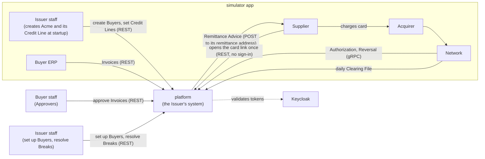
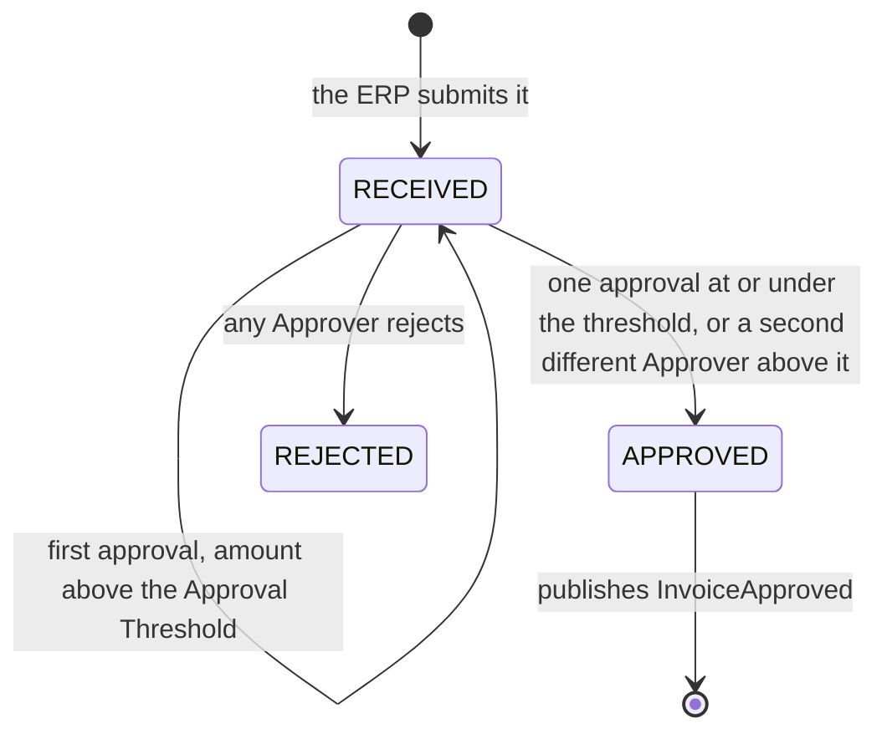
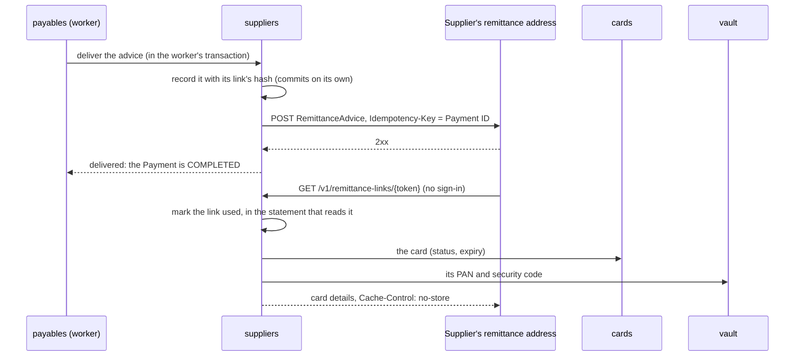
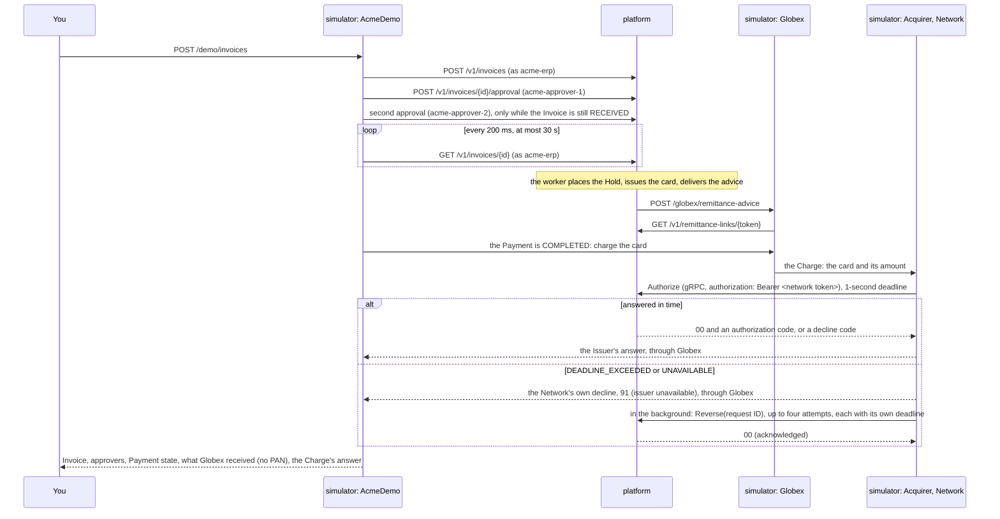

# Architecture

**Status:** M0 (foundations), M1 (Invoice to card) and M2 (Authorization) are done. The M1 modules are built: `shared`, `buyers`, `ledger` (Credit Lines and Holds), `suppliers` (Suppliers, Supplier Relationships, Remittance Advice), `payables` (Invoice intake, approvals, the Payment saga), `cards` (Single-Use Cards) and `vault`. M2 added `authorization`, which answers the Network's Authorizations and Reversals over gRPC (see [The Network link](#the-network-link)), and the expiry of cards nobody charged; the simulator's Acquirer and Network charge Globex's card through it, and the Network declines and reverses a Charge the platform doesn't answer within 1 second (see [The simulator](#the-simulator)). M3 has started: `clearing` imports the Network's Clearing Files with Spring Batch and posts every Clearing to `ledger`'s new double-entry journal, which Available Credit now reads, recording how it matched its Authorization (see [Clearing](#clearing)); Settlement, Repayments and the simulator's files follow. `reconciliation` arrives with M4, as the module table shows. Terms follow [`GLOSSARY.md`](../GLOSSARY.md), and the reasoning behind each choice is in [`docs/adr/`](adr/). The milestone plan is in the [README](../README.md#roadmap).

## System context

The `platform` is the Issuer's system. Everything it talks to, apart from Keycloak, is played by the `simulator` app (ADR-0002).



## Runtime (M0 to M4)

Docker Compose runs PostgreSQL (one schema per module), `grafana/otel-lgtm` for metrics, traces and logs, and Keycloak, which issues every token. The `platform` and `simulator` run from Maven and start the stack themselves through Spring Boot's Docker Compose support.

- **Identity:** Keycloak's `payments` realm (`keycloak/payments-realm.json`) defines the roles `approver`, `erp`, `issuer-admin` and `network` (the `network` client, which the Network signs in with), and puts them in a flat `roles` claim. Every Buyer-side client also carries its Buyer in a `buyer_id` claim (`acme-erp`, `acme-approver-1` and `acme-approver-2` carry Acme's), and the platform takes the Buyer only from that claim. An Approver is the token's subject (`sub`); its `preferred_username` is kept beside it to make the approval record readable. The platform is an OAuth2 resource server; client secrets live only in the gitignored `.env`, written by `scripts/init-env.sh`.
- **API contract:** the OpenAPI document in the `contracts` module is the source of truth. The platform implements interfaces generated from it, and the simulator calls the platform through HTTP interfaces generated from it. The Network link's contract is a protobuf file in the same module (`src/main/proto`), from which both sides get generated messages and gRPC stubs.
- **Ports:** REST on `8080`; the Network link's gRPC on `127.0.0.1:9090`.

## Modules

The `platform` is a modular monolith (ADR-0003). Spring Modulith tests enforce the boundaries.

| Module | Owns | Calls | Built |
|---|---|---|---|
| `shared` | `Money`, `BuyerId`, `SecretKeys` (reads a 256-bit key from configuration, or stops the platform); open to every module | | M1 |
| `buyers` | Buyer profiles, Approval Thresholds | | M1 |
| `suppliers` | Suppliers (one per tax ID, shared by Buyers, ADR-0012) and their Acceptor IDs, Supplier Relationships, Remittance Advice and their one-time card links | `cards`, `vault` | M1 |
| `payables` | Invoices and their Idempotency-Keys, approvals, Payments (runs the Payment saga) | `buyers`, `ledger`, `cards`, `suppliers` | M1 |
| `cards` | Virtual Card lifecycle, Card Tokens; Single-Use Cards so far (issue, cancel, authorize, back to `ACTIVE` on a Reversal, clear, expire after 30 days uncharged or 7 days after an Authorization that never cleared) | `vault` | M1 |
| `vault` | PANs and security codes, encrypted, with each PAN's keyed hash (ADR-0004); only `cards`, `suppliers`, `authorization` and `clearing` may call it | | M1 |
| `authorization` | The Network link over gRPC; Authorization rules, Reversals and a record of every answer; a card's approved Authorization by authorization code, for Clearing | `vault`, `cards`, `suppliers` | M2 |
| `ledger` | Credit Lines, Holds and Available Credit; the double-entry journal: Accounts and Journal Entries (ADR-0005, ADR-0015), from M3 | `buyers` | M1 |
| `clearing` | Clearing Files and their Clearings: the drop folder, the Spring Batch import and its job repository (the `batch` schema), matching; Settlement to come | `vault`, `cards`, `authorization`, `ledger` | M3 |
| `reconciliation` | Matching Charges to Authorizations and Invoices; Breaks | | M4 |

How modules interact:

- **Direct call** when the caller needs an answer now, such as `authorization` checking a card, or `ledger` asking `buyers` whether a Buyer exists before setting its Credit Line. The callee answers through a public type in its module's top-level package (`buyers.BuyerDirectory`); the rest of the module stays package-private.
- **Also direct:** `payables` asks `buyers.BuyerDirectory` whether the token's Buyer exists and, when an Approver approves, for the Buyer's Approval Threshold. It asks `suppliers` to find or create the Supplier and the Buyer's Supplier Relationship for each new Invoice, in the same transaction. The Payment saga places and releases Holds through `ledger.Holds` and issues cards through `cards.Cards`, inside the worker's transaction, so each step and the Payment's new state commit together. `cards` asks `vault.Vault` for a new PAN by Card Token, in that same transaction, and gets back only its last four digits. The saga delivers the Remittance Advice through `suppliers.RemittanceAdvices`, and when delivery fails for good it cancels the card through `cards.Cards`. When a Supplier opens its link, `suppliers` asks `cards.Cards` for the card (status, expiry) and `vault.Vault` for its PAN and security code. When the Network asks for an Authorization, `authorization` asks `vault.Vault` for the Card Token of the request's PAN and whether its security code is the card's, `cards.Cards` for the card, `suppliers.Suppliers` for its Supplier's Acceptor ID and, on an approval, `cards.Cards` to move the card to `AUTHORIZED`, in one transaction with the recorded answer. A Reversal of an approved Authorization asks `cards.Cards` to move its card back to `ACTIVE`, in one transaction with the Authorization's new status. For each Clearing it imports, `clearing` asks `vault.Vault` for the Card Token of the record's PAN, `cards.Cards` for the card, `authorization.ApprovedAuthorizations` for the card's Authorization with the record's authorization code, `cards.Cards` to move a card it knows to `CLEARED`, `ledger.Holds` whether the card's Hold was released and to clear it if it is still open, and `ledger.Journal` to post the Clearing to the card's Buyer Receivable or to Clearing Suspense, all in the import chunk's transaction. `ModularityTests` fails if any module other than `cards`, `suppliers`, `authorization` and `clearing` uses `vault`.
- **Event** when others react to something that happened. Events are stored with the change that raised them and redelivered until handled (ADR-0008). The first is `payables.InvoiceApproved` (Invoice, Buyer, Supplier, amount), published by the approval that completes an Invoice; the Payment saga's listener starts a Payment from it. The second is `cards.CardExpired` (Card Token, Payment, Buyer, amount), published by the expiry job for each card nobody charged or whose Charge didn't clear within 7 days; `payables` ends the Payment and releases its Hold (see [Card expiry](#card-expiry)). Publications whose listener didn't complete are delivered again when the platform starts, so a listener must cope with the same event twice.
- **Data**: each module owns its own schema; no joins or foreign keys cross modules (ADR-0009). Each module's Flyway migrations run in that schema with their own history table, declared through `ModuleMigrations` in `shared`. Spring Modulith's event publication registry keeps its one table, `event_publication`, in a `modulith` schema it creates at startup. Spring Batch's job repository lives in a `batch` schema, created by migrations `clearing` owns, the only module that runs jobs.

## Approvals

An Approver at the Invoice's Buyer approves (`POST /v1/invoices/{invoiceId}/approval`) or rejects (`.../rejection`) it. `payables` locks the Invoice's row, so concurrent decisions on one Invoice take turns, then applies the rules:



- The same Approver approving again changes nothing and returns the Invoice, so a retried approval is safe without an `Idempotency-Key`.
- A rejected Invoice takes no new decisions, a repeated rejection included, and neither does an approved one, whose Payment may be under way: both answer `409`.
- Each approval and rejection is a row in `payables.invoice_decision` (Approver's subject, user name, decision, time) and appears in the Invoice's `decisions`. That is M1's audit trail.
- The status change, the decision and the `InvoiceApproved` publication commit in one transaction.

## Core payment path

```mermaid
sequenceDiagram
  participant ERP as ERP (sim)
  participant PAY as payables
  participant LED as ledger
  participant CRD as cards + vault
  participant SUP as suppliers
  participant SPL as Supplier (sim)
  participant NET as Network (sim)
  participant AUT as authorization
  participant CLR as clearing
  participant REC as reconciliation

  ERP->>PAY: POST /v1/invoices (Idempotency-Key)
  Note over PAY: Approvers approve the Invoice; the final approval publishes InvoiceApproved
  PAY->>LED: place Hold for the Invoice amount
  PAY->>CRD: issue Single-Use Card
  PAY->>SUP: send Remittance Advice
  SUP-->>SPL: one-time card link
  SPL->>NET: charge card (through the Acquirer)
  NET->>AUT: Authorization request (gRPC)
  AUT->>CRD: check card rules
  AUT-->>NET: approve or decline, 99% within 100 ms
  NET->>CLR: next day: Clearing File
  CLR->>LED: post the cleared amount
  CLR->>REC: cleared Charges
  Note over REC: anything unmatched becomes a Break
```

## Payment saga

`payables` orchestrates each Payment (ADR-0013). Every step is safe to repeat, and the Payment's state is saved after each one, so a crash resumes where it stopped.

| Step | Module | If it fails for good |
|---|---|---|
| 1. Place the Hold | `ledger` | The Payment fails; the Invoice stays approved and unpaid |
| 2. Issue the card and store its PAN | `cards`, `vault` | Release the Hold |
| 3. Send the Remittance Advice | `suppliers` | Cancel the card, release the Hold |

All three steps are built: the Hold (#17), the card (#18) and the Remittance Advice (#19).

```mermaid
stateDiagram-v2
  [*] --> STARTED: InvoiceApproved (one Payment per Invoice)
  STARTED --> STARTED: technical error, retried after 10, 20, 40, 80 s
  STARTED --> HOLD_PLACED: Hold placed
  STARTED --> FAILED: not enough Available Credit, or the fifth technical error
  HOLD_PLACED --> HOLD_PLACED: technical error, retried after 10, 20, 40, 80 s
  HOLD_PLACED --> CARD_ISSUED: Single-Use Card issued
  HOLD_PLACED --> FAILED: the fifth technical error; the Hold is released
  CARD_ISSUED --> CARD_ISSUED: technical error (no 2xx in time), retried after 10, 20, 40, 80 s
  CARD_ISSUED --> COMPLETED: the Supplier answers the Remittance Advice with a 2xx
  CARD_ISSUED --> FAILED: the fifth technical error; the card is cancelled if still ACTIVE and the Hold released
  CARD_ISSUED --> EXPIRED: CardExpired (delivery still retrying); the retries stop and the Hold is released
  COMPLETED --> EXPIRED: CardExpired; the Hold is released
  COMPLETED --> [*]
  FAILED --> [*]
  EXPIRED --> [*]
```



- **The state row (ADR-0014):** each Payment is a row in `payables.payment` with its state, failure reason, failed attempts at the current step and the time its next step is due. `GET /v1/invoices/{invoiceId}` shows the state and any failure reason.
- **Starting:** `PaymentSaga.start` is an `@ApplicationModuleListener` for `InvoiceApproved`. It runs asynchronously after the approval commits and inserts the Payment unless the Invoice already has one, so a redelivered event changes nothing.
- **The worker:** `PaymentWorkerSchedule` calls `PaymentSaga.runDueSteps` every second (`payables.payment-worker.enabled=false` turns it off for tests that drive it by hand). Each pass claims up to ten due Payments, one per transaction, with `select ... for update skip locked`, so workers on other threads or instances skip Payments already claimed. In that transaction it runs the step and saves the Payment's new state, so a crash rolls both back. A technical error rolls the transaction back too, and a new transaction counts the failed attempt unless another worker has moved the Payment on meanwhile.
- **Placing a Hold (`ledger.Holds`):** locks the Buyer's Credit Line row, returns the existing Hold if one has the Payment's ID, sums the open Holds in a separate statement, and inserts the Hold only if the amount fits in Available Credit. A Buyer without a Credit Line has no credit. Holds live in `ledger.hold`; a released Hold keeps its row, marked `RELEASED` with its release time, and placing it again checks Available Credit afresh.
- **Issuing the card (`cards.Cards`):** returns the Payment's card if it has one; otherwise draws a Card Token, has `vault` generate and store the PAN, and stores the card in `cards.card`, locked to the Invoice's Supplier and amount and valid for 30 days. Placing the Hold makes this step due at once.
- **Delivering the Remittance Advice (`suppliers.RemittanceAdvices`):** records the advice and POSTs it to the Supplier's remittance address (see [Remittance Advice](#remittance-advice)); a 2xx answer completes the Payment. Issuing the card makes this step due at once, so one worker pass usually runs all three steps, each in its own transaction.
- **Compensation:** the transaction that records a step's fifth technical error also undoes the steps before it, so Available Credit comes back as the Payment becomes `FAILED`. Card issuance failing for good releases the Hold (`Holds.release`, which marks it `RELEASED` and is harmless to repeat). Delivery failing for good cancels the card (`Cards.cancel`, status `CANCELLED`, harmless to repeat), so its link shows nothing, and releases the Hold. `cancel` is one conditional update that moves only an `ACTIVE` card: a card the Supplier already charged stays `AUTHORIZED`, and the Hold is released all the same.
- **Available Credit** is the Credit Line minus the Buyer Receivable (what the Buyer owes for cleared Charges, from the journal) minus open Holds, read in one statement. It is negative when Issuer staff lower a Credit Line below what is owed and held, and no new Hold is placed until Available Credit covers its amount again.
- **What to do when a Payment is stuck:** [`runbooks/payment-stuck.md`](runbooks/payment-stuck.md). How the saga and the worker work: [`learning/sagas.md`](learning/sagas.md).

## Cards and the vault

A Single-Use Card's data is split between two modules so the PAN lives in exactly one place (ADR-0004):

| | `cards.card` | `vault.card_secret` |
|---|---|---|
| Key | Card Token: 16 random bytes, base64url | the same Card Token |
| Stores | Payment (unique), Buyer, Supplier and amount the card is locked to, last four digits, issue and expiry times, when it was authorized, status (`ACTIVE`; `AUTHORIZED` once a Charge on it is approved, `ACTIVE` again if the Network reverses that Authorization; `CANCELLED` when its Remittance Advice couldn't be delivered while it was `ACTIVE`; `EXPIRED` when nobody charged it within 30 days, or its Charge didn't clear within 7 days of its Authorization; `CLEARED` once the Network's Clearing File posts a Charge on it, from any status) | the PAN and the security code, each AES-256-GCM-encrypted under a fresh nonce with the Card Token as associated data; the PAN's HMAC-SHA-256 hash, unique |
| Read by | `payables` (the Invoice shows Card Token, last four digits, expiry); `suppliers` (status and expiry, when a link is opened); `authorization` (status, expiry, amount and currency, for the Authorization rules); `clearing` (Buyer, Payment and currency, to post a Clearing and clear its Hold) | `suppliers`, when a Supplier opens its link: the PAN and security code, decrypted, never stored outside the vault; `authorization`: the Card Token for a PAN, found through its hash, and whether a security code matches, compared inside the vault; `clearing`: the Card Token for a Clearing File record's PAN |

- **PANs** are synthetic: 16 digits, `990000` followed by nine random digits and a Luhn check digit. A PAN whose hash another card already has is drawn again.
- **Keys:** two separate 256-bit keys, one to encrypt and one to hash, come from `vault.encryption-key` and `vault.hash-key` (`VAULT_ENCRYPTION_KEY` and `VAULT_HASH_KEY` in `.env`, written by `scripts/init-env.sh`). The platform doesn't start when either is missing or isn't 32 bytes ([`runbooks/vault-key-invalid.md`](runbooks/vault-key-invalid.md)). M7 replaces them with envelope encryption.
- **How it works and why:** [`learning/card-vault.md`](learning/card-vault.md).

## Card expiry

A Single-Use Card nobody charged before its expiry, 30 days after issuance, returns its credit to the Buyer (ADR-0011). So does an `AUTHORIZED` card with no Clearing 7 days after its Authorization: by then the Charge isn't coming (M3 design, [The 7-day rule](design/m3-clearing-and-settlement.md#the-7-day-rule-q10)).

```mermaid
sequenceDiagram
  participant JOB as cards: expiry job
  participant PAY as payables
  participant LED as ledger

  Note over JOB: every minute, 100 cards per transaction
  JOB->>JOB: ACTIVE cards past their expiry, and AUTHORIZED cards 7 days after their Authorization, become EXPIRED (for update skip locked)
  JOB-)PAY: CardExpired, one per card (event publication registry)
  PAY->>PAY: lock the Payment; COMPLETED or CARD_ISSUED becomes EXPIRED
  PAY->>LED: Holds.release(Payment ID)
```

- **The job (`cards.CardExpiry`):** `CardExpirySchedule` runs it every minute (`cards.expiry-job.enabled=false` turns it off for tests that run it by hand). Each batch claims up to 100 cards, each kind with one `update ... where card_token in (select ... for update skip locked) returning ...`: first `ACTIVE` cards whose `expires_at` has come, then, in what is left of the batch, `AUTHORIZED` cards whose `authorized_at` is 7 days or more ago (`SingleUseCards.CLEARING_WINDOW`). It publishes a `CardExpired` for each, in the same transaction: a stop mid-run leaves each card as it was for the next run, or `EXPIRED` with its event in the registry. Cards in any other status are left alone; an index on `expires_at` covers only `ACTIVE` cards, and one on `authorized_at` only `AUTHORIZED` cards.
- **The 7 days (`authorized_at`):** `Cards.authorize` records the Authorization's time as it moves the card to `AUTHORIZED`, and `Cards.reverse` clears it as the card goes back to `ACTIVE`, so a reversed card waits for its own expiry and a second Charge starts a new 7 days.
- **The listener (`PaymentSaga.expire`):** in one transaction, it locks the Payment (waiting for a worker that is running its step), moves a `COMPLETED` Payment, or a `CARD_ISSUED` one still retrying its delivery, to `EXPIRED` with no step left, and releases the Hold through `ledger.Holds`. `payables`, not `cards`, releases the Hold because it owns the Hold's lifecycle in the saga, and `cards` needs no dependency on `ledger`. Another state stays as it is, but the Hold is still released.
- **Exactly once:** the registry may deliver `CardExpired` again; a second delivery finds the Payment `EXPIRED` and the Hold `RELEASED`, and changes nothing. Re-paying the Invoice is out of scope; it stays `APPROVED`.
- **When cards stay `ACTIVE` past their expiry, or `AUTHORIZED` past their 7 days:** [`runbooks/payment-stuck.md`](runbooks/payment-stuck.md#a-card-stays-active-past-its-expiry-or-authorized-past-its-7-days).

## Remittance Advice

The saga's third step tells the Supplier which Invoice is paid and hands it the Single-Use Card, through a link that shows the card's details once.



| | `suppliers.remittance_advice` |
|---|---|
| Key | the Payment's ID: one advice per Payment |
| Stores | the Invoice's ID and number, the Supplier, the amount, the Card Token; the SHA-256 of the link's token (unique); the link's expiry, 7 days after the first attempt, and when it was used |
| Never stores | the link's token, the PAN or the security code |

- **The link's token** is HMAC-SHA-256 of the Payment's ID under `remittance.link-key` (`REMITTANCE_LINK_KEY` in `.env`, written by `scripts/init-env.sh`), base64url-encoded: 256 bits nobody can work out without the key, and the same on every delivery attempt, so a retry after a crash sends the link the Supplier may already hold. The platform doesn't start without the key. The link is `platform.public-url` + `/v1/remittance-links/{token}`.
- **Delivery** records the advice in a transaction of its own before the POST, so the link works the moment the Supplier receives it; a second attempt finds the record and sends the same advice. The POST goes through Spring's `RestClient` (2-second connect and 5-second read timeouts, no redirects). Anything but a 2xx is a technical error for the saga to retry; the error names only the status, never the Supplier's answer.
- **Opening** a link hashes the token and runs one `update ... returning` that sets `link_used_at` only if it is unset and the link hasn't expired, so of two opens at once exactly one shows the card. A token with no record answers `404`; a used or expired link, or one whose card is neither `ACTIVE` nor `AUTHORIZED`, `410`, and a link that shows nothing isn't marked used. The card check is an allow-list, so a status added later refuses the link until someone decides otherwise. The PAN and security code come from `vault` for that answer only. Nothing logs the token, the PAN or the security code, and traces record a link request by its route (`RequestObservations`), not its URL.
- **The Supplier's address** is the remittance address on the first Invoice naming its tax ID (see Invoice intake in the M1 design). The simulator plays the Supplier Globex at `http://localhost:8081/globex/remittance-advice`: it drops repeated advice by `Idempotency-Key`, opens each link once, and logs only the last four digits.
- **How it works and why:** [`learning/one-time-links.md`](learning/one-time-links.md). When delivery keeps failing: [`runbooks/payment-stuck.md`](runbooks/payment-stuck.md).

## The Network link

The Network asks the platform to approve each Charge over gRPC (ADR-0006), signed in as the Keycloak client `network`. The contract is `contracts/src/main/proto/issuer_authorization.proto`: the `IssuerAuthorization` service with `Authorize` and `Reverse`, its fields named after the ISO 8583 data elements they stand for (the PAN is DE 2, the request ID DE 37, the response code DE 39).

```mermaid
sequenceDiagram
  participant NET as Network (sim)
  participant SEC as gRPC security
  participant AUT as authorization
  participant VLT as vault
  participant CRD as cards
  participant SUP as suppliers

  NET->>SEC: Authorize(PAN, amount, request ID, Acceptor ID, …)<br/>metadata authorization: Bearer <network token>
  SEC->>SEC: the token checked like REST's; ROLE_network required
  SEC->>AUT: the request
  AUT->>VLT: cardFor(PAN)
  VLT-->>AUT: Card Token, found through the PAN's keyed hash (or none)
  AUT->>CRD: find(Card Token)
  CRD-->>AUT: status, expiry, amount, Supplier
  AUT->>SUP: acceptorId(Supplier)
  SUP-->>AUT: the Supplier's Acceptor ID (or none)
  AUT->>VLT: securityCodeMatches(Card Token, security code)
  AUT->>AUT: AuthorizationRules: the response code
  AUT->>AUT: claim the request ID: insert the answer, on conflict do nothing<br/>(already answered: return that answer, change nothing)
  AUT->>CRD: approved: authorize(Card Token), ACTIVE to AUTHORIZED, one conditional update
  AUT-->>NET: 00 and an authorization code, or a decline code
```

- **Serving:** a Netty gRPC server on `127.0.0.1:9090` (`spring.grpc.server.address` and `.port`), beside the REST port, plaintext until mutual TLS in M7. Tests give each context's server a free port.
- **Signing in:** the Network's token travels in the `authorization` metadata header. Spring gRPC's `GrpcSecurity` (`SecurityConfig`) checks it with the same JWT decoder, issuer and `roles` claim as REST, and every call needs `ROLE_network`, the reflection and health services the starter adds included. No token or a bad one answers `UNAUTHENTICATED`; another client's token, `PERMISSION_DENIED`.
- **Answering**, in one transaction: `authorization` asks `vault.Vault.cardFor(pan)` for the card's Card Token (the vault looks up the PAN's HMAC and never returns the PAN), `cards.Cards.find` for the card, `suppliers.Suppliers.acceptorId` for its Supplier's Acceptor ID, and `vault.Vault.securityCodeMatches` whether the request's security code is the card's (the vault decrypts the stored code and compares in constant time, and never returns it). `AuthorizationRules` turns those facts into a response code, in the design's order, the first rule that fails winning: a zero or negative amount `13`; no card has the PAN `14`; the card `CANCELLED` or `EXPIRED`, or the request's expiry (DE 14, `YYMM`) not the card's expiry month in UTC, or the expiry passed `54`; a wrong security code `N7`; the request's Acceptor ID (DE 42) not exactly the Supplier's, or the Supplier has none, `57` (not permitted); an amount above the card's or another currency, compared as sent, `61`; the card already `AUTHORIZED` `57`. An approval answers `00` with a random six-character authorization code (`SecureRandom`) and moves the card from `ACTIVE` to `AUTHORIZED` in one conditional update; if a Charge with another request ID moved it first, the answer becomes `57`. There is no credit check, and no answer touches the Hold placed at issuance (ADR-0011). A request without a retrieval reference number is refused with `INVALID_ARGUMENT` and recorded nowhere. How the message and its codes work: [`learning/authorization-message.md`](learning/authorization-message.md).
- **A resent request** (the same retrieval reference number) gets the answer recorded the first time, whatever the rules would say now, and changes nothing. The answer is recorded with `insert … on conflict (request_id) do nothing` before the card moves: a resend that arrives while the first is still running waits on that insert, then finds the first answer, so one request ID records one Authorization and moves the card at most once.
- **A Reversal** (`Reverse`, naming the request ID to cancel) is acknowledged with `00` whatever it changes, in one transaction, and never touches the Hold. It first claims the request ID the way an Authorization does, with `insert … on conflict (request_id) do nothing`: a row with status `REVERSED`, response code `05` (do not honour) and no Card Token. If that insert wins, the platform had no Authorization for the request ID: the Network gave up while it was still running, and its own insert, when it gets there, finds the request ID taken and returns the stored `05` without moving the card. If the insert finds a row, that row has committed, an Authorization's or an earlier Reversal's (one still running makes the insert wait for it): one conditional update moves it from `APPROVED` to `REVERSED`, and `cards.Cards.reverse` moves its card from `AUTHORIZED` back to `ACTIVE` with another, so the card can be charged again. A declined or already reversed Authorization stays as it is, so repeating a Reversal changes nothing more, and reversing an old Authorization again never frees the card for a newer one's Charge. An approved Authorization that is reversed keeps its `00` and authorization code, so a resend of it gets them back like any resend. A Reversal without a retrieval reference number is refused with `INVALID_ARGUMENT` and recorded nowhere.
- **The Supplier's Acceptor ID** comes from the Buyer's ERP: the Invoice's Supplier block may carry an `acceptorId`, and the first Invoice that carries one sets it on the Supplier (`suppliers.supplier.acceptor_id`). Like the remittance address, a different one on a later Invoice is ignored, so no Buyer's ERP can redirect a Supplier's Charges once it has one.
- **The record:** every answer is a row in `"authorization".authorizations`: the request ID (DE 37, primary key), the Card Token (null for an unknown PAN), amount and currency as sent (a code that isn't ISO 4217 too), Acceptor ID, response code, authorization code (approvals only), status (`APPROVED`, `DECLINED`, or `REVERSED` once the Network reverses it) and time. A Reversal that came first leaves a row with only the request ID, response code `05` and status `REVERSED`; a `CHECK` keeps the amount, currency and Acceptor ID required on every other row. Never a PAN, security code or expiry. The schema's name is a reserved word in PostgreSQL, so SQL quotes it.
- **The PAN stays in the vault (ADR-0004):** `authorization` holds the PAN and security code in memory only, on their way to the vault. Nothing logs a request (a protobuf message's `toString` prints every field) or puts a request field in an exception message; the one log line per answer names its request ID and response code. Traces record the RPC's full method name, its status and the caller's address and port (Micrometer's gRPC observation), never message fields or metadata.
- **How it works and why:** [`learning/grpc.md`](learning/grpc.md). When the Network's calls are refused: [`runbooks/keycloak-unavailable.md`](runbooks/keycloak-unavailable.md); when every Charge answers `14`, or fails `UNKNOWN`: [`runbooks/vault-key-invalid.md`](runbooks/vault-key-invalid.md); when a Supplier's Charges answer `57`: [`runbooks/supplier-charges-declined.md`](runbooks/supplier-charges-declined.md); when Reversals arrive and Authorizations answer `05`: [`runbooks/network-cant-reach-platform.md`](runbooks/network-cant-reach-platform.md#the-platform-answers-too-slowly).

## Clearing

The Network sends the Issuer its Clearings in a Clearing File (M3 design, [The Clearing File](design/m3-clearing-and-settlement.md#the-clearing-file-q1-q8)). `clearing` imports each file with a Spring Batch job, posts every Clearing to `ledger`'s double-entry journal, because the Issuer pays what clears, and records how each matched its card's Authorization.

```mermaid
sequenceDiagram
  participant NET as Network (drop folder)
  participant IMP as clearing: import
  participant JOB as Spring Batch job
  participant VLT as vault
  participant CRD as cards
  participant AUT as authorization
  participant LED as ledger

  NET->>IMP: a file in the drop folder (checked every 30 s, or POST /v1/clearing-files)
  IMP->>IMP: move it into processing/ (one atomic rename); read its header: the file ID
  IMP->>JOB: start clearingFileImport(file ID)
  JOB->>JOB: validate: header, every record and trailer parse; the file recorded IMPORTING
  loop import: each chunk of 100 Clearings, one transaction
    JOB->>VLT: cardFor(PAN)
    JOB->>CRD: find(Card Token)
    JOB->>AUT: find(Card Token, authorization code)
    opt the vault knows the card
      JOB->>CRD: clear: CLEARED, whatever its status
      JOB->>LED: isReleased(Hold), locking it; clear it if still open
    end
    JOB->>JOB: decide the outcome: the first case that applies
    alt unknown card, or another currency than the card's
      JOB->>LED: postClearingToSuspense: debit Clearing Suspense, credit Network Settlement Payable
    else every other outcome
      JOB->>LED: postClearing: debit Buyer Receivable, credit Network Settlement Payable
    end
    JOB->>JOB: record the Clearing with its outcome; save the reader's position
  end
  JOB->>JOB: complete: the file IMPORTED
  IMP->>IMP: delete the file
```

- **The file:** fixed-width text, 120 characters a record: a header `90` (file ID, the Network's sequence number, Business Date), one detail record `05` per Clearing (Network record ID, PAN (DE 2), amount (DE 4) and currency (DE 49), retrieval reference number (DE 37), authorization code (DE 38), Acceptor ID (DE 42), Charge date), and a trailer `92` (record count, amount total, net settlement amount, currency). The layout and a sample file are a contract in `contracts/src/main/resources/clearing-file/`, like the OpenAPI document and the `.proto`; the platform's reader is tested against the sample, as the simulator's writer will be (#56).
- **Arrival:** `clearing.drop-folder` (by default `../var/clearing` from the module directory: `var/clearing` at the repository root, which git ignores) stands in for an SFTP landing zone. `DropFolderCheckSchedule` checks it every 30 seconds and imports each file in name order (`clearing.drop-folder-check.enabled=false` turns it off; tests and the e2e run do). A name starting with `.` is a file the Network is still writing, and waits for its rename. Issuer staff import a named file at once with `POST /v1/clearing-files` (`issuer-admin`), which answers when the import is done: `201` with the file's summary (ID, sequence number, Business Date, status, number of Clearings, and how many ended with each outcome); `404` for a name in neither the drop folder nor `processing/`; `409` when the file was already imported, or an import of it is running; `422` when it doesn't follow the layout, nothing posted, the detail naming the line and field; `500` when the import stopped partway. There is no `Idempotency-Key`: the file's own ID makes a repeat harmless.
- **One importer per file:** the file is moved into the folder's `processing/` folder before its import starts, in one atomic rename, so of two importers (the drop-folder check and a request, or two platform instances from M6) only one gets it. It waits there during the import, and is deleted once the import completes; a refused or stopped file stays there.
- **The job (`ClearingFileImportJob`, Spring Batch 6):** one job instance per file, keyed by its file ID (the job's identifying parameter), so Spring Batch refuses to import a completed file again. `validate`, one transaction, parses the header, every detail record and the trailer, and records the file `IMPORTING` in `clearing.clearing_file`; `import` reads the Clearings in chunks of 100, each chunk one transaction on the platform's DataSource transaction manager; `complete` marks the file `IMPORTED`. The job repository (the `batch` schema) shares that transaction manager, so a chunk's Journal Entries, Holds, cards and Clearings commit together with the reader's saved position, and importing the same file name again restarts the job after its last committed chunk. The job runs on the caller's thread, and Spring Boot never starts one at startup (`spring.batch.job.enabled=false`). How it works: [`learning/spring-batch.md`](learning/spring-batch.md).
- **Matching (`Clearings`, `ClearingOutcome`):** the record's PAN goes straight to `vault.cardFor`; the card's Authorization is the one with the record's authorization code (`authorization.ApprovedAuthorizations`, indexed on Card Token and authorization code). Every Clearing is posted and recorded with its outcome, the first of these that applies (M3 design, [Matching and outcomes](design/m3-clearing-and-settlement.md#matching-and-outcomes-q6-q7-q9-q21-q22)):

  | Outcome | When | Posted to |
  |---|---|---|
  | `UNKNOWN_CARD` | the vault knows no card with the PAN | Clearing Suspense |
  | `OTHER_CURRENCY` | another currency than the card's | Clearing Suspense |
  | `NO_AUTHORIZATION` | the card has no Authorization with the code | the card's Buyer Receivable |
  | `AUTHORIZATION_ALREADY_CLEARED` | a Clearing of that Authorization is already recorded | the card's Buyer Receivable |
  | `AGAINST_REVERSED_AUTHORIZATION` | the Authorization was reversed | the card's Buyer Receivable |
  | `AFTER_HOLD_EXPIRED` | the card's Hold was released | the card's Buyer Receivable |
  | `ABOVE_AUTHORIZED_AMOUNT` | more than the authorized amount | the card's Buyer Receivable, all of it |
  | `MATCHED` | at or below the authorized amount; both amounts kept, so M4 sees an undercharge | the card's Buyer Receivable |

  `ClearingOutcome.Facts` decides the outcome from what the import found, without the database, so unit tests cover each case and their order. The Journal Entry's idempotency key is the Network record ID. A card the vault knows moves to `CLEARED` whatever its status (`Cards.clear`), and its Hold to `CLEARED` only if it is still open (the saga places it under the card's Payment's ID): a released Hold stays released, and the Payment is left alone. The Hold's status, not the card's, decides "after Hold expired": the 7-day rule commits a card `EXPIRED` before `payables` handles its `CardExpired` and releases the Hold, so a Clearing in between clears the open Hold, and the late `CardExpired` leaves it (`Holds.release` only releases a placed Hold). The import locks the card (`Cards.clear` updates its row even when it is already `CLEARED`), then the Hold, the order every module locks them in, and keeps both until the chunk commits: Clearings of one card in two imports take turns, so the second finds the first recorded, and an Authorization's second Clearing is `AUTHORIZATION_ALREADY_CLEARED`. A unique index on each Authorization's first recorded Clearing serves that lookup, and refuses a second first Clearing outright. A Network record ID already recorded fails its chunk (the primary key) rather than posting twice.
- **The journal (`ledger.Journal`, ADR-0015):** Accounts (`ledger.account`: a Buyer Receivable per Buyer; one Network Settlement Payable, Issuer Cash and Clearing Suspense; each per currency and created by its first posting) and append-only Journal Entries (`ledger.journal_entry` and its `ledger.journal_line`s). An entry whose debits don't equal its credits can't be built; an entry of the same kind and idempotency key posts once and returns the first entry's ID; a trigger refuses any update or delete. A Clearing debits the card's Buyer Receivable, or Clearing Suspense when no Buyer can be charged for it yet, and credits the Network Settlement Payable. An Account's balance is the sum of its lines, with no running balance, so posting takes no row locks. How it works: [`learning/double-entry-bookkeeping.md`](learning/double-entry-bookkeeping.md).
- **Holds and Available Credit:** a Hold whose Charge cleared keeps its row, marked `CLEARED` with its time, and stops counting whole, so a Clearing below the Hold frees the rest. Available Credit is the Credit Line minus the Buyer Receivable minus open Holds.
- **The records:**

  | | `clearing.clearing_file` | `clearing.clearing` |
  |---|---|---|
  | Key | the file ID, from its header | the Network record ID |
  | Stores | sequence number, Business Date, status (`IMPORTING`, `IMPORTED`), number of Clearings, when it was received and imported | its file, the Card Token (null for a PAN the vault doesn't know), the request ID of the card's Authorization with the record's authorization code, the cleared and the authorized amount, each with its currency, outcome (the table above), the Journal Entry that posted it (every Clearing has one) |
  | Never stores | | the PAN |

- **The PAN stays in the vault (ADR-0004):** `clearing` holds each record's PAN in memory only, on its way to the vault. `ClearingRecord`'s `toString` leaves it out, every error names a line and a field but never a value (Spring Batch logs errors and keeps them in its job repository), and the import logs a file by its name or ID. The file holds PANs in clear text until it is deleted, in a folder git ignores. The job repository keeps each step's saved state as JSON rather than base64, so the "no PAN" check can search it.
- **When an import stops:** [`runbooks/clearing-import-stopped.md`](runbooks/clearing-import-stopped.md); when a file arrives twice: [`runbooks/clearing-file-arrived-twice.md`](runbooks/clearing-file-arrived-twice.md).

## The simulator

The `simulator` plays every party on the core path other than the platform; each role that calls the platform signs in as its own Keycloak client:

| Role | Class | What it does |
|---|---|---|
| Issuer staff | `AcmeSeeder` | At startup, creates the Buyer Acme (fixed ID, Approval Threshold $10,000) and gives it a $100,000 Credit Line (`simulator-issuer-admin`) |
| Acme's ERP | `AcmeErp` | Submits Invoices from Globex, with Globex's Acceptor ID (`simulator.globex.acceptor-id`), under a new `Idempotency-Key` each, and reads them back (`acme-erp`) |
| Acme's Approvers | `AcmeApprovers` | Approve on request, as `acme-approver-1` or `acme-approver-2` |
| Supplier Globex | `GlobexSupplier` | Receives Remittance Advice at `/globex/remittance-advice`, drops repeats by `Idempotency-Key`, opens each card link once with an untraced client, keeps the card's details in memory, and charges the card for its full amount through its Acquirer |
| Globex's Acquirer | `GlobexAcquirer` | Turns Globex's Charge into an Authorization request: the card's PAN, security code, amount and currency, and expiry month (`YYMM`, in UTC); the time sent; a STAN counting from `000001`; a retrieval reference number of 12 random letters and digits; Globex's Acceptor ID and name; the made-up category code `5085` |
| Network | `Network` | Sends the Acquirer's request to the platform's `Authorize` over gRPC, signed in as `network`, and returns the answer; when the platform doesn't answer within 1 second or can't be reached, declines the Charge itself (`91`) and sends `Reverse` for it (below) |
| Demo | `AcmeDemo` | `POST /demo/invoices[?minorUnits=…]`: runs the whole path in one call, the Charge included (below) |



- **The Network's channel:** Spring Boot's gRPC client starter builds the channel named `platform` from `spring.grpc.client.channel.platform.target`, which is `static://` plus `simulator.platform-grpc-address` (`localhost:9090` by default). The channel is plaintext, like the platform's server, until M7. The Network signs in as the Keycloak client `network` (secret `NETWORK_CLIENT_SECRET` from `.env`) through the same authorized-client manager as the REST clients, so it reuses its token until the token expires. Spring gRPC's `BearerTokenAuthenticationInterceptor` puts the token in every call's `authorization` metadata. When the Network can't reach the platform, or it answers too slowly: [`runbooks/network-cant-reach-platform.md`](runbooks/network-cant-reach-platform.md); when its sign-in fails: [`runbooks/keycloak-unavailable.md`](runbooks/keycloak-unavailable.md#the-networks-grpc-calls-are-refused).
- **The Network's deadline (ADR-0010):** every `Authorize` call gets its own deadline, `simulator.network.authorization-deadline` (`1s`). When it passes (`DEADLINE_EXCEEDED`), or the platform can't be reached (`UNAVAILABLE`), the Network answers Globex with a decline it makes up itself, `91` (issuer unavailable) with no authorization code, and sends `Reverse` for the same retrieval reference number, under a STAN of its own count and the time sent, in the background (Boot's application task executor), so Globex has its decline as soon as the deadline passes. The platform reverses an Authorization it approved too late, or records the request ID as reversed so a late Authorization answers `05`. A Reversal is safe to repeat, so a failed one is resent through Spring's `RetryTemplate`: four attempts, 100, 200 and 400 ms apart, each with its own deadline. When all four fail, the simulator logs the retrieval reference number at `ERROR` for follow-up; the decline stands. Any other gRPC failure fails the Charge, and the demo's request, as before.
- **Card details in the simulator:** Globex keeps the PAN and security code it reads through the link in memory only, to charge the card. Its record's `toString` leaves both out, logs show the last four digits at most, and the demo's Summary shows a copy of the card without them. Nothing logs the Authorization request, since a protobuf message's `toString` prints every field. The one log line per Charge names its retrieval reference number, the card's last four digits, the Invoice number and the response code; the Network's lines about a missing answer or a failed Reversal name the retrieval reference number alone.
- **The demo's Charge:** once the Payment is `COMPLETED`, Globex already has the card, and the demo has it charge the card. The Summary's `authorization`, the Issuer's answer to the Charge, shows `approved`, the `responseCode` and the `authorizationCode` (null on a decline). It is null when the Payment didn't complete.

- **One trace across both apps.** Both apps export traces to Grafana's Tempo over OTLP, and Spring's HTTP clients pass the trace context on (W3C `traceparent`). The demo's request is one trace, rooted at the simulator's `http post /demo/invoices`, holding the platform's spans for the Invoice submission, the approvals and every read. Delivering the advice is a trace of its own, rooted at the worker's task (`task paymentWorkerSchedule.runDueSteps`), that continues into Globex's `http post /globex/remittance-advice`. A card link's GET is deliberately untraced on Globex's side and recorded by its route on the platform's.

## How the core path is proven

- **The core path** (`CorePathTests`): real Keycloak tokens from the repository's realm file and real PostgreSQL, the worker on its schedule, only the Supplier's address stubbed. Acme is set up, an Invoice above the threshold is approved twice and paid, Available Credit drops by its amount, and the link opens once, then answers `410`.
- **No PAN outside the vault:** the same test class reads the PAN and security code through the link, has the Network charge the card with them over gRPC and clear the Charge in a Clearing File that Issuer staff import, then searches every column of every table outside `vault` (the `authorization`, `clearing`, `ledger` and `batch` schemas included, the job repository's saved step state too) and the captured logs, the gRPC call's and the import's included, for either.
- **A crash at each Payment state** (`PaymentSagaTests`): the platform stops mid-step after `STARTED`, `HOLD_PLACED` and `CARD_ISSUED`, and the next pass completes the Payment with one Hold and one card.
- **Module boundaries:** `ModularityTests` (Spring Modulith's verification, and only `cards`, `suppliers`, `authorization` and `clearing` using `vault`).
- **The simulator's roles and the demo** against stub Keycloak and platform servers, and a stub `IssuerAuthorization` gRPC server: after the Payment completes, the demo's Summary shows the Charge's answer (`AcmeDemoTests`).
- **The core path through both apps** (`e2e`, `CorePathEndToEndTests`): the platform and the simulator run in one JVM against real PostgreSQL and Keycloak. The simulator's demo endpoint takes an Invoice through two approvals to a completed Payment, Globex opens the card through its link and charges it, and the platform approves the Charge (`00`, a six-character authorization code). `docs/learning/testcontainers.md` explains how two apps share one JVM.

## How the Network link is proven

- **Only the Network signs in** (`NetworkAuthenticationTests`): real Keycloak tokens from the repository's realm file, over a real gRPC connection. No token or a forged one: `UNAUTHENTICATED`; `acme-erp`'s token: `PERMISSION_DENIED`, on `Authorize` and on `Reverse`; the `network` client's: answered.
- **The Authorization rules** (`AuthorizationRulesTests`, unit tests): each rule declines with its own code, the card's amount itself is approved and one minor unit more isn't, and the first rule that fails wins (an expired card with a wrong security code: `54`; an `AUTHORIZED` card: `57`, not `54`).
- **Authorize** (`AuthorizeTests`): over gRPC on PostgreSQL, with a mocked Network token. An issued `ACTIVE` card's PAN from its Supplier's Acceptor ID: `00` with a six-character authorization code, the card `AUTHORIZED`, Available Credit unchanged; an unknown PAN: `14`; a `CANCELLED` card or the wrong expiry month: `54`; a wrong security code: `N7`; another Acceptor ID, or a card whose Supplier has none: `57`; one minor unit too much, another currency or one that isn't ISO 4217: `61`; a zero amount: `13`; a second Charge with a new request ID: `57`. Each answer recorded, and each decline leaves the card's status and Available Credit as they were. Of eight Charges with different request IDs at once, one is approved and the rest answer `57`. No retrieval reference number: `INVALID_ARGUMENT`, nothing recorded.
- **A resent request** (`AuthorizeTests`): the same request ID again, with another amount, gets the first answer and leaves one row; eight requests with one request ID at once record one Authorization, all get its answer, and the card moves once.
- **Reversals** (`AuthorizeTests.Reversals`): over gRPC on PostgreSQL. Reversing an approved Authorization: acknowledged, the Authorization `REVERSED` with its `00` kept, the card `ACTIVE`, Available Credit unchanged, and a new Charge on the card approved; a declined one, twice: acknowledged, nothing changes; reversing an Authorization again after a newer one approved the card: acknowledged, the card stays `AUTHORIZED`. A Reversal for a request ID the platform hasn't seen, sent twice, is recorded as reversed once, and the Authorization that follows answers `05` and leaves the card `ACTIVE`; so does one already running when the Reversal commits, which the test holds on a lock on `cards.card` until then. The other order: an Authorization that claimed its request ID first, held on a row lock on its card before it moves it, approves after the Reversal arrived; the Reversal waits for it, then reverses it, and the card ends `ACTIVE`. No retrieval reference number, or only spaces: `INVALID_ARGUMENT`, nothing recorded.
- **The Supplier's Acceptor ID** (`InvoicesApiTests`): an Invoice carrying one stores it on the Supplier, later Invoices show it, a different one later doesn't change it, and Invoices without one are still accepted.
- **The vault finds a card by its PAN and checks its security code** (`CardSecretsTests`): a known PAN gives its Card Token, an unknown one nothing; the card's own security code matches, any other doesn't.
- **The simulator's Acquirer and Network** (`GlobexAcquirerTests`): against a stub Keycloak and a stub `IssuerAuthorization` server on a free port. The request carries Globex's Acceptor ID and name and the card's PAN, security code, amount, currency and expiry month in UTC: `2612` for a card that expires at 21:00 on 30 November 2026 in New York. Each Charge has its own retrieval reference number and STAN, and the metadata carries the `network` client's token as `Bearer`. An approval and a decline come back to Globex as the stub sent them. Neither the card record's `toString` nor a Charge's logs show the PAN or security code.
- **The Network's deadline** (`SlowPlatformTests`, `UnreachablePlatformTests`, `GlobexAcquirerTests`): with a 200 ms deadline and a stub that answers after 2 seconds, Globex gets `91` with no authorization code, and the stub then receives one `Reverse` carrying the Charge's retrieval reference number, a six-digit STAN, the time sent and the `network` client's token. With the channel pointed at a port nothing listens on, the Charge is declined `91` at once, without failing, while the Reversal is still being tried; after four failed attempts (`UNAVAILABLE`) the log names the retrieval reference number, with neither the PAN nor the security code anywhere in the captured logs. An Authorization approved within the deadline is returned as sent, and no Reversal follows.

## How the Clearing import is proven

- **The layout contract** (`ClearingFileLayoutTests`): the platform's reader parses `contracts`' sample file into its header, three Clearings and its trailer. A record off the layout (its length, its type, each field's form, the records' order) is refused by its line and field, and the message never holds the PAN.
- **Import through the endpoint** (`ClearingFileImportTests`): on PostgreSQL, with cards issued as the saga issues them and charged over gRPC. A Clearing below its approved Authorization: `201` and the file's summary, one Journal Entry debiting the Buyer Receivable and crediting the Network Settlement Payable by the cleared amount, the Hold and the card `CLEARED`, Available Credit the Credit Line minus the cleared amount (the rest of the Hold freed), the Clearing recorded `MATCHED`, the file deleted. A file without a trailer: `422` naming the line, nothing posted. An unknown file name: `404`; the `erp` role: `403`, the file left in place.
- **The outcome decision** (`ClearingOutcomeTests`, unit tests): each outcome, and their order: an unknown card comes first; a second Clearing of a reversed Authorization is `AUTHORIZATION_ALREADY_CLEARED`; one above a reversed Authorization's amount is `AGAINST_REVERSED_AUTHORIZATION`; one after the Hold was released, above its amount, is `AFTER_HOLD_EXPIRED`.
- **Every outcome through the import** (`ClearingFileImportTests`): each one's Journal Entry debits the right Account (Clearing Suspense for an unknown PAN and for another currency than the card's, the card's Buyer Receivable for every other one, an amount above the Authorization in full) and credits the Network Settlement Payable. The card ends `CLEARED` from `AUTHORIZED`, `ACTIVE` (its Authorization reversed), `EXPIRED` (the 7-day rule ran) and `CANCELLED`; its Hold ends `CLEARED` when it was open and stays `RELEASED` when the 7-day rule released it. A file mixing outcomes answers with each one's count, and the journal's debits still equal its credits.
- **The expiry race** (`ClearingFileImportTests`): the 7-day rule expires a charged card, and `payables`' release of its Hold is held back (a Mockito spy on `Holds`) until a Clearing for the card is imported. The Clearing clears the open Hold; the `CardExpired` handling that then finishes leaves the Hold `CLEARED` and Available Credit unchanged. The test fails when `Holds.release` also releases a cleared Hold.
- **A restart posts every Clearing once** (`ClearingFileImportTests`): 250 Clearings, the 150th failing once (a Mockito spy on the journal). The first import answers `500` with 100 Clearings posted and the file in `processing/`; importing it again answers `201`, with all 250 posted and matched once and every Hold cleared. The same test fails against a reader that doesn't save its position.
- **The drop folder check** (`ClearingFileImportTests`): a file dropped in the folder is imported; a name starting with `.` stays.
- **The journal** (`JournalEntryTests`, unit tests): an entry whose debits and credits differ, with fewer than two lines, in two currencies, or with a line that isn't positive can't be built, and only a Buyer Receivable has a Buyer. On PostgreSQL (`JournalTests`): the same idempotency key twice posts once and returns the first entry; an update or delete of a posted entry or line fails.
- **A cleared card takes no Charge** (`AuthorizationRulesTests`): a Charge on a `CLEARED` card answers `57`, like one on an `AUTHORIZED` card.

## Quality targets

- **Authorization latency:** 99% answered within 100 ms at the platform. The Network gives up after 1 second, declines, and sends a Reversal (ADR-0010).

## Planned evolution

Each extraction gets its own ADR naming the force behind it (ADR-0003).

- **M5:** `authorization` becomes its own service, driven by the latency target. Events start crossing process boundaries through Kafka.
- **M6:** everything runs on Kubernetes (k3d and Helm) behind Spring Cloud Gateway.
- **M7:** `vault` becomes its own service and database, for PCI isolation.
