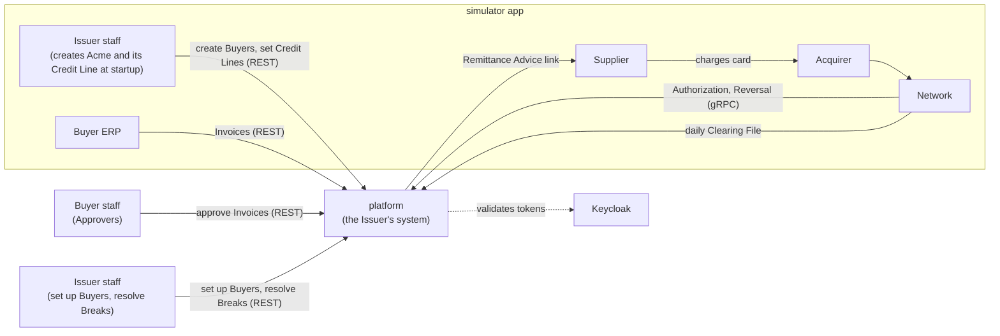
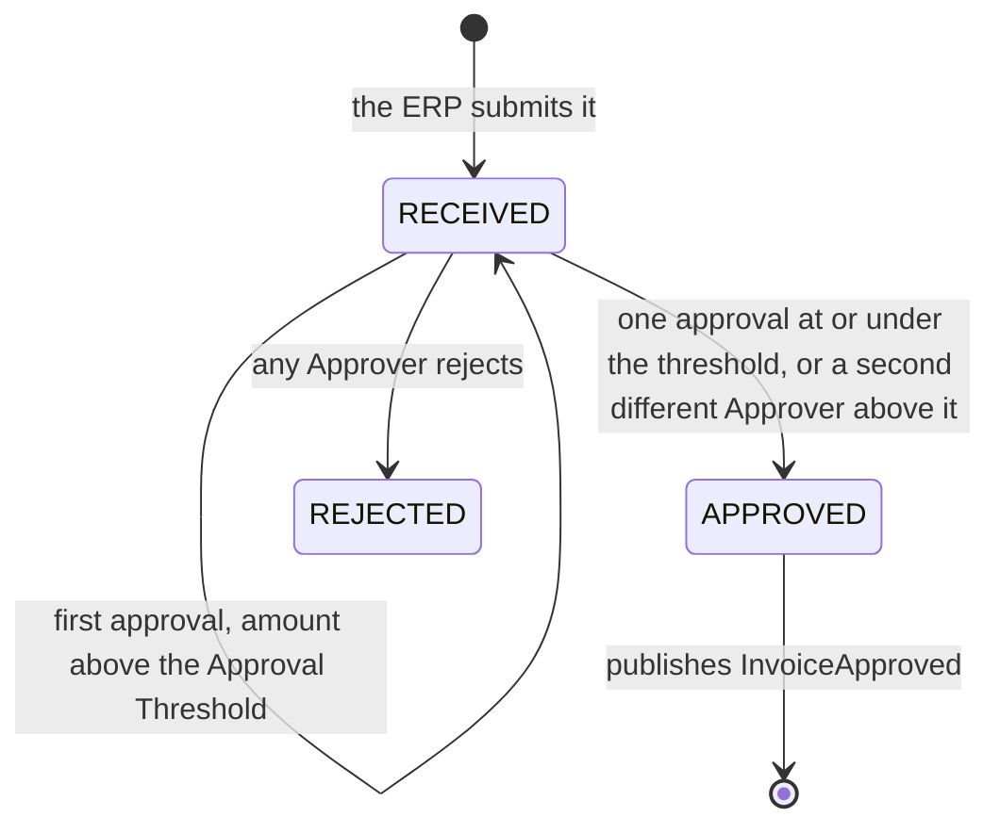
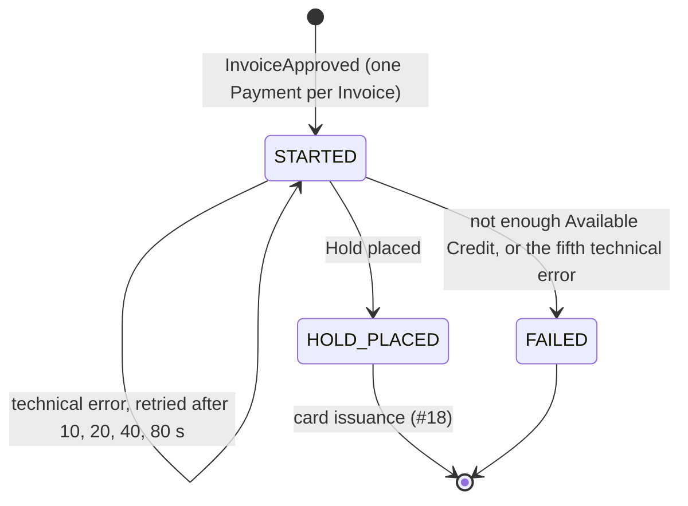

# Architecture

**Status:** M0 foundations are built, and M1 is under way: `shared`, `buyers`, `ledger` (Credit Lines and Holds so far), `suppliers` and `payables` (Invoice intake, approvals and the Payment saga's first step so far) exist; the other modules below don't yet. Terms follow [`GLOSSARY.md`](../GLOSSARY.md), and the reasoning behind each choice is in [`docs/adr/`](adr/). The milestone plan is in the [README](../README.md#roadmap).

## System context

The `platform` is the Issuer's system. Everything it talks to, apart from Keycloak, is played by the `simulator` app (ADR-0002).



## Runtime (M0 to M4)

Docker Compose runs PostgreSQL (one schema per module), `grafana/otel-lgtm` for metrics, traces and logs, and Keycloak, which issues every token. The `platform` and `simulator` run from Maven and start the stack themselves through Spring Boot's Docker Compose support.

- **Identity:** Keycloak's `payments` realm (`keycloak/payments-realm.json`) defines the roles `approver`, `erp` and `issuer-admin`, and puts them in a flat `roles` claim. Every Buyer-side client also carries its Buyer in a `buyer_id` claim (`acme-erp`, `acme-approver-1` and `acme-approver-2` carry Acme's), and the platform takes the Buyer only from that claim. An Approver is the token's subject (`sub`); its `preferred_username` is kept beside it to make the approval record readable. The platform is an OAuth2 resource server; client secrets live only in the gitignored `.env`, written by `scripts/init-env.sh`.
- **API contract:** the OpenAPI document in the `contracts` module is the source of truth. The platform implements interfaces generated from it, and the simulator calls the platform through HTTP interfaces generated from it.

## Modules

The `platform` is a modular monolith (ADR-0003). Spring Modulith tests enforce the boundaries.

| Module | Owns | Calls |
|---|---|---|
| `shared` | `Money`, `BuyerId`; open to every module | |
| `buyers` | Buyer profiles, Approval Thresholds | |
| `suppliers` | Suppliers (one per tax ID, shared by Buyers, ADR-0012), Supplier Relationships, Remittance Advice delivery | |
| `payables` | Invoices and their Idempotency-Keys, approvals, Payments (runs the Payment saga) | `buyers`, `ledger`, `cards`, `suppliers` |
| `cards` | Virtual Card lifecycle, Card Tokens | `vault` |
| `vault` | PANs, encrypted (ADR-0004) | |
| `authorization` | Authorization rules; answers the Network | `cards`, `ledger` |
| `ledger` | Credit Lines, Holds, postings, Available Credit (ADR-0005) | `buyers` |
| `clearing` | Clearing File processing, Settlement | `ledger` |
| `reconciliation` | Matching Charges to Authorizations and Invoices; Breaks | |

How modules interact:

- **Direct call** when the caller needs an answer now, such as `authorization` checking a card, or `ledger` asking `buyers` whether a Buyer exists before setting its Credit Line. The callee answers through a public type in its module's top-level package (`buyers.BuyerDirectory`); the rest of the module stays package-private.
- **Also direct:** `payables` asks `buyers.BuyerDirectory` whether the token's Buyer exists and, when an Approver approves, for the Buyer's Approval Threshold. It asks `suppliers` to find or create the Supplier and the Buyer's Supplier Relationship for each new Invoice, in the same transaction. The Payment saga places Holds through `ledger.Holds`, inside the worker's transaction, so the Hold and the Payment's new state commit together.
- **Event** when others react to something that happened. Events are stored with the change that raised them and redelivered until handled (ADR-0008). The first is `payables.InvoiceApproved` (Invoice, Buyer, Supplier, amount), published by the approval that completes an Invoice; the Payment saga's listener starts a Payment from it. Publications whose listener didn't complete are delivered again when the platform starts, so a listener must cope with the same event twice.
- **Data**: each module owns its own schema; no joins or foreign keys cross modules (ADR-0009). Each module's Flyway migrations run in that schema with their own history table, declared through `ModuleMigrations` in `shared`. Spring Modulith's event publication registry keeps its one table, `event_publication`, in a `modulith` schema it creates at startup.

## Approvals

An Approver at the Invoice's Buyer approves (`POST /v1/invoices/{invoiceId}/approval`) or rejects (`.../rejection`) it. `payables` locks the Invoice's row, so concurrent decisions on one Invoice take turns, then applies the rules:



- The same Approver approving again changes nothing and returns the Invoice, so a retried approval is safe without an `Idempotency-Key`.
- A rejected Invoice takes no new decisions, a repeated rejection included, and neither does an approved one, whose Payment may be under way: both answer `409`.
- Each approval and rejection is a row in `payables.invoice_decision` (Approver's subject, user name, decision, time) and appears in the Invoice's `decisions`. That is M1's audit trail.
- The status change, the decision and the `InvoiceApproved` publication commit in one transaction.

## Core payment path

```mermaid
sequenceDiagram
  participant ERP as ERP (sim)
  participant PAY as payables
  participant LED as ledger
  participant CRD as cards + vault
  participant SUP as suppliers
  participant SPL as Supplier (sim)
  participant NET as Network (sim)
  participant AUT as authorization
  participant CLR as clearing
  participant REC as reconciliation

  ERP->>PAY: POST /v1/invoices (Idempotency-Key)
  Note over PAY: Approvers approve the Invoice; the final approval publishes InvoiceApproved
  PAY->>LED: place Hold for the Invoice amount
  PAY->>CRD: issue Single-Use Card
  PAY->>SUP: send Remittance Advice
  SUP-->>SPL: one-time card link
  SPL->>NET: charge card (through the Acquirer)
  NET->>AUT: Authorization request (gRPC)
  AUT->>CRD: check card rules
  AUT-->>NET: approve or decline, 99% within 100 ms
  NET->>CLR: next day: Clearing File
  CLR->>LED: post the cleared amount
  CLR->>REC: cleared Charges
  Note over REC: anything unmatched becomes a Break
```

## Payment saga

`payables` orchestrates each Payment (ADR-0013). Every step is safe to repeat, and the Payment's state is saved after each one, so a crash resumes where it stopped.

| Step | Module | If it fails for good |
|---|---|---|
| 1. Place the Hold | `ledger` | The Payment fails; the Invoice stays approved and unpaid |
| 2. Issue the card and store its PAN | `cards`, `vault` | Release the Hold |
| 3. Send the Remittance Advice | `suppliers` | Cancel the card, release the Hold |

Step 1 is built (#17); a Payment stops at `HOLD_PLACED` until card issuance arrives (#18).



- **The state row (ADR-0014):** each Payment is a row in `payables.payment` with its state, failure reason, failed attempts at the current step and the time its next step is due. `GET /v1/invoices/{invoiceId}` shows the state and any failure reason.
- **Starting:** `PaymentSaga.start` is an `@ApplicationModuleListener` for `InvoiceApproved`. It runs asynchronously after the approval commits and inserts the Payment unless the Invoice already has one, so a redelivered event changes nothing.
- **The worker:** `PaymentWorkerSchedule` calls `PaymentSaga.runDueSteps` every second (`payables.payment-worker.enabled=false` turns it off for tests that drive it by hand). Each pass claims up to ten due Payments, one per transaction, with `select ... for update skip locked`, so workers on other threads or instances skip Payments already claimed. In that transaction it runs the step inside a savepoint and saves the Payment's new state: a crash rolls both back, and a technical error rolls back only the step while its failed attempt is saved.
- **Placing a Hold (`ledger.Holds`):** locks the Buyer's Credit Line row, returns the existing Hold if one has the Payment's ID, sums the open Holds in a separate statement, and inserts the Hold only if the amount fits in Available Credit. A Buyer without a Credit Line has no credit. Holds live in `ledger.hold`; releasing them comes with #18.
- **Available Credit** is the Credit Line minus open Holds (posted spend arrives in M3). It is negative when Issuer staff lower a Credit Line below the open Holds, and no new Hold is placed until Available Credit covers its amount again.
- **What to do when a Payment is stuck:** [`runbooks/payment-stuck.md`](runbooks/payment-stuck.md). How the saga and the worker work: [`learning/sagas.md`](learning/sagas.md).

## Quality targets

- **Authorization latency:** 99% answered within 100 ms at the platform. The Network gives up after 1 second, declines, and sends a Reversal (ADR-0010).

## Planned evolution

Each extraction gets its own ADR naming the force behind it (ADR-0003).

- **M5:** `authorization` becomes its own service, driven by the latency target. Events start crossing process boundaries through Kafka.
- **M6:** everything runs on Kubernetes (k3d and Helm) behind Spring Cloud Gateway.
- **M7:** `vault` becomes its own service and database, for PCI isolation.
