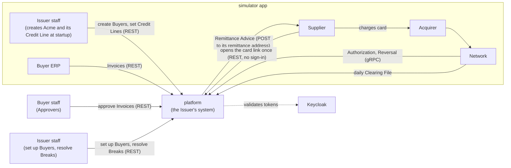
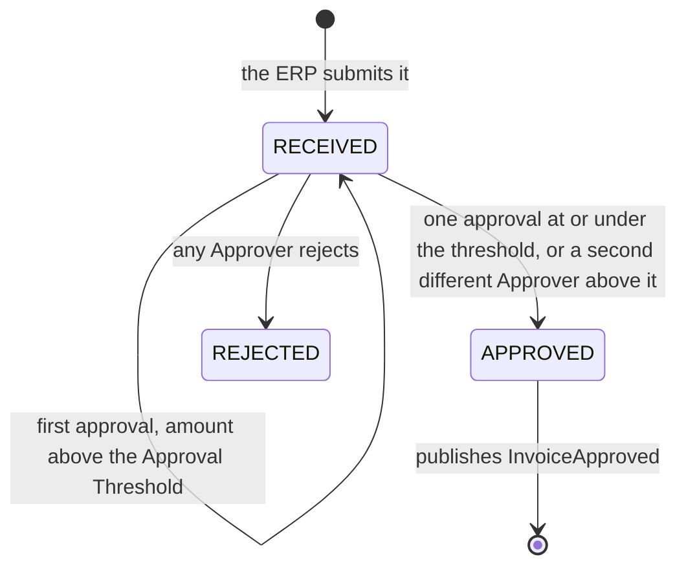
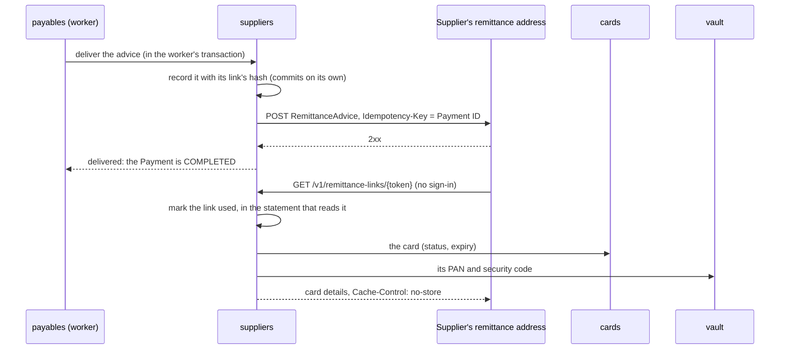
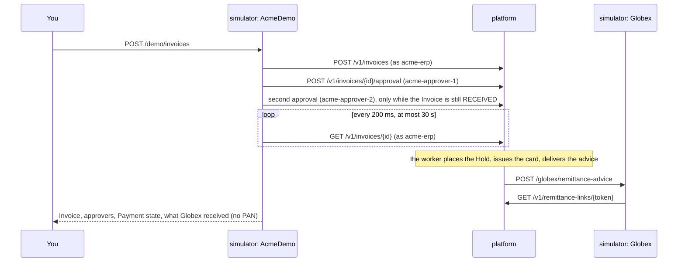

# Architecture

**Status:** M0 (foundations) and M1 (Invoice to card) are done. The M1 modules are built: `shared`, `buyers`, `ledger` (Credit Lines and Holds), `suppliers` (Suppliers, Supplier Relationships, Remittance Advice), `payables` (Invoice intake, approvals, the Payment saga), `cards` (Single-Use Cards) and `vault`. `authorization`, `clearing` and `reconciliation` arrive with M2 to M4, as the module table shows. Terms follow [`GLOSSARY.md`](../GLOSSARY.md), and the reasoning behind each choice is in [`docs/adr/`](adr/). The milestone plan is in the [README](../README.md#roadmap).

## System context

The `platform` is the Issuer's system. Everything it talks to, apart from Keycloak, is played by the `simulator` app (ADR-0002).



## Runtime (M0 to M4)

Docker Compose runs PostgreSQL (one schema per module), `grafana/otel-lgtm` for metrics, traces and logs, and Keycloak, which issues every token. The `platform` and `simulator` run from Maven and start the stack themselves through Spring Boot's Docker Compose support.

- **Identity:** Keycloak's `payments` realm (`keycloak/payments-realm.json`) defines the roles `approver`, `erp` and `issuer-admin`, and puts them in a flat `roles` claim. Every Buyer-side client also carries its Buyer in a `buyer_id` claim (`acme-erp`, `acme-approver-1` and `acme-approver-2` carry Acme's), and the platform takes the Buyer only from that claim. An Approver is the token's subject (`sub`); its `preferred_username` is kept beside it to make the approval record readable. The platform is an OAuth2 resource server; client secrets live only in the gitignored `.env`, written by `scripts/init-env.sh`.
- **API contract:** the OpenAPI document in the `contracts` module is the source of truth. The platform implements interfaces generated from it, and the simulator calls the platform through HTTP interfaces generated from it.

## Modules

The `platform` is a modular monolith (ADR-0003). Spring Modulith tests enforce the boundaries.

| Module | Owns | Calls | Built |
|---|---|---|---|
| `shared` | `Money`, `BuyerId`, `SecretKeys` (reads a 256-bit key from configuration, or stops the platform); open to every module | | M1 |
| `buyers` | Buyer profiles, Approval Thresholds | | M1 |
| `suppliers` | Suppliers (one per tax ID, shared by Buyers, ADR-0012), Supplier Relationships, Remittance Advice and their one-time card links | `cards`, `vault` | M1 |
| `payables` | Invoices and their Idempotency-Keys, approvals, Payments (runs the Payment saga) | `buyers`, `ledger`, `cards`, `suppliers` | M1 |
| `cards` | Virtual Card lifecycle, Card Tokens; Single-Use Cards so far (issue, cancel, expire after 30 days uncharged) | `vault` | M1 |
| `vault` | PANs and security codes, encrypted, with each PAN's keyed hash (ADR-0004); only `cards` and `suppliers` may call it | | M1 |
| `authorization` | Authorization rules; answers the Network | `cards`, `ledger` | M2 |
| `ledger` | Credit Lines, Holds and Available Credit; postings and the journal from M3 (ADR-0005) | `buyers` | M1 |
| `clearing` | Clearing File processing, Settlement | `ledger` | M3 |
| `reconciliation` | Matching Charges to Authorizations and Invoices; Breaks | | M4 |

How modules interact:

- **Direct call** when the caller needs an answer now, such as `authorization` checking a card, or `ledger` asking `buyers` whether a Buyer exists before setting its Credit Line. The callee answers through a public type in its module's top-level package (`buyers.BuyerDirectory`); the rest of the module stays package-private.
- **Also direct:** `payables` asks `buyers.BuyerDirectory` whether the token's Buyer exists and, when an Approver approves, for the Buyer's Approval Threshold. It asks `suppliers` to find or create the Supplier and the Buyer's Supplier Relationship for each new Invoice, in the same transaction. The Payment saga places and releases Holds through `ledger.Holds` and issues cards through `cards.Cards`, inside the worker's transaction, so each step and the Payment's new state commit together. `cards` asks `vault.Vault` for a new PAN by Card Token, in that same transaction, and gets back only its last four digits. The saga delivers the Remittance Advice through `suppliers.RemittanceAdvices`, and when delivery fails for good it cancels the card through `cards.Cards`. When a Supplier opens its link, `suppliers` asks `cards.Cards` for the card (status, expiry) and `vault.Vault` for its PAN and security code. `ModularityTests` fails if any module other than `cards` and `suppliers` uses `vault`.
- **Event** when others react to something that happened. Events are stored with the change that raised them and redelivered until handled (ADR-0008). The first is `payables.InvoiceApproved` (Invoice, Buyer, Supplier, amount), published by the approval that completes an Invoice; the Payment saga's listener starts a Payment from it. The second is `cards.CardExpired` (Card Token, Payment, Buyer, amount), published by the expiry job for each card nobody charged; `payables` ends the Payment and releases its Hold (see [Card expiry](#card-expiry)). Publications whose listener didn't complete are delivered again when the platform starts, so a listener must cope with the same event twice.
- **Data**: each module owns its own schema; no joins or foreign keys cross modules (ADR-0009). Each module's Flyway migrations run in that schema with their own history table, declared through `ModuleMigrations` in `shared`. Spring Modulith's event publication registry keeps its one table, `event_publication`, in a `modulith` schema it creates at startup.

## Approvals

An Approver at the Invoice's Buyer approves (`POST /v1/invoices/{invoiceId}/approval`) or rejects (`.../rejection`) it. `payables` locks the Invoice's row, so concurrent decisions on one Invoice take turns, then applies the rules:



- The same Approver approving again changes nothing and returns the Invoice, so a retried approval is safe without an `Idempotency-Key`.
- A rejected Invoice takes no new decisions, a repeated rejection included, and neither does an approved one, whose Payment may be under way: both answer `409`.
- Each approval and rejection is a row in `payables.invoice_decision` (Approver's subject, user name, decision, time) and appears in the Invoice's `decisions`. That is M1's audit trail.
- The status change, the decision and the `InvoiceApproved` publication commit in one transaction.

## Core payment path

```mermaid
sequenceDiagram
  participant ERP as ERP (sim)
  participant PAY as payables
  participant LED as ledger
  participant CRD as cards + vault
  participant SUP as suppliers
  participant SPL as Supplier (sim)
  participant NET as Network (sim)
  participant AUT as authorization
  participant CLR as clearing
  participant REC as reconciliation

  ERP->>PAY: POST /v1/invoices (Idempotency-Key)
  Note over PAY: Approvers approve the Invoice; the final approval publishes InvoiceApproved
  PAY->>LED: place Hold for the Invoice amount
  PAY->>CRD: issue Single-Use Card
  PAY->>SUP: send Remittance Advice
  SUP-->>SPL: one-time card link
  SPL->>NET: charge card (through the Acquirer)
  NET->>AUT: Authorization request (gRPC)
  AUT->>CRD: check card rules
  AUT-->>NET: approve or decline, 99% within 100 ms
  NET->>CLR: next day: Clearing File
  CLR->>LED: post the cleared amount
  CLR->>REC: cleared Charges
  Note over REC: anything unmatched becomes a Break
```

## Payment saga

`payables` orchestrates each Payment (ADR-0013). Every step is safe to repeat, and the Payment's state is saved after each one, so a crash resumes where it stopped.

| Step | Module | If it fails for good |
|---|---|---|
| 1. Place the Hold | `ledger` | The Payment fails; the Invoice stays approved and unpaid |
| 2. Issue the card and store its PAN | `cards`, `vault` | Release the Hold |
| 3. Send the Remittance Advice | `suppliers` | Cancel the card, release the Hold |

All three steps are built: the Hold (#17), the card (#18) and the Remittance Advice (#19).

```mermaid
stateDiagram-v2
  [*] --> STARTED: InvoiceApproved (one Payment per Invoice)
  STARTED --> STARTED: technical error, retried after 10, 20, 40, 80 s
  STARTED --> HOLD_PLACED: Hold placed
  STARTED --> FAILED: not enough Available Credit, or the fifth technical error
  HOLD_PLACED --> HOLD_PLACED: technical error, retried after 10, 20, 40, 80 s
  HOLD_PLACED --> CARD_ISSUED: Single-Use Card issued
  HOLD_PLACED --> FAILED: the fifth technical error; the Hold is released
  CARD_ISSUED --> CARD_ISSUED: technical error (no 2xx in time), retried after 10, 20, 40, 80 s
  CARD_ISSUED --> COMPLETED: the Supplier answers the Remittance Advice with a 2xx
  CARD_ISSUED --> FAILED: the fifth technical error; the card is cancelled and the Hold released
  CARD_ISSUED --> EXPIRED: CardExpired (delivery still retrying); the retries stop and the Hold is released
  COMPLETED --> EXPIRED: CardExpired; the Hold is released
  COMPLETED --> [*]
  FAILED --> [*]
  EXPIRED --> [*]
```



- **The state row (ADR-0014):** each Payment is a row in `payables.payment` with its state, failure reason, failed attempts at the current step and the time its next step is due. `GET /v1/invoices/{invoiceId}` shows the state and any failure reason.
- **Starting:** `PaymentSaga.start` is an `@ApplicationModuleListener` for `InvoiceApproved`. It runs asynchronously after the approval commits and inserts the Payment unless the Invoice already has one, so a redelivered event changes nothing.
- **The worker:** `PaymentWorkerSchedule` calls `PaymentSaga.runDueSteps` every second (`payables.payment-worker.enabled=false` turns it off for tests that drive it by hand). Each pass claims up to ten due Payments, one per transaction, with `select ... for update skip locked`, so workers on other threads or instances skip Payments already claimed. In that transaction it runs the step and saves the Payment's new state, so a crash rolls both back. A technical error rolls the transaction back too, and a new transaction counts the failed attempt unless another worker has moved the Payment on meanwhile.
- **Placing a Hold (`ledger.Holds`):** locks the Buyer's Credit Line row, returns the existing Hold if one has the Payment's ID, sums the open Holds in a separate statement, and inserts the Hold only if the amount fits in Available Credit. A Buyer without a Credit Line has no credit. Holds live in `ledger.hold`; a released Hold keeps its row, marked `RELEASED` with its release time, and placing it again checks Available Credit afresh.
- **Issuing the card (`cards.Cards`):** returns the Payment's card if it has one; otherwise draws a Card Token, has `vault` generate and store the PAN, and stores the card in `cards.card`, locked to the Invoice's Supplier and amount and valid for 30 days. Placing the Hold makes this step due at once.
- **Delivering the Remittance Advice (`suppliers.RemittanceAdvices`):** records the advice and POSTs it to the Supplier's remittance address (see [Remittance Advice](#remittance-advice)); a 2xx answer completes the Payment. Issuing the card makes this step due at once, so one worker pass usually runs all three steps, each in its own transaction.
- **Compensation:** the transaction that records a step's fifth technical error also undoes the steps before it, so Available Credit comes back as the Payment becomes `FAILED`. Card issuance failing for good releases the Hold (`Holds.release`, which marks it `RELEASED` and is harmless to repeat). Delivery failing for good cancels the card (`Cards.cancel`, status `CANCELLED`, harmless to repeat), so its link shows nothing, and releases the Hold.
- **Available Credit** is the Credit Line minus open Holds (posted spend arrives in M3). It is negative when Issuer staff lower a Credit Line below the open Holds, and no new Hold is placed until Available Credit covers its amount again.
- **What to do when a Payment is stuck:** [`runbooks/payment-stuck.md`](runbooks/payment-stuck.md). How the saga and the worker work: [`learning/sagas.md`](learning/sagas.md).

## Cards and the vault

A Single-Use Card's data is split between two modules so the PAN lives in exactly one place (ADR-0004):

| | `cards.card` | `vault.card_secret` |
|---|---|---|
| Key | Card Token: 16 random bytes, base64url | the same Card Token |
| Stores | Payment (unique), Buyer, Supplier and amount the card is locked to, last four digits, issue and expiry times, status (`ACTIVE`; `CANCELLED` when its Remittance Advice couldn't be delivered; `EXPIRED` when nobody charged it within 30 days) | the PAN and the security code, each AES-256-GCM-encrypted under a fresh nonce with the Card Token as associated data; the PAN's HMAC-SHA-256 hash, unique |
| Read by | `payables` (the Invoice shows Card Token, last four digits, expiry); `suppliers` (status and expiry, when a link is opened) | `suppliers`, when a Supplier opens its link: the PAN and security code, decrypted, never stored outside the vault |

- **PANs** are synthetic: 16 digits, `990000` followed by nine random digits and a Luhn check digit. A PAN whose hash another card already has is drawn again.
- **Keys:** two separate 256-bit keys, one to encrypt and one to hash, come from `vault.encryption-key` and `vault.hash-key` (`VAULT_ENCRYPTION_KEY` and `VAULT_HASH_KEY` in `.env`, written by `scripts/init-env.sh`). The platform doesn't start when either is missing or isn't 32 bytes ([`runbooks/vault-key-invalid.md`](runbooks/vault-key-invalid.md)). M7 replaces them with envelope encryption.
- **How it works and why:** [`learning/card-vault.md`](learning/card-vault.md).

## Card expiry

A Single-Use Card nobody charged before its expiry, 30 days after issuance, returns its credit to the Buyer (ADR-0011).

```mermaid
sequenceDiagram
  participant JOB as cards: expiry job
  participant PAY as payables
  participant LED as ledger

  Note over JOB: every minute, 100 cards per transaction
  JOB->>JOB: ACTIVE cards past their expiry become EXPIRED (for update skip locked)
  JOB-)PAY: CardExpired, one per card (event publication registry)
  PAY->>PAY: lock the Payment; COMPLETED or CARD_ISSUED becomes EXPIRED
  PAY->>LED: Holds.release(Payment ID)
```

- **The job (`cards.CardExpiry`):** `CardExpirySchedule` runs it every minute (`cards.expiry-job.enabled=false` turns it off for tests that run it by hand). Each batch claims up to 100 `ACTIVE` cards whose `expires_at` has come with one `update ... where card_token in (select ... for update skip locked) returning ...`, and publishes a `CardExpired` for each, in the same transaction: a stop mid-run leaves each card `ACTIVE` for the next run, or `EXPIRED` with its event in the registry. Cards in any other status are left alone; an index on `expires_at` covers only `ACTIVE` cards.
- **The listener (`PaymentSaga.expire`):** in one transaction, it locks the Payment (waiting for a worker that is running its step), moves a `COMPLETED` Payment, or a `CARD_ISSUED` one still retrying its delivery, to `EXPIRED` with no step left, and releases the Hold through `ledger.Holds`. `payables`, not `cards`, releases the Hold because it owns the Hold's lifecycle in the saga, and `cards` needs no dependency on `ledger`. Another state stays as it is, but the Hold is still released.
- **Exactly once:** the registry may deliver `CardExpired` again; a second delivery finds the Payment `EXPIRED` and the Hold `RELEASED`, and changes nothing. Re-paying the Invoice is out of scope; it stays `APPROVED`.
- **When cards stay `ACTIVE` past their expiry:** [`runbooks/payment-stuck.md`](runbooks/payment-stuck.md#a-card-past-its-expiry-is-still-active).

## Remittance Advice

The saga's third step tells the Supplier which Invoice is paid and hands it the Single-Use Card, through a link that shows the card's details once.



| | `suppliers.remittance_advice` |
|---|---|
| Key | the Payment's ID: one advice per Payment |
| Stores | the Invoice's ID and number, the Supplier, the amount, the Card Token; the SHA-256 of the link's token (unique); the link's expiry, 7 days after the first attempt, and when it was used |
| Never stores | the link's token, the PAN or the security code |

- **The link's token** is HMAC-SHA-256 of the Payment's ID under `remittance.link-key` (`REMITTANCE_LINK_KEY` in `.env`, written by `scripts/init-env.sh`), base64url-encoded: 256 bits nobody can work out without the key, and the same on every delivery attempt, so a retry after a crash sends the link the Supplier may already hold. The platform doesn't start without the key. The link is `platform.public-url` + `/v1/remittance-links/{token}`.
- **Delivery** records the advice in a transaction of its own before the POST, so the link works the moment the Supplier receives it; a second attempt finds the record and sends the same advice. The POST goes through Spring's `RestClient` (2-second connect and 5-second read timeouts, no redirects). Anything but a 2xx is a technical error for the saga to retry; the error names only the status, never the Supplier's answer.
- **Opening** a link hashes the token and runs one `update ... returning` that sets `link_used_at` only if it is unset and the link hasn't expired, so of two opens at once exactly one shows the card. A token with no record answers `404`; a used or expired link, or one whose card is cancelled, `410`, and a link that shows nothing isn't marked used. The PAN and security code come from `vault` for that answer only. Nothing logs the token, the PAN or the security code, and traces record a link request by its route (`RequestObservations`), not its URL.
- **The Supplier's address** is the remittance address on the first Invoice naming its tax ID (see Invoice intake in the M1 design). The simulator plays the Supplier Globex at `http://localhost:8081/globex/remittance-advice`: it drops repeated advice by `Idempotency-Key`, opens each link once, and logs only the last four digits.
- **How it works and why:** [`learning/one-time-links.md`](learning/one-time-links.md). When delivery keeps failing: [`runbooks/payment-stuck.md`](runbooks/payment-stuck.md).

## The simulator in M1

The `simulator` plays every party on M1's core path other than the platform; each role that calls the platform signs in as its own Keycloak client:

| Role | Class | What it does |
|---|---|---|
| Issuer staff | `AcmeSeeder` | At startup, creates the Buyer Acme (fixed ID, Approval Threshold $10,000) and gives it a $100,000 Credit Line (`simulator-issuer-admin`) |
| Acme's ERP | `AcmeErp` | Submits Invoices from Globex under a new `Idempotency-Key` each, and reads them back (`acme-erp`) |
| Acme's Approvers | `AcmeApprovers` | Approve on request, as `acme-approver-1` or `acme-approver-2` |
| Supplier Globex | `GlobexSupplier` | Receives Remittance Advice at `/globex/remittance-advice`, drops repeats by `Idempotency-Key`, opens each card link once with an untraced client, and keeps only the last four digits, expiry and amount |
| Demo | `AcmeDemo` | `POST /demo/invoices[?minorUnits=…]`: runs the whole path in one call (below) |



- **One trace across both apps.** Both apps export traces to Grafana's Tempo over OTLP, and Spring's HTTP clients pass the trace context on (W3C `traceparent`). The demo's request is one trace, rooted at the simulator's `http post /demo/invoices`, holding the platform's spans for the Invoice submission, the approvals and every read. Delivering the advice is a trace of its own, rooted at the worker's task (`task paymentWorkerSchedule.runDueSteps`), that continues into Globex's `http post /globex/remittance-advice`. A card link's GET is deliberately untraced on Globex's side and recorded by its route on the platform's.

## How M1 is proven

- **The core path** (`CorePathTests`): real Keycloak tokens from the repository's realm file and real PostgreSQL, the worker on its schedule, only the Supplier's address stubbed. Acme is set up, an Invoice above the threshold is approved twice and paid, Available Credit drops by its amount, and the link opens once, then answers `410`.
- **No PAN outside the vault:** the same test class searches every column of every table outside `vault`, and the captured logs, for the PAN it just read through the link.
- **A crash at each Payment state** (`PaymentSagaTests`): the platform stops mid-step after `STARTED`, `HOLD_PLACED` and `CARD_ISSUED`, and the next pass completes the Payment with one Hold and one card.
- **Module boundaries:** `ModularityTests` (Spring Modulith's verification, and only `cards` and `suppliers` using `vault`).
- **The simulator's roles and the demo** against stub Keycloak and platform servers.

## Quality targets

- **Authorization latency:** 99% answered within 100 ms at the platform. The Network gives up after 1 second, declines, and sends a Reversal (ADR-0010).

## Planned evolution

Each extraction gets its own ADR naming the force behind it (ADR-0003).

- **M5:** `authorization` becomes its own service, driven by the latency target. Events start crossing process boundaries through Kafka.
- **M6:** everything runs on Kubernetes (k3d and Helm) behind Spring Cloud Gateway.
- **M7:** `vault` becomes its own service and database, for PCI isolation.
