# Architecture

**Status:** M0 (foundations), M1 (Invoice to card), M2 (Authorization), M3 (Clearing and Settlement), M4 (Reconciliation and measurement) and M5 (Authorization becomes its own service) are done. M1 built `shared`, `buyers`, `ledger` (Credit Lines and Holds), `suppliers` (Suppliers, Supplier Relationships, Remittance Advice), `payables` (Invoice intake, approvals, the Payment saga), `cards` (Single-Use Cards) and `vault`. M2 added `authorization`, which answers the Network's Authorizations and Reversals over gRPC (see [The Network link](#the-network-link)), and the expiry of cards nobody charged; the simulator's Acquirer and Network charge Globex's card through it, and the Network declines and reverses a Charge the platform doesn't answer within 1 second. M3 added `clearing`, which imports the Network's daily Clearing Files with a Spring Batch job, posts every Clearing to `ledger`'s new double-entry journal, which Available Credit now reads, records how each matched its Authorization, settles each file with the Network, and lists the files, with any gap in the Network's sequence, for Issuer staff (see [Clearing](#clearing)). Issuer staff also record a Buyer's Repayment, which raises Available Credit again (see [Repayments](#repayments)), and a card whose Charge never clears expires 7 days after its Authorization (see [Card expiry](#card-expiry)). The simulator's Network writes the Clearing Files from Globex's approved Charges, and its demo can inject every Clearing edge case (see [The simulator](#the-simulator)). M4 added `reconciliation`, which turns every Clearing that didn't match, every Undercharge, every Authorization that never cleared, every Payment that ended unpaid, every mismatched Settlement and every failed balance check of the books into a Break, daily and on demand, which Reconcilers and Issuer staff read and only Reconcilers resolve, moving money with a Correcting Entry where it is in the wrong Account (see [Reconciliation](#reconciliation)); Grafana's four provisioned dashboards and its Authorization p99 alert (see [Dashboards and alerts](#dashboards-and-alerts)); and the `load-test` module, whose measured result is in the [M4 design](design/m4-reconciliation-and-measurement.md#measured-75). The simulator's demo runs Reconciliation for today and shows the Breaks it found (see [The simulator](#the-simulator)). M5 moved the Network link out of the platform into `authorization-service`, for availability (ADR-0016): it answers from its Card Copy, fed by the platform's `cards` topic, so Charges are still approved while the platform is down; its outbox sends every approved and reversed Authorization and each Card on File to the `authorizations` topic, from which the platform keeps its Authorization Copy and the Payment saga waits for the card to be on file; the service answers `91` in milliseconds through Resilience4j when its database fails; Pact message pacts cover each event both ways; and one trace runs from the Network's call to the platform's consumers (see [authorization-service](#authorization-service), [The cards topic](#the-cards-topic) and [The authorizations topic](#the-authorizations-topic)). Its load test is in the [M5 design](design/m5-authorization-service.md#measured-97). Terms follow [`GLOSSARY.md`](../GLOSSARY.md), and the reasoning behind each choice is in [`docs/adr/`](adr/). The milestone plan is in the [README](../README.md#roadmap).

## System context

The `platform` is the Issuer's system. Everything it talks to, apart from Keycloak and M5's `authorization-service`, is played by the `simulator` app (ADR-0002).

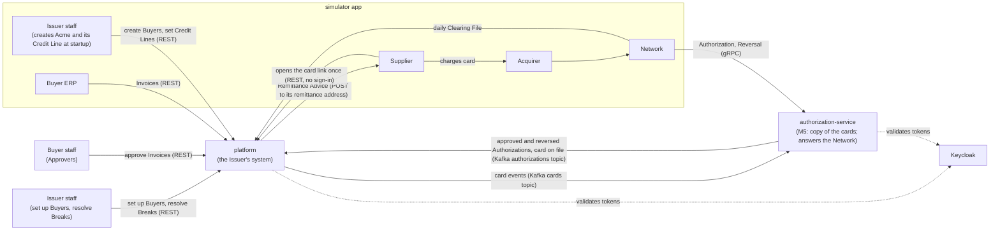

## Runtime

Docker Compose runs PostgreSQL (one schema per module), `grafana/otel-lgtm` for metrics, traces and logs, with dashboards provisioned from `grafana/` ([Dashboards and alerts](#dashboards-and-alerts)), Keycloak, which issues every token, a single-broker Kafka for the `cards` and `authorizations` topics ([The cards topic](#the-cards-topic), [The authorizations topic](#the-authorizations-topic)), and `authorization-service`'s own PostgreSQL, `authorization-postgres` on `127.0.0.1:5433` ([authorization-service](#authorization-service)). The `platform` and `simulator` run from Maven and start the stack themselves through Spring Boot's Docker Compose support; the platform ignores `authorization-postgres` (its `org.springframework.boot.ignore` label), so it still finds one PostgreSQL. `authorization-service` also runs from Maven (`./mvnw -pl authorization-service spring-boot:run`) but doesn't use Docker Compose support, which would hand it the platform's database too: it connects by the addresses in its `application.properties`, so start the stack first. The `load-test` module's Gatling simulation runs by hand against them (`-Pload-test`): it charges the simulator's seeded cards over gRPC as the Network, at 200 Authorizations a second from 5 paced users (Gatling's open-source gRPC limit); without the profile the build only compiles it and unit-tests how it reads the cards file.

- **Identity:** Keycloak's `payments` realm (`keycloak/payments-realm.json`) defines the roles `approver`, `erp`, `issuer-admin`, `reconciler` (the `simulator-reconciler` client, which resolves Breaks) and `network` (the `network` client, which the Network signs in with), and puts them in a flat `roles` claim. Every Buyer-side client also carries its Buyer in a `buyer_id` claim (`acme-erp`, `acme-approver-1` and `acme-approver-2` carry Acme's; `initech-erp` and `initech-approver` carry Initech's), and the platform takes the Buyer only from that claim. An Approver is the token's subject (`sub`); its `preferred_username` is kept beside it to make the approval record readable. The platform is an OAuth2 resource server; client secrets live only in the gitignored `.env`, written by `scripts/init-env.sh`.
- **API contract:** the OpenAPI document in the `contracts` module is the source of truth. The platform implements interfaces generated from it, and the simulator calls the platform through HTTP interfaces generated from it. The Network link's contract is a protobuf file in the same module (`src/main/proto`), from which both sides get generated messages and gRPC stubs.
- **Ports:** the platform's REST on `8080`; `authorization-service`'s Network link (gRPC) on `127.0.0.1:9090`, where the platform answered until the cutover (#92), and its HTTP (actuator only) on `8082` (the simulator has `8081`). The platform runs no gRPC server.
- **Addresses outside Compose (#120):** every address an app connects to is a Spring Boot property, which its environment variable overrides by relaxed binding (`spring.r2dbc.url` by `SPRING_R2DBC_URL`); with none set, Compose plus `spring-boot:run` runs as before. Docker Compose support is left out of the executable jars (an optional dependency), so where a jar runs, as in the M6 chart ([Deployment](#deployment)), what Compose supplied comes from properties instead. The chart sets:
  - **platform:** `spring.datasource.url`, `.username` and `.password`; `management.opentelemetry.tracing.export.otlp.endpoint`, `management.opentelemetry.logging.export.otlp.endpoint` and `management.otlp.metrics.export.url`; `spring.kafka.bootstrap-servers`; `platform.public-url`, the address in Remittance Advice card links, which Globex opens from the simulator's pod.
  - **authorization-service:** `spring.grpc.server.address` (`127.0.0.1` by default; `0.0.0.0` in the chart); `spring.r2dbc.url`, `spring.flyway.url` and `spring.kafka.bootstrap-servers`; the same three OTLP properties as the platform.
  - **simulator:** the same three OTLP properties; `simulator.platform-url`, `simulator.platform-grpc-address`, Keycloak's `spring.security.oauth2.client.provider.keycloak.token-uri`, and `simulator.globex.url`, where the platform delivers Globex's Remittance Advice (by default `http://localhost:` plus `server.port`).
  - **gateway:** `gateway.platform-uri`, where it routes `/v1` ([The Gateway](#the-gateway)).
  - **Tokens:** the three resource servers (platform, authorization-service, gateway) take an optional `spring.security.oauth2.resourceserver.jwt.jwk-set-uri`. Unset, they fetch the signing keys through `issuer-uri`'s discovery document, as before. Set, the keys come from it, `iss` is still checked against `issuer-uri`, and the issuer is never fetched; the chart sets it, because tokens name Keycloak's host address (`http://localhost:8180`), which the pods can't reach. The service builds its own blocking decoder for gRPC (`SecurityConfig`), and its `JwkSetUriTests` prove it from the application's configuration. The platform uses Spring Boot's decoder unchanged: its `JwkSetUriTests` run Boot's resource-server auto-configuration alone with both properties set, not the platform's full context.

## Deployment

Compose plus `spring-boot:run` stays the development loop. To run it as a platform (M6, ADR-0017), the whole stack also runs on a single-node k3d cluster from one Helm chart, `deploy/helm/b2b-payments/` ([M6 design](design/m6-run-as-a-platform.md#what-runs-where-q2-q3-q9-q10-q13); how: [`learning/kubernetes.md`](learning/kubernetes.md), [`learning/helm.md`](learning/helm.md); steps: the README's "Run it on Kubernetes").

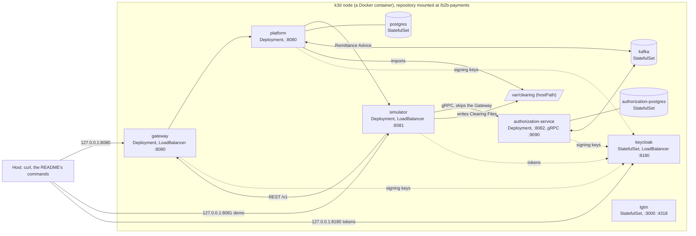

- **Images:** `./mvnw -pl platform,authorization-service,simulator,gateway -am -DskipTests spring-boot:build-image` builds `b2b-payments/<module>:local` with Cloud Native Buildpacks ([how](learning/buildpacks.md)) from each app's executable (`exec`) jar; no Dockerfiles, no registry. Only the four apps build one (`spring-boot.build-image.skip`, like `spring-boot.run.skip`). `scripts/k3d-cluster.sh` creates the cluster `b2b-payments` (k3s `v1.37.1-k3s1`, Traefik off, the repository root mounted into the node, host ports `127.0.0.1:8080`, `8081` and `8180`) and imports the images.
- **Charts:** a subchart per app, rendering the umbrella's shared `b2b-payments.app` template (a Deployment and a Service), and an `infra` subchart with a hand-written StatefulSet and Service each for both PostgreSQL databases, Kafka (one KRaft broker; the apps create their topics as in Compose), Keycloak (realm imported from the mounted `keycloak/`, hostname `http://localhost:8180`) and otel-lgtm (dashboards and alert rule from the mounted `grafana/`), with the images `compose.yaml` pins. The databases and Kafka keep their data on local-path volumes. Every app runs one replica for now; readiness reads Spring Boot's `/actuator/health/readiness`.
- **Addresses:** each app's environment points every address in [Runtime](#runtime) at a Service: the simulator reaches the platform's REST API through `gateway:8080`, as every client outside the platform does, and `authorization-service:9090` for gRPC, past the Gateway; Remittance Advice links name `http://gateway:8080`, and the platform delivers Globex's to `http://simulator:8081`. Tokens are issued for `http://localhost:8180` wherever they are asked for; the resource servers fetch Keycloak's keys from `keycloak:8180` inside the cluster.
- **Files:** the platform and the simulator mount `var/clearing` from the repository as hostPath volumes, so the Network's files land in the folder the platform claims them from by atomic move; the simulator also mounts `var/load-test`. Both run as the installing user (`global.hostUser`), so they can write there. This ties the cluster to one node.
- **Secrets:** `scripts/k8s-secrets.sh [env file]` turns `.env` into one Secret per component holding only the variables it reads (`platform-secrets`: the vault and link keys; `authorization-service-secrets`: `VAULT_HASH_KEY`; `simulator-secrets`: the client secrets; `keycloak-secrets`: those and the admin password), which the pods read as the same environment variables as in development. Nothing secret is in the chart.
- **Not yet:** the second replica, probes for rolling restarts and the headless gRPC Service (#116), Redis (#115), per-pod telemetry (#118).

## Modules

The `platform` is a modular monolith (ADR-0003). Spring Modulith tests enforce the boundaries.

| Module | Owns | Calls | Built |
|---|---|---|---|
| `shared` | `Money`, `BuyerId`, `SecretKeys` (reads a 256-bit key from configuration, or stops the platform); open to every module | | M1 |
| `buyers` | Buyer profiles, Approval Thresholds | | M1 |
| `suppliers` | Suppliers (one per tax ID, shared by Buyers, ADR-0012) and their Acceptor IDs, Supplier Relationships, Remittance Advice and their one-time card links | `cards`, `vault` | M1 |
| `payables` | Invoices and their Idempotency-Keys, approvals, Payments (runs the Payment saga); reads `CardOnFile` from the `authorizations` topic (M5) | `buyers`, `ledger`, `cards`, `suppliers` | M1 |
| `cards` | Virtual Card lifecycle, Card Tokens; Single-Use Cards so far (issue, cancel, authorize, back to `ACTIVE` on a Reversal, clear, expire after 30 days uncharged or 7 days after an Authorization that never cleared); publishes `CardIssued`, `CardCancelled`, `CardExpired` and `CardCleared` to the `cards` topic (M5) | `vault` | M1 |
| `vault` | PANs and security codes, encrypted, with each PAN's keyed hash (ADR-0004); only `cards`, `suppliers` and `clearing` may call it (`authorization` did until M5) | | M1 |
| `authorization` | The platform's copy of the Authorizations `authorization-service` approved and of their Reversals, read from the `authorizations` topic (M5), each moving its card through `cards`; a card's approved Authorization by authorization code, for Clearing, and whether the copy has caught up with the topic (`AuthorizationCopyFreshness`, M5). Until M5 it answered the Network over gRPC (see [The Network link](#the-network-link)) | `cards` | M2 |
| `ledger` | Credit Lines, Holds and Available Credit; the double-entry journal: Accounts and Journal Entries (ADR-0005, ADR-0015), and Repayments, from M3 | `buyers` | M1 |
| `clearing` | Clearing Files and their Clearings: the drop folder, the Spring Batch import and its job repository (the `batch` schema), its wait for the Authorization Copy to catch up (M5), matching, each file's Settlement, the list of files with the gaps in the Network's sequence; a Business Date's Clearings for other modules (`RecordedClearings`, M4) | `vault`, `cards`, `authorization`, `ledger` | M3 |
| `reconciliation` | The daily Reconciliation (a Spring Batch job in the `batch` job repository) and its Breaks, each keyed by its kind and the record it names; a Reconciler's resolution of a Break, with its Correcting Entry | `clearing`, `authorization`, `payables`, `ledger`, `buyers` | M4 |

How modules interact:

- **Direct call** when the caller needs an answer now, such as `clearing` looking up a card's approved Authorization, or `ledger` asking `buyers` whether a Buyer exists before setting its Credit Line. The callee answers through a public type in its module's top-level package (`buyers.BuyerDirectory`); the rest of the module stays package-private.
- **Also direct:** `payables` asks `buyers.BuyerDirectory` whether the token's Buyer exists and, when an Approver approves, for the Buyer's Approval Threshold. It asks `suppliers` to find or create the Supplier and the Buyer's Supplier Relationship for each new Invoice, in the same transaction. The Payment saga places and releases Holds through `ledger.Holds` and issues cards through `cards.Cards`, inside the worker's transaction, so each step and the Payment's new state commit together. `cards` asks `vault.Vault` for a new PAN by Card Token, in that same transaction, and gets back only its last four digits. The saga delivers the Remittance Advice through `suppliers.RemittanceAdvices`, and when delivery fails for good it cancels the card through `cards.Cards`. When a Supplier opens its link, `suppliers` asks `cards.Cards` for the card (status, expiry) and `vault.Vault` for its PAN and security code. When `authorization` reads an approved Authorization from the `authorizations` topic, it asks `cards.Cards` to move the card to `AUTHORIZED`, in one transaction with its copy; a Reversal of it asks `cards.Cards` to move the card back to `ACTIVE`, in one transaction with the copy's new status. Before each Clearing File's import, `clearing` asks `authorization.AuthorizationCopyFreshness` whether the copy has caught up. For each Clearing it imports, `clearing` asks `vault.Vault` for the Card Token of the record's PAN, `cards.Cards` for the card, `authorization.ApprovedAuthorizations` for the card's Authorization with the record's authorization code, `cards.Cards` to move a card it knows to `CLEARED`, `ledger.Holds` whether the card's Hold was released and to clear it if it is still open, and `ledger.Journal` to post the Clearing to the card's Buyer Receivable or to Clearing Suspense, all in the import chunk's transaction; once the file's Clearings are posted, it asks `ledger.Journal` to post the file's Settlement, in the settle step's transaction. `ModularityTests` fails if any module other than `cards`, `suppliers` and `clearing` uses `vault`. A Reconciliation run asks `clearing.RecordedClearings` for the Business Date's Clearings, which asks `cards.Cards` for each card's Buyer, and `payables.InvoicePayments` for an Undercharge's Invoice, which asks `cards.Cards` for the card's Payment; `authorization.ApprovedAuthorizations` for the Authorizations that never cleared, which asks `cards.Cards` for the cards the 7-day rule expired that day; `payables.InvoicePayments` for the Payments that ended unpaid that day; `clearing.RecordedSettlements` for the day's mismatched Settlements; and `ledger.Books` and `clearing.RecordedSettlements` for the books' balances and whether every file is settled, from one snapshot. It writes only its own `reconciliation.break`. A Reconciler's resolution asks `buyers.BuyerDirectory` whether each named Buyer exists and `ledger.Journal` to post its Correcting Entry, in one transaction with the Break's new status.
- **Event** when others react to something that happened. Events are stored with the change that raised them and redelivered until handled (ADR-0008). The first is `payables.InvoiceApproved` (Invoice, Buyer, Supplier, amount), published by the approval that completes an Invoice; the Payment saga's listener starts a Payment from it. The second is `cards.CardExpired` (Card Token, Payment, Buyer, amount), published by the expiry job for each card nobody charged or whose Charge didn't clear within 7 days; `payables` ends the Payment and releases its Hold (see [Card expiry](#card-expiry)). Publications whose listener didn't complete are delivered again when the platform starts, so a listener must cope with the same event twice. Events that another process needs (`CardIssued`, `CardCancelled`, `CardExpired`, `CardCleared`) are externalized to Kafka from the same registry (see [The cards topic](#the-cards-topic)).
- **Data**: each module owns its own schema; no joins or foreign keys cross modules (ADR-0009). Each module's Flyway migrations run in that schema with their own history table, declared through `ModuleMigrations` in `shared`. Spring Modulith's event publication registry keeps its one table, `event_publication`, in a `modulith` schema it creates at startup. Spring Batch's job repository lives in a `batch` schema, created by migrations `clearing` owns; `reconciliation`'s job shares it, through Spring Batch's `JobRepository`, never its tables.

## Approvals

An Approver at the Invoice's Buyer approves (`POST /v1/invoices/{invoiceId}/approval`) or rejects (`.../rejection`) it. `payables` locks the Invoice's row, so concurrent decisions on one Invoice take turns, then applies the rules:

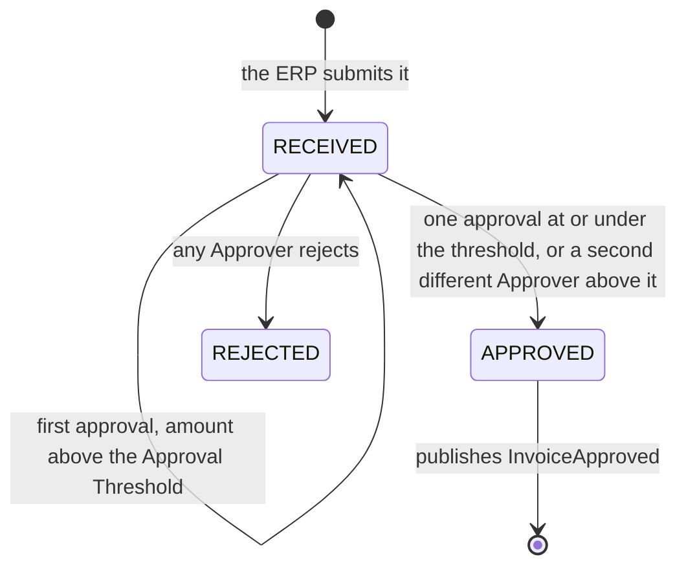

- The same Approver approving again changes nothing and returns the Invoice, so a retried approval is safe without an `Idempotency-Key`.
- A rejected Invoice takes no new decisions, a repeated rejection included, and neither does an approved one, whose Payment may be under way: both answer `409`.
- Each approval and rejection is a row in `payables.invoice_decision` (Approver's subject, user name, decision, time) and appears in the Invoice's `decisions`. That is M1's audit trail.
- The status change, the decision and the `InvoiceApproved` publication commit in one transaction.

## Core payment path

```mermaid
sequenceDiagram
  participant ERP as ERP (sim)
  participant PAY as payables
  participant LED as ledger
  participant CRD as cards + vault
  participant SUP as suppliers
  participant SPL as Supplier (sim)
  participant NET as Network (sim)
  participant SVC as authorization-service
  participant AUT as authorization
  participant CLR as clearing
  participant REC as reconciliation

  ERP->>PAY: POST /v1/invoices (Idempotency-Key)
  Note over PAY: Approvers approve the Invoice; the final approval publishes InvoiceApproved
  PAY->>LED: place Hold for the Invoice amount
  PAY->>CRD: issue Single-Use Card
  CRD-)SVC: CardIssued (Kafka cards topic)
  SVC-)PAY: CardOnFile (Kafka authorizations topic)
  PAY->>SUP: send Remittance Advice
  SUP-->>SPL: one-time card link
  SPL->>NET: charge card (through the Acquirer)
  NET->>SVC: Authorization request (gRPC)
  SVC->>SVC: check the card rules on its copy of the card
  SVC-->>NET: approve or decline, 99% within 100 ms
  SVC-)AUT: approved Authorization (Kafka authorizations topic)
  AUT->>CRD: card AUTHORIZED
  NET->>CLR: next day: Clearing File
  CLR->>LED: post the cleared amount
  CLR->>LED: post the file's Settlement to the Network
  CLR->>REC: cleared Charges
  Note over REC: anything unmatched becomes a Break
```

## Payment saga

`payables` orchestrates each Payment (ADR-0013). Every step is safe to repeat, and the Payment's state is saved after each one, so a crash resumes where it stopped.

| Step | Module | If it fails for good |
|---|---|---|
| 1. Place the Hold | `ledger` | The Payment fails; the Invoice stays approved and unpaid |
| 2. Issue the card and store its PAN | `cards`, `vault` | Release the Hold |
| 3. Send the Remittance Advice | `suppliers` | Cancel the card, release the Hold |

All three steps are built: the Hold (#17), the card (#18) and the Remittance Advice (#19). Between steps 2 and 3 the Payment waits, with no step due, until `authorization-service` has the card on file (#91, M5 design, "The gaps"), so a Supplier never receives a card the service would decline as unknown.

```mermaid
stateDiagram-v2
  [*] --> STARTED: InvoiceApproved (one Payment per Invoice)
  STARTED --> STARTED: technical error, retried after 10, 20, 40, 80 s
  STARTED --> HOLD_PLACED: Hold placed
  STARTED --> FAILED: not enough Available Credit, or the fifth technical error
  HOLD_PLACED --> HOLD_PLACED: technical error, retried after 10, 20, 40, 80 s
  HOLD_PLACED --> CARD_ISSUED: Single-Use Card issued
  HOLD_PLACED --> FAILED: the fifth technical error; the Hold is released
  CARD_ISSUED --> CARD_ON_FILE: CardOnFile from authorization-service (no time limit, no attempts)
  CARD_ISSUED --> EXPIRED: CardExpired while waiting; the Hold is released
  CARD_ON_FILE --> CARD_ON_FILE: technical error (no 2xx in time), retried after 10, 20, 40, 80 s
  CARD_ON_FILE --> COMPLETED: the Supplier answers the Remittance Advice with a 2xx
  CARD_ON_FILE --> FAILED: the fifth technical error; the card is cancelled if still ACTIVE and the Hold released
  CARD_ON_FILE --> EXPIRED: CardExpired (delivery still retrying); the retries stop and the Hold is released
  COMPLETED --> EXPIRED: CardExpired; the Hold is released
  COMPLETED --> [*]
  FAILED --> [*]
  EXPIRED --> [*]
```

- **The state row (ADR-0014):** each Payment is a row in `payables.payment` with its state, failure reason, failed attempts at the current step and the time its next step is due. `GET /v1/invoices/{invoiceId}` shows the state and any failure reason. A Payment that ends `FAILED` or `EXPIRED` records when (`ended_at`, #70), and `payables.InvoicePayments` lists them by UTC day for Reconciliation's unpaid-Invoice Breaks; it also answers which Invoice a card's Payment pays. Payments ended before the column existed count as ending when its migration ran.
- **Starting:** `PaymentSaga.start` is an `@ApplicationModuleListener` for `InvoiceApproved`. It runs asynchronously after the approval commits and inserts the Payment unless the Invoice already has one, so a redelivered event changes nothing.
- **The worker:** every second, `PaymentWorkerSchedule` runs `payables.payment-worker.threads` workers (4 by default) at once, each on its own virtual thread calling `PaymentSaga.runDueSteps`, and waits for all of them before the next pass (`payables.payment-worker.enabled=false` turns it off for tests that drive it by hand). Each worker claims due Payments one per transaction, with `select ... for update skip locked`, until none is due, so workers on other threads or instances skip Payments already claimed. Each worker holds one database connection at a time, so the thread count stays well under the connection pool's size. In that transaction it runs the step and saves the Payment's new state, so a crash rolls both back. A technical error rolls the transaction back too, and a new transaction counts the failed attempt unless another worker has moved the Payment on meanwhile.
- **Placing a Hold (`ledger.Holds`):** locks the Buyer's Credit Line row, returns the existing Hold if one has the Payment's ID, sums the open Holds in a separate statement, and inserts the Hold only if the amount fits in Available Credit. A Buyer without a Credit Line has no credit. Holds live in `ledger.hold`; a released Hold keeps its row, marked `RELEASED` with its release time, and placing it again checks Available Credit afresh.
- **Issuing the card (`cards.Cards`):** returns the Payment's card if it has one; otherwise draws a Card Token, has `vault` generate and store the PAN, and stores the card in `cards.card`, locked to the Invoice's Supplier and amount and valid for 30 days. Placing the Hold makes this step due at once.
- **Waiting for the card to be on file (#91):** issuing the card leaves the Payment `CARD_ISSUED` with no step due (`next_attempt_at` null), so the worker passes it by. `CardOnFileListener` reads `CardOnFile` from the `authorizations` topic (see [The authorizations topic](#the-authorizations-topic)) and calls `PaymentSaga.cardOnFile`, which, in one transaction, finds the card's Payment through `cards`, locks it as the worker does, and moves a `CARD_ISSUED` Payment to `CARD_ON_FILE` with delivery due at once. Any other state stays as it is, so a repeated event, or one for a Payment that has expired, changes nothing; a Card Token the platform never issued is logged and skipped. The wait has no time limit and counts no attempts: a short Kafka or service outage must not fail real Payments (M5 design, rejected options), and the card's 30-day expiry ends a wait that never resolves ([Card expiry](#card-expiry)). The Payment records when it reached `CARD_ISSUED` (`card_issued_at`), and `WaitingPaymentsMetric` reports how many wait and how long the oldest has.
- **Delivering the Remittance Advice (`suppliers.RemittanceAdvices`):** records the advice and POSTs it to the Supplier's remittance address (see [Remittance Advice](#remittance-advice)); a 2xx answer completes the Payment. The card on file makes this step due at once; with the service and Kafka up it arrives within a second of the card's issue (the e2e test's run: 0.4 s).
- **Compensation:** the transaction that records a step's fifth technical error also undoes the steps before it, so Available Credit comes back as the Payment becomes `FAILED`. A `CARD_ISSUED` Payment runs no step, so none fails while it waits. Card issuance failing for good releases the Hold (`Holds.release`, which marks it `RELEASED` and is harmless to repeat). Delivery failing for good cancels the card (`Cards.cancel`, status `CANCELLED`, harmless to repeat), so its link shows nothing, and releases the Hold. `cancel` is one conditional update that moves only an `ACTIVE` card: a card the Supplier already charged stays `AUTHORIZED`, and the Hold is released all the same.
- **Available Credit** is the Credit Line minus the Buyer Receivable (what the Buyer owes for cleared Charges, from the journal) minus open Holds, read in one statement. It is negative when Issuer staff lower a Credit Line below what is owed and held, and no new Hold is placed until Available Credit covers its amount again.
- **What to do when a Payment is stuck:** [`runbooks/payment-stuck.md`](runbooks/payment-stuck.md). How the saga and the worker work: [`learning/sagas.md`](learning/sagas.md).

## Cards and the vault

A Single-Use Card's data is split between two modules so the PAN lives in exactly one place (ADR-0004):

| | `cards.card` | `vault.card_secret` |
|---|---|---|
| Key | Card Token: 16 random bytes, base64url | the same Card Token |
| Stores | Payment (unique), Buyer, Supplier and amount the card is locked to, last four digits, issue and expiry times, when it was authorized, status (`ACTIVE`; `AUTHORIZED` once a Charge on it is approved, `ACTIVE` again if the Network reverses that Authorization; `CANCELLED` when its Remittance Advice couldn't be delivered while it was `ACTIVE`; `EXPIRED` when nobody charged it within 30 days, or its Charge didn't clear within 7 days of its Authorization; `CLEARED` once the Network's Clearing File posts a Charge on it, from any status) | the PAN and the security code, each AES-256-GCM-encrypted under a fresh nonce with the Card Token as associated data; the PAN's HMAC-SHA-256 hash, unique |
| Read by | `payables` (the Invoice shows Card Token, last four digits, expiry); `suppliers` (status and expiry, when a link is opened); `authorization` (moves the card on an approved Authorization or its Reversal; the cards the 7-day rule expired, for Reconciliation); `clearing` (Buyer, Payment and currency, to post a Clearing and clear its Hold) | `suppliers`, when a Supplier opens its link: the PAN and security code, decrypted, never stored outside the vault; `clearing`: the Card Token for a Clearing File record's PAN |

- **PANs** are synthetic: 16 digits, `990000` followed by nine random digits and a Luhn check digit. A PAN whose hash another card already has is drawn again.
- **Keys:** two separate 256-bit keys, one to encrypt and one to hash, come from `vault.encryption-key` and `vault.hash-key` (`VAULT_ENCRYPTION_KEY` and `VAULT_HASH_KEY` in `.env`, written by `scripts/init-env.sh`). The platform doesn't start when either is missing or isn't 32 bytes ([`runbooks/vault-key-invalid.md`](runbooks/vault-key-invalid.md)). M7 replaces them with envelope encryption.
- **How it works and why:** [`learning/card-vault.md`](learning/card-vault.md).

## Card expiry

A Single-Use Card nobody charged before its expiry, 30 days after issuance, returns its credit to the Buyer (ADR-0011). So does an `AUTHORIZED` card with no Clearing 7 days after its Authorization: by then the Charge isn't coming (M3 design, [The 7-day rule](design/m3-clearing-and-settlement.md#the-7-day-rule-q10)).

```mermaid
sequenceDiagram
  participant JOB as cards: expiry job
  participant PAY as payables
  participant LED as ledger

  Note over JOB: every minute, 100 cards per transaction
  JOB->>JOB: ACTIVE cards past their expiry, and AUTHORIZED cards 7 days after their Authorization, become EXPIRED (for update skip locked)
  JOB-)PAY: CardExpired, one per card (event publication registry)
  PAY->>PAY: lock the Payment; COMPLETED, CARD_ON_FILE or CARD_ISSUED becomes EXPIRED
  PAY->>LED: Holds.release(Payment ID)
```

- **The job (`cards.CardExpiry`):** `CardExpirySchedule` runs it every minute (`cards.expiry-job.enabled=false` turns it off for tests that run it by hand). Each batch claims up to 100 cards, each kind with one `update ... where card_token in (select ... for update skip locked) returning ...`: first `ACTIVE` cards whose `expires_at` has come, then, in what is left of the batch, `AUTHORIZED` cards whose `authorized_at` is 7 days or more ago (`SingleUseCards.CLEARING_WINDOW`). It publishes a `CardExpired` for each, in the same transaction: a stop mid-run leaves each card as it was for the next run, or `EXPIRED` with its event in the registry. Cards in any other status are left alone; an index on `expires_at` covers only `ACTIVE` cards, and one on `authorized_at` only `AUTHORIZED` cards.
- **The 7 days (`authorized_at`):** `Cards.authorize` records the Authorization's time as it moves the card to `AUTHORIZED`, and `Cards.reverse` clears it as the card goes back to `ACTIVE`, so a reversed card waits for its own expiry and a second Charge starts a new 7 days.
- **When it expired (`expired_at`, #70):** the job records its `now` on each card it expires. A card with `authorized_at` set expired by the 7-day rule, whatever its status since (a late Clearing moves it to `CLEARED`); `Cards.expiredUnclearedOn(day)` lists them by UTC day, through an index on `expired_at` covering only those, for Reconciliation's never-cleared Breaks. Cards expired before the column existed count as expiring when its migration ran.
- **The listener (`PaymentSaga.expire`):** in one transaction, it locks the Payment (waiting for a worker that is running its step), moves a `COMPLETED` Payment, a `CARD_ON_FILE` one still retrying its delivery, or a `CARD_ISSUED` one still waiting for its card to be on file, to `EXPIRED` with no step left, and releases the Hold through `ledger.Holds`. `payables`, not `cards`, releases the Hold because it owns the Hold's lifecycle in the saga, and `cards` needs no dependency on `ledger`. Another state stays as it is, but the Hold is still released.
- **Exactly once:** the registry may deliver `CardExpired` again; a second delivery finds the Payment `EXPIRED` and the Hold `RELEASED`, and changes nothing. Re-paying the Invoice is out of scope; it stays `APPROVED`.
- **When cards stay `ACTIVE` past their expiry, or `AUTHORIZED` past their 7 days:** [`runbooks/payment-stuck.md`](runbooks/payment-stuck.md#a-card-stays-active-past-its-expiry-or-authorized-past-its-7-days).

## The cards topic

M5's `authorization-service` keeps its own copy of the cards it may authorize (ADR-0016), fed by the platform's events on the `cards` topic.

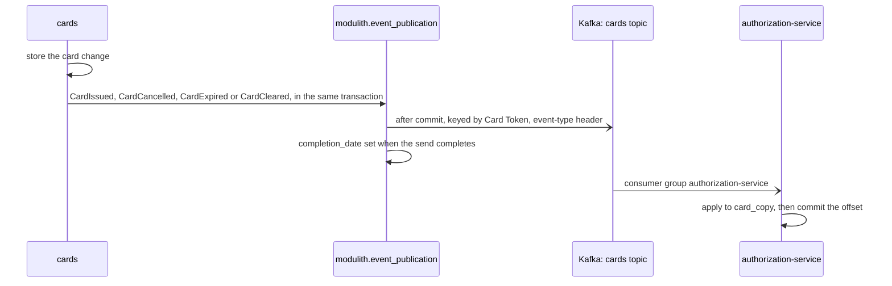

- **What is published:** `CardIssued` when `Cards.issueSingleUse` creates a card (issuing again for a Payment that has one publishes nothing), `CardCancelled` when an `ACTIVE` card is cancelled, `CardExpired` from the expiry job, which already published it in-process, and `CardCleared` when a Clearing moves a card to `CLEARED` (#101). `Cards.clear` reads the status it replaced (PostgreSQL 18's `RETURNING old.status`), so only the Clearing that clears the card publishes: once per card, whatever its status before.
- **`CardIssued` carries what the service needs and nothing secret:** Card Token, the PAN's and security code's keyed hashes (HMAC-SHA-256 under `vault.hash-key`, base64-encoded), expiry, amount in minor units with its currency, and the Supplier's Acceptor ID. The saga reads the Acceptor ID from `suppliers` and passes it into issuance, because `cards` can't call `suppliers` (Spring Modulith forbids the cycle); it is copied at issuance, so a Supplier that changes Acquirer later is declined. The service holds the same hash key and hashes each request's PAN and security code in memory to compare.
- **`CardCancelled`** and **`CardCleared`** name the Card Token, so the service refuses Charges on the card; `CardExpired` is the existing in-process event, now externalized too.
- **Routing:** topic `cards` with 3 partitions, keyed by Card Token so one card's events stay in the order they reached the topic; the value is JSON and the `event-type` header names `CardIssued`, `CardCancelled`, `CardExpired` or `CardCleared`. Externalization is serialized, one send at a time, but each event is sent from its own thread after its commit, so the platform may send one card's events out of the order it published them: consumers must be order-tolerant.
- **Outbox:** Spring Modulith's publication registry row is the outbox; the send sets its `completion_date`. A failed send or a stopped platform leaves it incomplete, and `EventResubmissionSchedule` sends every publication still incomplete after a minute again, once a minute (`IncompleteEventPublications.resubmitIncompletePublicationsOlderThan`; `platform.event-resubmission.enabled=false` turns it off for tests), as `spring.modulith.events.republish-outstanding-events-on-restart=true` does at each start. Without it, a `CardIssued` Kafka refused while down would wait for a restart, and its Payment for the card to be on file until the card expired. Kafka delivers at least once, so a consumer keys its write on the Card Token and event type.
- **Tests:** `CardEventsTests` runs PostgreSQL and Kafka in Testcontainers and reads each event back from the topic, checking the key, header, payload and publication row. Externalization is off in every other test context.
- **Contract:** Pact message pacts, one per event and one more for a `CardIssued` without an Acceptor ID (`null`, when no Invoice gave the Supplier one), in `pacts/authorization-service-platform.json` (no Pact Broker). `authorization-service`'s `CardEventsPactTests` writes them, saying only what the service reads, and reads each through the service's own reader; the platform's `CardEventsPactVerificationTests` issues, cancels, expires and clears a real card, reads each event back from Kafka and checks its value and headers against them. The reactor builds `authorization-service` before the platform, so a full build verifies the pacts it just wrote. Each side keeps its own Java records ([`learning/pact.md`](learning/pact.md)).
- **How it works and why:** [`learning/kafka.md`](learning/kafka.md). When the broker is down or events stop arriving: [`runbooks/kafka-down.md`](runbooks/kafka-down.md).

## The authorizations topic

`authorization-service` tells the platform what it did on the `authorizations` topic (M5 design, "Events and contracts"): every approved Authorization, every Reversal of one, and each card it now holds. The platform's `payables` reads `CardOnFile` (#91); its `authorization` module reads the approved and reversed Authorizations into the platform's copy (#92).

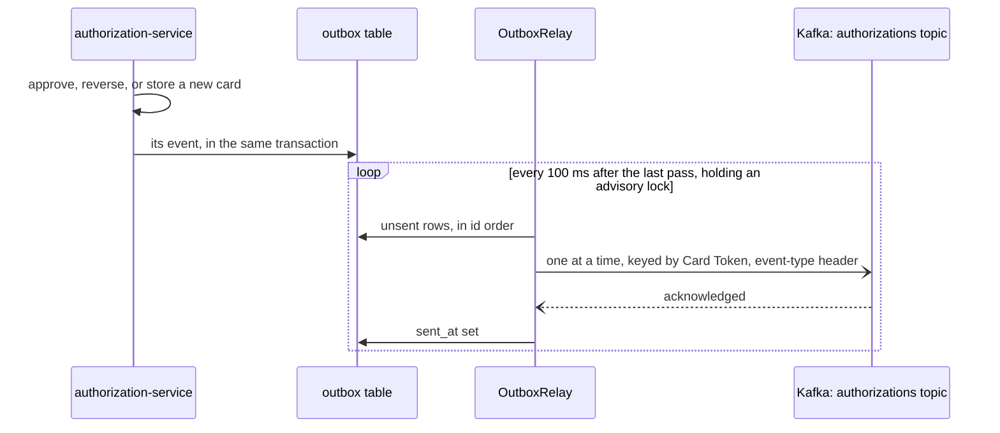

- **What is published:** `AuthorizationApproved` when an approved Authorization moves its card to `AUTHORIZED`, `AuthorizationReversed` when a Reversal reverses an approved Authorization (only the first; the Reversal of a declined Authorization, one before its Authorization and a repeat publish nothing), and `CardOnFile` when a `CardIssued` first stores a card (not for a card that ended before its `CardIssued` arrived, nor for a repeat). A decline publishes nothing.
- **Payloads** (JSON, the service's own records, no shared classes): both Authorization events carry `requestId` (DE 37), `cardToken`, `amountMinorUnits` and `currency` (DE 4 and 49, as the Network sent them), `authorizationCode` (DE 38) and `acceptorId` (DE 42); a Reversal's are those of the approved Authorization it reverses. `CardOnFile` carries `cardToken`. No PAN or security code.
- **Routing:** topic `authorizations`, 3 partitions (`OutboxConfiguration`'s `NewTopic`), keyed by Card Token, the `event-type` header naming the event: the `cards` topic's conventions.
- **Outbox:** `Outbox.append` inserts the event into the service's `outbox` table in the caller's R2DBC transaction, so it commits with the change or not at all, in the same commit flush. Each event is written after the change took the card's lock, so one card's events get ids (an identity column, not a timestamp) in the order their transactions commit.
- **Relay:** `OutboxRelaySchedule` runs a pass on Spring's scheduler thread, off the hot path, 100 ms after the last one ended, calling `OutboxRelay` through its transactional proxy (`outbox.relay.enabled=false` turns the schedule off for tests that run passes by hand). Each pass is one R2DBC transaction on one pooled connection, held until it commits: it takes the advisory lock `pg_try_advisory_xact_lock(hashtext('outbox-relay'))` or does nothing, so one relay runs at a time across every instance, and the lock lasts until the pass commits; reads up to 500 unsent rows in id order; sends them one at a time, waiting for each acknowledgement before the next (`linger.ms=0`, since nothing waits to be batched); and sets each row's `sent_at`, all committing together at the end of the pass. The first failed send ends the pass, which commits the rows sent before it; the rest wait for the next pass, so a card's events never overtake each other. Short producer timeouts (`max.block.ms` and `delivery.timeout.ms` of 5 s) make a send to an unreachable Kafka fail within seconds, so a pass never holds its connection long. `FOR UPDATE SKIP LOCKED` was rejected: two instances would send disjoint batches at once, and one card's events out of order.
- **At least once:** a crash between the commit and the send leaves the row unsent, and the next pass sends it. A crash in the middle of a pass rolls back every `sent_at` that pass set, so the next pass sends again, unchanged, every row the crashed pass had already sent. The platform's consumer must therefore key its write on each event's natural ID: the request ID and event type for `AuthorizationApproved` and `AuthorizationReversed` (the two share a request ID), and the Card Token for `CardOnFile`.
- **Sent rows stay** in the table, with `sent_at`; a partial index on unsent rows keeps the relay's read small.
- **Trace context (#96):** each row keeps the W3C `traceparent` of the trace it was written in (`trace_parent`, migration `V6`): the Network's call for an Authorization or Reversal, the `cards` message's for `CardOnFile`. The relay reads it back as a consumer reads a message's header, as the parent of an `outbox relay` span, and sends inside it, so Spring Kafka's template observation (`spring.kafka.template.observation-enabled`) writes the same trace into the message's `traceparent` header, and the platform's listener observation continues it. A row written with no trace current has none, and its send starts a trace of its own. A relay pass itself makes no trace: an `ObservationPredicate` in `OutboxConfiguration` drops the schedule's task observation, which would otherwise be ten traces a second in Tempo.
- **The platform's consumers: one consumer group per module.** Each module that needs the topic reads all of it with its own `@KafkaListener` in its own consumer group and ignores the event types it doesn't use: `payables` in `platform-payables` (`CardOnFileListener`, #91), which takes only `CardOnFile`, and `authorization` in `platform-authorization` (`AuthorizationEventsListener`, #92), which takes only `AuthorizationApproved` and `AuthorizationReversed`. Two listeners in one group would split the topic's partitions between them, each seeing only some cards' events, so one group would need a single listener dispatching to both modules, owned by one of them; separate groups keep each module's listener, offsets and failures its own (a stuck message holds back only that module's partition), at the cost of reading each message once per module. The lag check (#94, below) reads the group whose lag matters to Clearing, `platform-authorization`.
- **Consumer settings** (`application.properties`, `KafkaConsumerConfiguration`, as the service's): a new group reads from the topic's start; values are read as JSON text (Spring Modulith's Kafka support would default the consumer to bytes); the offset is committed only after the listener's transaction commits, so a crash redelivers. A failure that may pass, such as the database being down, is retried with a pause growing from 1 to 30 s and no limit; a message that can never be read, malformed JSON, one without a `cardToken`, one with no value or no `event-type` header, is logged by partition and offset and skipped. The platform declares the topic too (3 partitions), so whichever app starts first creates it before any listener subscribes (the service declares `cards` the same way): a listener subscribing to a missing topic has the broker create it with one partition, and stays on that partition for minutes after the owner adds the other two. Test contexts leave the listeners off (`spring.kafka.listener.auto-startup=false`) unless they run a broker.
- **The platform's Authorization Copy** (`authorization.Authorizations`, #92): each event is applied in one transaction with its card's move through `cards`, in the existing `"authorization".authorizations` table (every row's response code `00`). `AuthorizationApproved` inserts the row `APPROVED`, `on conflict (request_id) do nothing`, and then `cards.Cards.authorize` moves the card from `ACTIVE` to `AUTHORIZED`; a card `EXPIRED`, `CANCELLED` or `CLEARED` meanwhile stays as it is, and its Clearing still finds the Authorization. `AuthorizationReversed` moves the row from `APPROVED` to `REVERSED`, then `cards.Cards.reverse` moves the card from `AUTHORIZED` back to `ACTIVE`; a `CLEARED` card stays `CLEARED`. The same event again changes nothing. A Reversal read before its approved Authorization is stored `REVERSED`, so the late approved one changes nothing; it can't happen in practice, since the service writes both through its outbox in commit order, keyed by Card Token, onto one partition. The card's `authorized_at`, from which its 7 days to clear count, is the Kafka record's timestamp: when the service's relay sent the event, not when the platform read it. `ApprovedAuthorizations` keeps its interface, so `clearing` and `reconciliation` read the copy as they read the platform's own answers before.
- **The Clearing import waits for the copy** (#94, M5 design, "The gaps"): before a Clearing File's import starts, `clearing` asks `authorization.AuthorizationCopyFreshness.caughtUp()`. `AuthorizationCopyLag` answers it with one Kafka `Admin` client, built from Spring Kafka's `KafkaAdmin` settings: the `authorizations` topic's partitions, each one's end offset (`listOffsets` with `OffsetSpec.latest()`), and the offsets `platform-authorization` committed (`listConsumerGroupOffsets`); a partition the group never committed on counts from its first retained offset (`OffsetSpec.earliest()`), where the group would start. Each partition is checked on its own, so one can't offset another's lag. Any lag, or any call that fails or passes its 5-second timeout (`default.api.timeout.ms`, `request.timeout.ms`), answers no, and the reason is logged. The file then stays where it is, untouched: not moved to `processing/`, not recorded, nothing posted. The import logs `Clearing File … waits` and the next drop-folder check, 30 s later, tries it again; `POST /v1/clearing-files` answers `503`. A restart of a stopped import, its file already in `processing/`, waits the same way: the request answers `503`, the file stays in `processing/`, and since only a request restarts a stopped import (M3), it must be sent again once the copy has caught up. With no lag the import runs as in M3. The check can't see events still in the service's outbox, so zero lag doesn't prove the copy complete ([`runbooks/kafka-down.md`](runbooks/kafka-down.md)). The wait can't be turned off: test contexts without a broker import `CaughtUpAuthorizationCopy`, a `@Primary` stand-in that always answers yes. Kafka details stay in `authorization`, which owns the copy and its consumer group; `clearing` sees only a yes or no.
- **Tests:** `OutboxRelayTests` runs relay passes by hand on PostgreSQL and Kafka in Testcontainers, with a `KafkaTemplate` that fails the sends a test picks: the topic's 3 partitions, an event's key, header and JSON, a pass that stops at a failed send and the next one that sends the rest in order, a lost acknowledgement whose event is sent again unchanged, a pass that sends nothing while another relay holds the lock, and the scheduled pass still holding the lock while it sends. `NetworkLinkTests` and `CardsTopicTests` read each event back from the topic with the scheduled relay running (`AuthorizationsTopic`). The platform's `AuthorizationCopyTests` sends each event to a real Kafka in Testcontainers as the relay does and reads the copy and the card back: approved, then reversed; both again, changing nothing; an approved Authorization on an `EXPIRED` card, stored with the card left `EXPIRED`; a late Reversal of a `CLEARED` card, left `CLEARED`; a Reversal before its approved Authorization; and an unreadable message skipped with the next event behind it still arriving. `ClearingFileWaitsForAuthorizationCopyTests` runs the import with the platform's listeners on a real Kafka, stopping and starting the copy's listener container through `KafkaListenerEndpointRegistry`: with one event unread, the drop-folder check leaves the file in the drop folder byte for byte, unrecorded, and logs the wait; once the listener has read the event, the next check imports it. A restart request for a file left in `processing/` by a stopped import answers `503` while the copy lags, the drop-folder check leaves the file there, and the same request sent again once the copy has caught up answers `201`. With Kafka paused, the drop-folder check leaves the file and `POST /v1/clearing-files` answers `503` Problem Details within seconds. `AuthorizationCopyLagTests` unit-tests the lag per partition: committed at the end, behind it, never committed (counted from the first retained offset), and one partition committed past its end beside one that lags.
- **Contract:** Pact message pacts in `pacts/platform-authorization-service.json`, the reverse of [the cards topic's](#the-cards-topic): the platform is the consumer. `AuthorizationEventsPactTests` (`AuthorizationApproved`, `AuthorizationReversed`) and `payables`' `CardOnFilePactTests` write them, each handing the pact's message to the module's real listener with its collaborator mocked. `authorization-service`'s `AuthorizationEventsPactVerificationTests` produces the real events, a `CardIssued` on `cards`, then the service's own approved Authorization and its Reversal, reads them from Kafka and checks them against the pacts. The reactor builds the service before the platform, as each app consumes the other's topic, so the service verifies the pact file as committed, and the platform's build then rewrites it; CI's step "Check the committed pacts are current" fails the run when `./mvnw verify` leaves `pacts/` changed, so a stale committed pact can't pass ([`learning/pact.md`](learning/pact.md)).
- **How it works and why:** [`learning/kafka.md`](learning/kafka.md#the-services-outbox-90). When events stop arriving: [`runbooks/kafka-down.md`](runbooks/kafka-down.md#the-services-outbox).

## Remittance Advice

The saga's third step tells the Supplier which Invoice is paid and hands it the Single-Use Card, through a link that shows the card's details once.

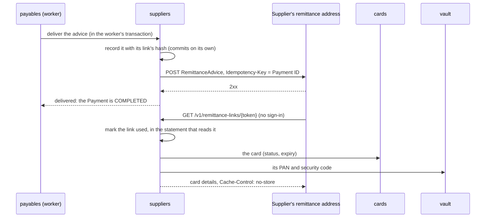

| | `suppliers.remittance_advice` |
|---|---|
| Key | the Payment's ID: one advice per Payment |
| Stores | the Invoice's ID and number, the Supplier, the amount, the Card Token; the SHA-256 of the link's token (unique); the link's expiry, 7 days after the first attempt, and when it was used |
| Never stores | the link's token, the PAN or the security code |

- **The link's token** is HMAC-SHA-256 of the Payment's ID under `remittance.link-key` (`REMITTANCE_LINK_KEY` in `.env`, written by `scripts/init-env.sh`), base64url-encoded: 256 bits nobody can work out without the key, and the same on every delivery attempt, so a retry after a crash sends the link the Supplier may already hold. The platform doesn't start without the key. The link is `platform.public-url` + `/v1/remittance-links/{token}`.
- **Delivery** records the advice in a transaction of its own before the POST, so the link works the moment the Supplier receives it; a second attempt finds the record and sends the same advice. The POST goes through Spring's `RestClient` (2-second connect and 5-second read timeouts, no redirects). Anything but a 2xx is a technical error for the saga to retry; the error names only the status, never the Supplier's answer.
- **Opening** a link hashes the token and runs one `update ... returning` that sets `link_used_at` only if it is unset and the link hasn't expired, so of two opens at once exactly one shows the card. A token with no record answers `404`; a used or expired link, or one whose card is neither `ACTIVE` nor `AUTHORIZED`, `410`, and a link that shows nothing isn't marked used. The card check is an allow-list, so a status added later refuses the link until someone decides otherwise. The PAN and security code come from `vault` for that answer only. Nothing logs the token, the PAN or the security code, and traces record a link request by its route (`RequestObservations`), not its URL.
- **The Supplier's address** is the remittance address on the first Invoice naming its tax ID (see Invoice intake in the M1 design). The simulator plays the Supplier Globex at `http://localhost:8081/globex/remittance-advice`: it drops repeated advice by `Idempotency-Key`, opens each link once, and logs only the last four digits.
- **How it works and why:** [`learning/one-time-links.md`](learning/one-time-links.md). When delivery keeps failing: [`runbooks/payment-stuck.md`](runbooks/payment-stuck.md).

## The Network link

The Network asks `authorization-service` to approve each Charge over gRPC (ADR-0006, ADR-0016), signed in as the Keycloak client `network`. From M2 until the cutover (#92) the platform's `authorization` module answered, against `vault`, `cards` and `suppliers`; the service gives the same answers from its own copy of the cards ([authorization-service](#authorization-service)), and the platform keeps a copy of the approved ones ([The authorizations topic](#the-authorizations-topic)). The contract is `contracts/src/main/proto/issuer_authorization.proto`: the `IssuerAuthorization` service with `Authorize` and `Reverse`, its fields named after the ISO 8583 data elements they stand for (the PAN is DE 2, the request ID DE 37, the response code DE 39).

```mermaid
sequenceDiagram
  participant NET as Network (sim)
  participant SEC as gRPC security
  participant SVC as authorization-service
  participant CPY as card_copy
  participant AUT as authorizations
  participant OBX as outbox

  NET->>SEC: Authorize(PAN, amount, request ID, Acceptor ID, …)<br/>metadata authorization: Bearer <network token>
  SEC->>SEC: the token checked like the platform's REST; ROLE_network required
  SEC->>SVC: the request
  SVC->>SVC: hash the PAN under vault.hash-key, in memory
  SVC->>CPY: findByPanHash
  CPY-->>SVC: status, expiry, amount, Acceptor ID, security code's hash (or none)
  SVC->>SVC: AuthorizationRules: the response code
  SVC->>AUT: claim the request ID: insert the answer, on conflict do nothing<br/>(already answered: return that answer, change nothing)
  SVC->>CPY: approved: ACTIVE to AUTHORIZED, one conditional update
  SVC->>OBX: approved: AuthorizationApproved, in the same transaction
  SVC-->>NET: 00 and an authorization code, or a decline code
```

- **Serving:** `authorization-service`'s Netty gRPC server on `127.0.0.1:9090` (`spring.grpc.server.address` and `.port`), beside its WebFlux port, plaintext until mutual TLS in M7. The platform served on the same address until #92, so the simulator's Network and the load test call it unchanged; the platform runs no gRPC server now. Tests give each context's server a free port.
- **Signing in:** the Network's token travels in the `authorization` metadata header. Spring gRPC's `GrpcSecurity` (the service's `SecurityConfig`) checks it with the same issuer and `roles` claim as the platform's REST, and every call needs `ROLE_network`, the reflection and health services the starter adds included. No token or a bad one answers `UNAUTHENTICATED`; another client's token, `PERMISSION_DENIED`.
- **Answering**, in one R2DBC transaction: the service hashes the request's PAN under `vault.hash-key` in memory and finds the card's copy by the hash (`CardCopies.findByPanHash`), and compares the security code's hash with the card's in constant time (`CardHashing.matches`). `AuthorizationRules` turns those facts into a response code, in the design's order, the first rule that fails winning: a zero or negative amount `13`; no card has the PAN `14`; the card `CANCELLED` or `EXPIRED`, or the request's expiry (DE 14, `YYMM`) not the card's expiry month in UTC, or the expiry passed `54`; a wrong security code `N7`; the request's Acceptor ID (DE 42) not exactly the Supplier's, copied at issuance, or the card was copied with none, `57` (not permitted); an amount above the card's or another currency, compared as sent, `61`; the card already `AUTHORIZED` `57`. An approval answers `00` with a random six-character authorization code (`SecureRandom`), moves the card's copy from `ACTIVE` to `AUTHORIZED` in one conditional update and writes `AuthorizationApproved` to the outbox; if a Charge with another request ID moved it first, the answer becomes `57`. There is no credit check, and no answer touches the Hold placed at issuance (ADR-0011). A request without a retrieval reference number is refused with `INVALID_ARGUMENT` and recorded nowhere. How the message and its codes work: [`learning/authorization-message.md`](learning/authorization-message.md).
- **A resent request** (the same retrieval reference number) gets the answer recorded the first time, whatever the rules would say now, and changes nothing. The answer is recorded with `insert … on conflict (request_id) do nothing` before the card moves: a resend that arrives while the first is still running waits on that insert, then finds the first answer, so one request ID records one Authorization and moves the card at most once.
- **A Reversal** (`Reverse`, naming the request ID to cancel) is acknowledged with `00` whatever it changes, in one transaction, and never touches the Hold. It first claims the request ID the way an Authorization does, with `insert … on conflict (request_id) do nothing`: a row with status `REVERSED`, response code `05` (do not honour) and no Card Token. If that insert wins, the service had no Authorization for the request ID: the Network gave up while it was still running, and its own insert, when it gets there, finds the request ID taken and returns the stored `05` without moving the card. If the insert finds a row, that row has committed, an Authorization's or an earlier Reversal's (one still running makes the insert wait for it): one conditional update moves it from `APPROVED` to `REVERSED`, another moves its card's copy from `AUTHORIZED` back to `ACTIVE`, so the card can be charged again, and `AuthorizationReversed` goes to the outbox. A declined or already reversed Authorization stays as it is, so repeating a Reversal changes nothing more, and reversing an old Authorization again never frees the card for a newer one's Charge. An approved Authorization that is reversed keeps its `00` and authorization code, so a resend of it gets them back like any resend. A Reversal without a retrieval reference number is refused with `INVALID_ARGUMENT` and recorded nowhere.
- **When the database is slow or down** (#93): every Authorization goes through a Resilience4j time limiter and circuit breaker, both named `authorization-database` in `application.properties`. An Authorization not answered within 500 ms, or any database error, answers `91` (Issuer unavailable) instead of letting the Network's 1-second deadline pass, so the Network sends no Reversal. Once half of the last 20 Authorizations failed (from the 10th), the breaker opens and answers `91` at once without touching the database. After 5 seconds it lets 3 through, and closes if they succeed, with no restart. A `91` leaves no approval standing. The time limit cancels the Authorization's transaction, which rolls back unless its commit was already under way. So after every `91` that reached the database, the service sends itself the Reversal the Network won't: it calls its own Reversal path for the request ID in the background, retried with a pause doubling from 100 ms to 5 s, for up to 10 minutes (`authorization.self-reversal.*`). That reverses an approval whose commit went through, or claims the request ID as reversed (`05`) if nothing committed. Given up, it logs the request ID at `ERROR`; it is held in memory, so a crash loses it (the runbook covers both). A Reversal from the Network gets the same time limit but no breaker: while the database is down it fails quickly, and the Network resends it. Connections come from an R2DBC pool (`r2dbc-pool`, 10 connections by default) whose `max-acquire-time` is 250 ms, so no call waits past its limit for one. How it works: [`learning/resilience4j.md`](learning/resilience4j.md).
- **The Supplier's Acceptor ID** comes from the Buyer's ERP: the Invoice's Supplier block may carry an `acceptorId`, and the first Invoice that carries one sets it on the Supplier (`suppliers.supplier.acceptor_id`); the platform copies it into each card's `CardIssued` ([The cards topic](#the-cards-topic)). Like the remittance address, a different one on a later Invoice is ignored, so no Buyer's ERP can redirect a Supplier's Charges once it has one.
- **The record:** every answer is a row in the service's `authorizations` table (the columns of the platform's `"authorization".authorizations`, which now holds only the copy): the request ID (DE 37, primary key), the Card Token (null for an unknown PAN), amount and currency as sent (a code that isn't ISO 4217 too), Acceptor ID, response code, authorization code (approvals only), status (`APPROVED`, `DECLINED`, or `REVERSED` once the Network reverses it) and time. A Reversal that came first leaves a row with only the request ID, response code `05` and status `REVERSED`; a `CHECK` keeps the amount, currency and Acceptor ID required on every other row. Never a PAN, security code or expiry. The platform's schema name is a reserved word in PostgreSQL, so its SQL quotes it.
- **The PAN stays in the vault (ADR-0004):** the service holds the PAN and security code in memory only, long enough to hash them, and the platform's copy has only Card Tokens. Nothing logs a request (a protobuf message's `toString` prints every field) or puts a request field in an exception message; the one log line per answer names its request ID and response code. Traces record the RPC's full method name, its status and the caller's address and port (Micrometer's gRPC observation), never message fields or metadata.
- **How it works and why:** [`learning/grpc.md`](learning/grpc.md). When the Network's calls are refused: [`runbooks/keycloak-unavailable.md`](runbooks/keycloak-unavailable.md); when every Charge answers `14`, or fails `UNKNOWN`: [`runbooks/vault-key-invalid.md`](runbooks/vault-key-invalid.md); when a Supplier's Charges answer `57`: [`runbooks/supplier-charges-declined.md`](runbooks/supplier-charges-declined.md); when Reversals arrive and Authorizations answer `05`: [`runbooks/network-cant-reach-platform.md`](runbooks/network-cant-reach-platform.md#the-service-answers-too-slowly); when the service answers `91` itself: [`runbooks/authorization-service-database-down.md`](runbooks/authorization-service-database-down.md).

## Clearing

The Network sends the Issuer its Clearings in a Clearing File (M3 design, [The Clearing File](design/m3-clearing-and-settlement.md#the-clearing-file-q1-q8)). `clearing` imports each file with a Spring Batch job, posts every Clearing to `ledger`'s double-entry journal, because the Issuer pays what clears, records how each matched its card's Authorization, and settles the file with the Network at the Network's figure.

```mermaid
sequenceDiagram
  participant NET as Network (drop folder)
  participant IMP as clearing: import
  participant JOB as Spring Batch job
  participant VLT as vault
  participant CRD as cards
  participant AUT as authorization
  participant LED as ledger

  NET->>IMP: a file in the drop folder (checked every 30 s, or POST /v1/clearing-files)
  IMP->>AUT: AuthorizationCopyFreshness.caughtUp(): any lag on the authorizations topic?
  Note over IMP,AUT: lag, or Kafka unreachable: the file stays in the drop folder for the next check (POST answers 503)
  IMP->>IMP: move it into processing/ (one atomic rename); read its header: the file ID
  IMP->>IMP: its file ID or content hash an imported file's? a repeat: move it to failed/
  JOB->>JOB: validate: header, every record and trailer parse, the trailer's totals match, its currency USD; the file recorded IMPORTING
  Note over IMP,JOB: a failed check: the file recorded REFUSED, moved to failed/
  loop import: each chunk of 100 Clearings, one transaction
    JOB->>VLT: cardFor(PAN)
    JOB->>CRD: find(Card Token)
    JOB->>AUT: find(Card Token, authorization code)
    opt the vault knows the card
      JOB->>CRD: clear: CLEARED, whatever its status
      JOB->>LED: isReleased(Hold), locking it; clear it if still open
    end
    JOB->>JOB: decide the outcome: the first case that applies
    alt unknown card, or another currency than the card's
      JOB->>LED: postClearingToSuspense: debit Clearing Suspense, credit Network Settlement Payable
    else every other outcome
      JOB->>LED: postClearing: debit Buyer Receivable, credit Network Settlement Payable
    end
    JOB->>JOB: record the Clearing with its outcome; already recorded? skipped, its posting the first one's
    JOB->>JOB: count the chunk's skipped records; save the reader's position
  end
  JOB->>JOB: settle: total the file's posted Clearings; read the trailer's net settlement amount
  JOB->>LED: postSettlement: debit Network Settlement Payable, credit Issuer Cash, by the trailer's figure
  JOB->>JOB: record the Settlement, matched or not
  JOB->>JOB: complete: the file IMPORTED
  IMP->>IMP: delete the file
```

- **The file:** fixed-width text, 120 characters a record: a header `90` (file ID, the Network's sequence number, Business Date), one detail record `05` per Clearing (Network record ID, PAN (DE 2), amount (DE 4) and currency (DE 49), retrieval reference number (DE 37), authorization code (DE 38), Acceptor ID (DE 42), Charge date), and a trailer `92` (record count, amount total, net settlement amount, currency). The layout and a sample file are a contract in `contracts/src/main/resources/clearing-file/`, like the OpenAPI document and the `.proto`; the platform's reader is tested against the sample, and the simulator's writer is read back by the layout's rules, which its test checks against the sample too.
- **Arrival:** `clearing.drop-folder` (by default `../var/clearing` from the module directory: `var/clearing` at the repository root, which git ignores) stands in for an SFTP landing zone. `DropFolderCheckSchedule` checks it every 30 seconds and imports each file in name order (`clearing.drop-folder-check.enabled=false` turns it off; tests and the e2e run do). A name starting with `.` is a file the Network is still writing, and waits for its rename. Issuer staff import a named file at once with `POST /v1/clearing-files` (`issuer-admin`), which answers when the import is done: `201` with the file's summary (ID, sequence number, Business Date, status, number of Clearings, how many ended with each outcome and how many were skipped, its Settlement and whether it matched); `404` for a name in neither the drop folder nor `processing/`; `409` when the file repeats an imported one (below), naming it, or an import of it is running; `422` when it fails a check of the `validate` step, nothing posted, the detail naming the line and field; `500` when the import stopped partway; `503` when the Authorization Copy lags or Kafka can't be reached, nothing imported and the file left where it is: a new file for the folder's next check, a restart to be requested again ([The authorizations topic](#the-authorizations-topic)). There is no `Idempotency-Key`: the file's ID and content hash make a repeat harmless.
- **One importer per file:** the file is moved into the folder's `processing/` folder before its import starts, in one atomic rename, so of two importers (the drop-folder check and a request, or two platform instances from M6) only one gets it. It waits there during the import, and is deleted once the import completes; a stopped file stays there for a restart, and a refused or repeated one moves on to the folder's `failed/` folder, where it waits for a person (the runbooks below).
- **A repeated file is refused before its import starts:** one whose file ID, or whose content hash, matches a file imported or being imported. The content hash is the SHA-256 of the file's lines without the header's record type and file ID, so the same Clearings sent again under a new file ID match too, and without each detail record's PAN (positions 23–41), so the hash, kept outside the vault, can't be worked back to a PAN. A refused file doesn't count, as it wasn't imported: the Network's corrected file may carry its ID again. A file with both the ID and the hash of an import that stopped partway is that file again, and restarts it. The check runs before the job, not in `validate`, because a restart skips a `validate` that completed.
- **The job (`ClearingFileImportJob`, Spring Batch 6):** one job instance per file, keyed by its file ID (the job's identifying parameter), so Spring Batch refuses to import a completed file again, a second guard against a repeat. `validate`, one transaction, parses the header, every detail record and the trailer, checks that the trailer's record count is the number of detail records, its amount total their sum, a control total whatever each record's currency, and its currency USD, the only one the platform settles, and records the file `IMPORTING` in `clearing.clearing_file` with its trailer's figures and its content hash, in place of a refused file with its ID; when a restart runs `validate` again (it committed, then stopped before Spring Batch recorded it complete), that record is already there and stays. A failed check records the file `REFUSED` with the check it failed and moves it to `failed/`; any other failure of `validate` (the database, the disk) stops the import instead, so an outage never refuses a good file. `import` reads the Clearings in chunks of 100, each chunk one transaction on the platform's DataSource transaction manager; `settle`, one transaction, settles the file; `complete` marks the file `IMPORTED`. The job repository (the `batch` schema) shares that transaction manager, so a chunk's Journal Entries, Holds, cards and Clearings commit together with the reader's saved position, and importing the same file name again restarts the job after its last committed chunk. The job runs on the caller's thread, and Spring Boot never starts one at startup (`spring.batch.job.enabled=false`). How it works: [`learning/spring-batch.md`](learning/spring-batch.md).
- **Matching (`Clearings`, `ClearingOutcome`):** the record's PAN goes straight to `vault.cardFor`; the card's Authorization is the one with the record's authorization code (`authorization.ApprovedAuthorizations`, indexed on Card Token and authorization code). Every Clearing is posted and recorded with its outcome, the first of these that applies (M3 design, [Matching and outcomes](design/m3-clearing-and-settlement.md#matching-and-outcomes-q6-q7-q9-q21-q22)):

  | Outcome | When | Posted to |
  |---|---|---|
  | `UNKNOWN_CARD` | the vault knows no card with the PAN | Clearing Suspense |
  | `OTHER_CURRENCY` | another currency than the card's | Clearing Suspense |
  | `NO_AUTHORIZATION` | the card has no Authorization with the code | the card's Buyer Receivable |
  | `AUTHORIZATION_ALREADY_CLEARED` | a Clearing of that Authorization is already recorded | the card's Buyer Receivable |
  | `AGAINST_REVERSED_AUTHORIZATION` | the Authorization was reversed | the card's Buyer Receivable |
  | `AFTER_HOLD_EXPIRED` | the card's Hold was released | the card's Buyer Receivable |
  | `ABOVE_AUTHORIZED_AMOUNT` | more than the authorized amount | the card's Buyer Receivable, all of it |
  | `MATCHED` | at or below the authorized amount; both amounts kept, so M4 sees an undercharge | the card's Buyer Receivable |

  `ClearingOutcome.Facts` decides the outcome from what the import found, without the database, so unit tests cover each case and their order. The Journal Entry's idempotency key is the Network record ID. A card the vault knows moves to `CLEARED` whatever its status (`Cards.clear`), and its Hold to `CLEARED` only if it is still open (the saga places it under the card's Payment's ID): a released Hold stays released, and the Payment is left alone. The Hold's status, not the card's, decides "after Hold expired": the 7-day rule commits a card `EXPIRED` before `payables` handles its `CardExpired` and releases the Hold, so a Clearing in between clears the open Hold, and the late `CardExpired` leaves it (`Holds.release` only releases a placed Hold). The import locks the card (`Cards.clear` updates its row even when it is already `CLEARED`), then the Hold, the order every module locks them in, and keeps both until the chunk commits: Clearings of one card in two imports take turns, so the second finds the first recorded, and an Authorization's second Clearing is `AUTHORIZATION_ALREADY_CLEARED`. A unique index on each Authorization's first recorded Clearing serves that lookup, and refuses a second first Clearing outright.
- **A repeated record is skipped:** a record whose Network record ID is already recorded, earlier in the file or in another, is imported as any other, which changes nothing the first one didn't: its card and Hold are cleared already, and its posting, keyed by the Network record ID, returns the first one's Journal Entry and posts nothing. Its row, inserted with `on conflict (network_record_id) do nothing`, then goes nowhere, and the writer adds each chunk's skipped records to the file's `skipped_count`, in the chunk's transaction. So the unique constraints, the journal's key and the Clearing's, decide, never a check before them: when two imports meet one record at once, the second waits on the card's row (or, for an unknown card, on the journal's key) until the first commits, then skips it.
- **Settlement (`Settlements`, M3 design, [Settlement](design/m3-clearing-and-settlement.md#settlement-q13)):** once the file's Clearings are posted, the `settle` step totals them (every Clearing with a Journal Entry, in the trailer's currency; one in another currency leaves the Settlement mismatched) and reads the trailer's net settlement amount from the file, still in `processing/`. Either way it posts the Network's figure, the trailer's, because the Issuer pays what the Network says: `Journal.postSettlement` debits the Network Settlement Payable and credits Issuer Cash, keyed by the file ID. It records the Settlement with both figures and whether they match; when they don't, the Network Settlement Payable keeps the gap for M4's Reconciliation, the file's summary shows `"matched": false`, and the import logs a warning pointing at [`runbooks/settlement-mismatched.md`](runbooks/settlement-mismatched.md). A figure of zero is recorded with no Journal Entry, as an entry can't move nothing. Each file is settled on its own, so two files of one Business Date make two Settlements. A settle step that runs again (it committed, then stopped before Spring Batch recorded it complete) finds the Journal Entry by its key and the Settlement by its file, and adds nothing.
- **Reading the files (`ClearingFilesController`, `ClearingFiles`, M3 design, [What people read](design/m3-clearing-and-settlement.md#what-people-read-q16)):** Issuer staff (`issuer-admin`) list every file the platform received with `GET /v1/clearing-files`, newest first by `received_at`, ties broken by file ID, each item the summary the import answers; a `REFUSED` file shows its `refusalReason`, and no record count. The list pages by cursor: `limit` 1 to 100 (20 by default), and a page's `nextCursor`, absent on the last page, is the position of its last file, opaque to the caller (base64url of its `received_at` and ID); the next page starts after it by keyset (`where (received_at, id) < (…)`) on the index `clearing_file_received_idx`, never by `OFFSET`. Every page also carries `missingSequenceNumbers`: the Network's sequence numbers between the lowest and the highest of the `IMPORTED` files' that no `IMPORTED` file has, the first 100, worked out in one query: each imported number and the next one up (`lead`) bound a gap, and `generate_series` lists at most the first 100 numbers of each, so the work grows with the number of files, not with how far apart two numbers are. A file still `IMPORTING`, or `REFUSED`, leaves its number missing until it is imported. `GET /v1/clearing-files/{fileId}` answers one file's summary, `404` for an unknown ID. A `limit` out of bounds or a cursor that can't be read is `400`. For every endpoint: the generated API interfaces are `@Validated`, so a query or path parameter outside its schema's bounds throws `ConstraintViolationException` from their method validation, which `ApiProblems` turns into a `400` Problem Details. How keyset paging works: [`learning/cursor-pagination.md`](learning/cursor-pagination.md).
- **The journal (`ledger.Journal`, ADR-0015):** Accounts (`ledger.account`: a Buyer Receivable per Buyer; one Network Settlement Payable, Issuer Cash and Clearing Suspense; each per currency and created by its first posting) and append-only Journal Entries (`ledger.journal_entry` and its `ledger.journal_line`s). An entry whose debits don't equal its credits can't be built; an entry of the same kind and idempotency key posts once and returns the first entry's ID; a trigger refuses any update or delete. A Clearing debits the card's Buyer Receivable, or Clearing Suspense when no Buyer can be charged for it yet, and credits the Network Settlement Payable; a Settlement debits the Network Settlement Payable and credits Issuer Cash; a Repayment debits Issuer Cash and credits the Buyer Receivable (see [Repayments](#repayments)); a Correcting Entry debits and credits the two Accounts a Reconciler named when resolving a Break, keyed by the Break's ID (see [Reconciliation](#reconciliation)). An Account's balance is the sum of its lines, with no running balance, so posting takes no row locks. How it works: [`learning/double-entry-bookkeeping.md`](learning/double-entry-bookkeeping.md).
- **Holds and Available Credit:** a Hold whose Charge cleared keeps its row, marked `CLEARED` with its time, and stops counting whole, so a Clearing below the Hold frees the rest. Available Credit is the Credit Line minus the Buyer Receivable minus open Holds.
- **The records:**

  | | `clearing.clearing_file` | `clearing.clearing` | `clearing.settlement` |
  |---|---|---|---|
  | Key | the file ID, from its header | the Network record ID | its file's ID |
  | Stores | sequence number, Business Date, status (`IMPORTING`, `IMPORTED`, `REFUSED`), number of Clearings and how many were skipped, the trailer's amount total, net settlement amount and their currency, the content hash (unique), why it was refused, when it was received and imported | its file, the Card Token (null for a PAN the vault doesn't know), the request ID of the card's Authorization with the record's authorization code, the cleared and the authorized amount, each with its currency, outcome (the table above), the Journal Entry that posted it (every Clearing has one) | the Network's figure (the trailer's net settlement amount), the total of the file's posted Clearings, their currency, whether they match, the Journal Entry that posted it (none for zero), when it was settled |
  | Never stores | | the PAN | |

- **The PAN stays in the vault (ADR-0004):** `clearing` holds each record's PAN in memory only, on its way to the vault. `ClearingRecord`'s `toString` leaves it out, every error names a line and a field but never a value (Spring Batch logs errors and keeps them in its job repository), and the import logs a file by its name or ID. The file holds PANs in clear text until it is deleted, in a folder git ignores; a refused or repeated file keeps them in `failed/` until a person deletes it. A refusal's reason names a line and a field, never a value. The job repository keeps each step's saved state as JSON rather than base64, so the "no PAN" check can search it.
- **When an import stops:** [`runbooks/clearing-import-stopped.md`](runbooks/clearing-import-stopped.md); when a file is refused: [`runbooks/clearing-file-refused.md`](runbooks/clearing-file-refused.md); when a file arrives twice: [`runbooks/clearing-file-arrived-twice.md`](runbooks/clearing-file-arrived-twice.md); when a Settlement is mismatched: [`runbooks/settlement-mismatched.md`](runbooks/settlement-mismatched.md); when a file is missing from the Network's sequence: [`runbooks/clearing-file-missing.md`](runbooks/clearing-file-missing.md).

## Reconciliation

Every Clearing is posted, matched or not (M3); Reconciliation finds the ones that didn't match, and what never reached a Clearing File or is wrong with the books, and turns each into a Break a Reconciler can act on (M4 design, [Reconciliation](design/m4-reconciliation-and-measurement.md#reconciliation-q1-q9)). `reconciliation` owns it, and reads the other modules only through their public read APIs (ADR-0009), each answering only what a Break needs, never a PAN.

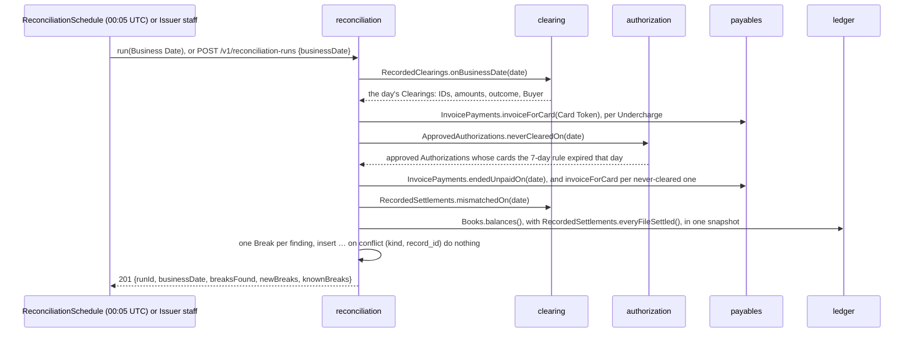

- **The job (`ReconciliationJob`, Spring Batch 6):** the job `reconciliation` in the `batch` job repository the import uses. Its identifying parameters are the Business Date and a new run ID, so every run is a job instance of its own and a date reconciled already can be reconciled again; a failed run isn't restarted but run again. Five chunk-oriented steps, in order: `clearings`, `neverCleared`, `unpaidInvoices`, `settlements` and `books`. Each reads its source whole when it starts, into a `ListItemReader` (a day's records are few), turns each record into a Break or nothing (`ClearingBreaks` for Clearings, `RecordBreaks` for the rest), and `BreakWriter` raises them, 100 to a transaction, counting the new ones in the step's execution context; the run's summary adds up every step's. The job runs on the caller's thread.
- **One run at a time (`Reconciliations.run`, M6 design, [Two copies of each app](design/m6-run-as-a-platform.md#two-copies-of-each-app-q14-q17-q19)):** two platform pods would otherwise both start the 00:05 run. Before the job starts, a run takes a connection of its own from the pool and `pg_try_advisory_lock(hashtext('reconciliation'))` on it, a session-level PostgreSQL advisory lock, whatever the Business Date. It holds that connection for the whole run, outside the job's transactions (a transaction-scoped lock, like the service's outbox relay's, would end with the first chunk), and `pg_advisory_unlock`s it in a `finally` when the run ends or fails: the pool keeps the connection open, so the lock would otherwise outlive the run. If the unlock itself fails, the connection is aborted out of the pool, which ends its session; failures to unlock or close are only logged, so a completed run still answers what it found. Lock and unlock run through `JdbcClient` over a `SingleConnectionDataSource` on that connection (ADR-0009). A connection that drops mid-run ends its session too, and PostgreSQL lets the lock go. A run that can't take the lock doesn't start: the schedule logs at `INFO` that this pod skipped that day's Reconciliation, and `POST /v1/reconciliation-runs` answers `409`. When the lock is stuck: [`runbooks/reconciliation-lock-stuck.md`](runbooks/reconciliation-lock-stuck.md). Rejected: ShedLock (a new dependency for one job) and keying the job by date (it would block rerunning a date on demand).
- **The other kinds (`RecordBreaks`, #70):** `NEVER_CLEARED` names an approved Authorization (its request ID) whose card the 7-day rule expired on the Business Date, with the Buyer, the authorized amount as the gap, and its card's Invoice in the facts; one the Network reversed since is left out. `UNPAID_INVOICE` names a Payment that ended `FAILED` or `EXPIRED` on the Business Date, with the Buyer, the Payment's amount as the gap, and its state, failure reason and Invoice in the facts. `MISMATCHED_SETTLEMENT` names a Settlement of one of the Business Date's files by the file's ID (a Settlement's own), with no Buyer; its gap is how far the Network's figure is from the imported total, either way, and its facts keep both figures, so the direction shows. `BOOKS_OUT_OF_BALANCE` is an alarm: one per failed check and currency, named `<Business Date>/<check>/<currency>`, where the check is `DEBITS_AGAINST_CREDITS` (the journal's total debits aren't its total credits) or `NETWORK_SETTLEMENT_PAYABLE` (not zero once every Clearing File, refused ones aside, is settled); the gap is how far off it is, the facts the totals the run saw. `ledger.Books.balances()` answers the totals and `BooksBalance` carries the two checks; the books step reads them and `RecordedSettlements.everyFileSettled()` in one read-only Repeatable Read transaction, so a file settled between the two reads can't raise a false alarm. Each failed check is also logged as an error pointing at [`runbooks/books-out-of-balance.md`](runbooks/books-out-of-balance.md). A mismatched Settlement leaves its gap on the Network Settlement Payable, so once every file is settled it raises a books Break as well, every day until a Correcting Entry (#71) clears it.
- **Kinds and gaps (`ClearingBreaks`, M4 design, [Kinds of Break](design/m4-reconciliation-and-measurement.md#kinds-of-break-q2)):** each Clearing outcome other than `MATCHED` raises a Break of the same name (`ABOVE_AUTHORIZED_AMOUNT`, `NO_AUTHORIZATION`, `UNKNOWN_CARD`, `OTHER_CURRENCY`, `AGAINST_REVERSED_AUTHORIZATION`, `AFTER_HOLD_EXPIRED`, `AUTHORIZATION_ALREADY_CLEARED`), and a `MATCHED` Clearing below its authorized amount raises an `UNDERCHARGE`; one at its authorized amount raises nothing. The gap is the cleared amount above the authorized one, or the authorized amount above the cleared one for an Undercharge; for every other kind, the whole cleared amount, in the Clearing's currency. A Break names its Clearing by its Network record ID, has its card's Buyer (none for an unknown card), and keeps the Clearing's facts as JSON (`facts.clearing`: Network record ID, file ID, Business Date, Card Token, Buyer, Authorization request ID, cleared and authorized amounts, outcome). An Undercharge also names the Invoice its card's Payment pays (`facts.invoice.id`, null when no Payment has the card).
- **Breaks (`reconciliation.break`, `Breaks`):** ID, kind, the record it names (`record_id`), status (`OPEN` or `RESOLVED`, with the resolution below), Business Date, Buyer, gap and its currency, facts, created at. The natural key `unique (kind, record_id)` and an insert `on conflict do nothing` make a re-run, or two runs at once, find a Break instead of adding another, and leave a resolved one as it is.
- **Triggers:** `ReconciliationSchedule` runs the day before at 00:05 UTC (`reconciliation.daily-run.enabled=false` turns it off; every test does). It doesn't catch up a day the platform was down. Issuer staff run any date at once with `POST /v1/reconciliation-runs` (`issuer-admin`, body `{"businessDate": "2026-10-15"}`), which answers when the run is done: `201` with the run ID and the Breaks found, new and already known; `400` without a Business Date; `409` while another run holds the lock; `500` when the run didn't complete. There is no `Idempotency-Key`: the natural key makes a repeat harmless.
- **Reading Breaks (`BreaksController`):** `GET /v1/breaks` (`reconciler` or `issuer-admin`) lists them newest first by when they were raised, a page at a time by keyset cursor (`limit` 1 to 100, default 20; `nextCursor` absent on the last page; `break_created_at_id_idx` keeps the order), filtered by `status`, `kind` and `buyerId`, which combine; one fixed statement takes each left-out filter as a null that matches every row. `GET /v1/breaks/{breakId}` shows one: kind, status, the record it names, Business Date, Buyer (absent when unknown), gap, when it was raised, and `facts` as the run stored them, keyed by record type, so the records it names come with their amounts and dates; an unknown ID is `404`. The gap is an `Amount`, not `Money`: an `OTHER_CURRENCY` Break's gap is in the Clearing's currency. A resolved Break also shows its `resolution`: kind, note, who, when and any Correcting Entry ID. A `limit` out of range, an unknown `status` or `kind`, or an unreadable cursor is `400`.
- **Resolving a Break (`BreaksController`, `BreakResolutions`, M4 design, [Resolving a Break](design/m4-reconciliation-and-measurement.md#resolving-a-break-q3-q4-q8)):** `POST /v1/breaks/{id}/resolution`, the `reconciler` role only (`issuer-admin` gets `403`: the role that sets Credit Lines and records Repayments doesn't also move money out of Clearing Suspense). The body names the kind and a required note: `ACCEPTED` moves no money; `REASSIGNED` names a Buyer and an amount, and its Correcting Entry debits that Buyer's Receivable and credits Clearing Suspense; `CORRECTED` names a debit Account, a credit Account (by kind, and Buyer for a Buyer Receivable) and an amount. `Resolution` refuses a blank note, a missing field, the same Account twice or an amount that isn't positive, the controller an unknown currency or a field the kind doesn't take, and `BreakResolutions` an unknown Buyer or a Buyer Receivable in another currency than its Buyer's, debt no Available Credit would count: `422`. One transaction marks the Break `RESOLVED` with the kind, note, the Reconciler (the token's subject and user name) and the time, by an update conditional on `status = 'OPEN'`, then posts the Correcting Entry through `Journal.postCorrection` (kind `CORRECTION`, keyed by the Break's ID) and records its ID on the Break. No row changed means the Break is unknown (`404`) or already resolved (`409`): of two resolutions at once, the second waits on the first's row lock, then finds it resolved. So a repeat can't move money twice, and there is no `Idempotency-Key`. `200` with the Break and its resolution.
- **When a run fails:** [`runbooks/reconciliation-run-failed.md`](runbooks/reconciliation-run-failed.md). How it works: [`learning/reconciliation.md`](learning/reconciliation.md).

## Repayments

A Buyer pays the Issuer what it owes for its cleared Charges, and Issuer staff record that Repayment, so its Available Credit rises again (M3 design, [Repayment](design/m3-clearing-and-settlement.md#repayment-q14-q23)). `ledger` owns it: no other module takes part.

- **The endpoint:** `POST /v1/buyers/{buyerId}/repayments` (`issuer-admin`), with the amount in minor units and its currency and a required `Idempotency-Key` header. `201` with the Repayment: the ID of its Journal Entry, its amount, when it was posted.
- **Posting (`CreditLines.repay`), one transaction:** locks the Buyer's Credit Line row, as placing a Hold does, so Repayments for one Buyer take turns and two can't both repay the last of what it owes; reads the Buyer Receivable after the lock; then posts one Journal Entry (`JournalEntries.postRepayment`, kind `REPAYMENT`) debiting Issuer Cash and crediting the Buyer Receivable. Available Credit rises by the amount, as it reads the Buyer Receivable.
- **Refusals:** `422` for an amount of zero or less, in another currency than the Credit Line's (compared as sent, so a code that isn't a currency is refused the same way), or above the Buyer Receivable, which would leave the Issuer owing the Buyer; `404` for a Buyer without a Credit Line, an unknown Buyer included; `403` for any other role; `400` without an `Idempotency-Key`. The request schema takes any whole number and any three-letter code, so those amounts reach the `422` rules rather than the schema's `400`.
- **Idempotency:** the `Idempotency-Key` is the Journal Entry's idempotency key, not a row in a table of keys like `payables`' (that one is `payables`' own, ADR-0009). The key is looked up under the lock, before the checks: an entry for the same Buyer and amount is the first answer, rebuilt from the entry, and nothing is posted; one for another Buyer or amount is `422`. Keys are one space for all Issuer staff. How it compares with the Invoice endpoint: [`learning/idempotency-keys.md`](learning/idempotency-keys.md#repayments-the-journals-key-instead).
- **Reading credit:** `GET /v1/buyers/{buyerId}/credit` answers the Credit Line, open Holds, the Buyer Receivable and Available Credit.

## The simulator

The `simulator` plays every party on the core path other than the platform; each role that calls the platform signs in as its own Keycloak client:

| Role | Class | What it does |
|---|---|---|
| Issuer staff | `BuyerSeeder` | At startup, creates the Buyer Acme (fixed ID, Approval Threshold $10,000) and gives it a $100,000 Credit Line, then the load test's Buyer Initech (fixed ID, Approval Threshold $100) with a $1,000,000 Credit Line (`simulator-issuer-admin`) |
| Acme's ERP | `AcmeErp` | Submits Invoices from Globex, with Globex's Acceptor ID (`simulator.globex.acceptor-id`), under a new `Idempotency-Key` each, and reads them back (`acme-erp`) |
| Acme's Approvers | `AcmeApprovers` | Approve on request, as `acme-approver-1` or `acme-approver-2` |
| Initech's ERP and Approver | `Initech` | Submit Invoices from Globex under the load-test run's numbers and read them back (`initech-erp`); approve each (`initech-approver`) |
| Supplier Globex | `GlobexSupplier` | Receives Remittance Advice at `/globex/remittance-advice`, drops repeats by `Idempotency-Key`, opens each card link once with an untraced client, keeps the card's details in memory, and charges the card for its full amount through its Acquirer |
| Globex's Acquirer | `GlobexAcquirer` | Turns Globex's Charge into an Authorization request: the card's PAN, security code, amount and currency, and expiry month (`YYMM`, in UTC); the time sent; a STAN counting from `000001`; a retrieval reference number of 12 random letters and digits; Globex's Acceptor ID and name; the made-up category code `5085`. Submits each approved Charge for Clearing to the Network at once |
| Network | `Network` | Sends the Acquirer's request to `authorization-service`'s `Authorize` over gRPC, signed in as `network`, and returns the answer; when the service doesn't answer within 1 second or can't be reached, declines the Charge itself (`91`) and sends `Reverse` for it (below) |
| Network, Clearing | `NetworkClearingFiles` | Keeps the Clearings the Acquirer submits, in memory, and writes the Issuer's Clearing File with every one not yet sent into the platform's drop folder, at 00:05 UTC and on demand (below) |
| Demo | `AcmeDemo`, `ClearingFileDemo`, `ReconciliationDemo` | `POST /demo/invoices[?minorUnits=…]`: runs the whole path in one call, the Charge included (below); `POST /demo/clearing-file[?duplicateRecord=true&…]`: has the Network write its Clearing File, changed by any edge-case switch, and Issuer staff import it (below); `POST /demo/reconciliation`: has Issuer staff run today's Reconciliation and list today's open Breaks (below) |
| Load-test cards | `LoadTestCards` | `POST /demo/load-test-cards?count=N` (1 to 25,000): sends N $10.00 Invoices from Initech to Globex, 64 at a time, approves each, waits up to 2 minutes for each Payment, and writes every card Globex received to `var/load-test/cards.csv` (gitignored, overwritten each run, or added to with `append=true`): a header, then `pan,securityCode,expiry` (`YYMM`, UTC)`,amountMinorUnits,currency,acceptorId` per card. Answers `{requested, written, file}`; logs never show a PAN or security code |

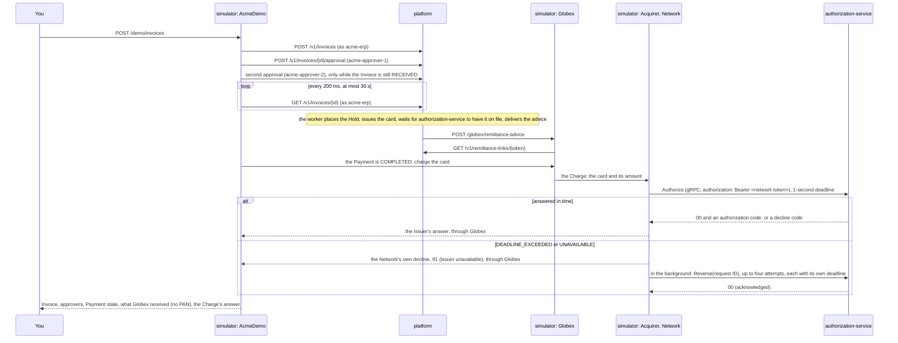

- **The Network's channel:** Spring Boot's gRPC client starter builds the channel named `platform` from `spring.grpc.client.channel.platform.target`, which is `static://` plus `simulator.platform-grpc-address` (`localhost:9090` by default), which reaches `authorization-service` since the cutover (#92); the channel's and the property's names are M2's. The channel is plaintext, like the service's server, until M7. The Network signs in as the Keycloak client `network` (secret `NETWORK_CLIENT_SECRET` from `.env`) through the same authorized-client manager as the REST clients, so it reuses its token until the token expires. Spring gRPC's `BearerTokenAuthenticationInterceptor` puts the token in every call's `authorization` metadata. When the Network can't reach the service, or it answers too slowly: [`runbooks/network-cant-reach-platform.md`](runbooks/network-cant-reach-platform.md); when its sign-in fails: [`runbooks/keycloak-unavailable.md`](runbooks/keycloak-unavailable.md#the-networks-grpc-calls-are-refused).
- **The Network's deadline (ADR-0010):** every `Authorize` call gets its own deadline, `simulator.network.authorization-deadline` (`1s`). When it passes (`DEADLINE_EXCEEDED`), or the service can't be reached (`UNAVAILABLE`), the Network answers Globex with a decline it makes up itself, `91` (issuer unavailable) with no authorization code, and sends `Reverse` for the same retrieval reference number, under a STAN of its own count and the time sent, in the background (Boot's application task executor), so Globex has its decline as soon as the deadline passes. The service reverses an Authorization it approved too late, or records the request ID as reversed so a late Authorization answers `05`. A Reversal is safe to repeat, so a failed one is resent through Spring's `RetryTemplate`: four attempts, 100, 200 and 400 ms apart, each with its own deadline. When all four fail, the simulator logs the retrieval reference number at `ERROR` for follow-up; the decline stands. Any other gRPC failure fails the Charge, and the demo's request, as before.
- **Card details in the simulator:** Globex keeps the PAN and security code it reads through the link in memory only, to charge the card. Its record's `toString` leaves both out, logs show the last four digits at most, and the demo's Summary shows a copy of the card without them. Nothing logs the Authorization request, since a protobuf message's `toString` prints every field. The one log line per Charge names its retrieval reference number, the card's last four digits, the Invoice number and the response code; the Network's lines about a missing answer or a failed Reversal name the retrieval reference number alone.
- **The demo's Charge:** once the Payment is `COMPLETED`, Globex already has the card, and the demo has it charge the card. The Summary's `authorization`, the Issuer's answer to the Charge, shows `approved`, the `responseCode` and the `authorizationCode` (null on a decline). It is null when the Payment didn't complete.

- **One trace across both apps.** Both apps export traces to Grafana's Tempo over OTLP, and Spring's HTTP clients pass the trace context on (W3C `traceparent`); so do the Network's gRPC channel and, since #96, both apps' Kafka producers and listeners. The demo's request is one trace, rooted at the simulator's `http post /demo/invoices`, holding the platform's spans for the Invoice submission, the approvals and every read. Delivering the advice is a trace of its own, rooted at the worker's task (`task paymentWorkerSchedule.runDueSteps`), that continues into Globex's `http post /globex/remittance-advice`. A card link's GET is deliberately untraced on Globex's side and recorded by its route on the platform's. The Charge stays in the demo's trace across all three apps (#96): the simulator's `payments.network.v1.IssuerAuthorization/Authorize` client span, the service's server span, its `outbox relay` and `authorizations send` spans, and the platform's two `authorizations process` spans, one per consumer group. To see it, open Grafana's **Explore > Tempo** and search `{ name = "payments.network.v1.IssuerAuthorization/Authorize" && kind = server }`.

The Charge reaches the Issuer's books the next day, in the Network's Clearing File, or at once through the demo's second call:

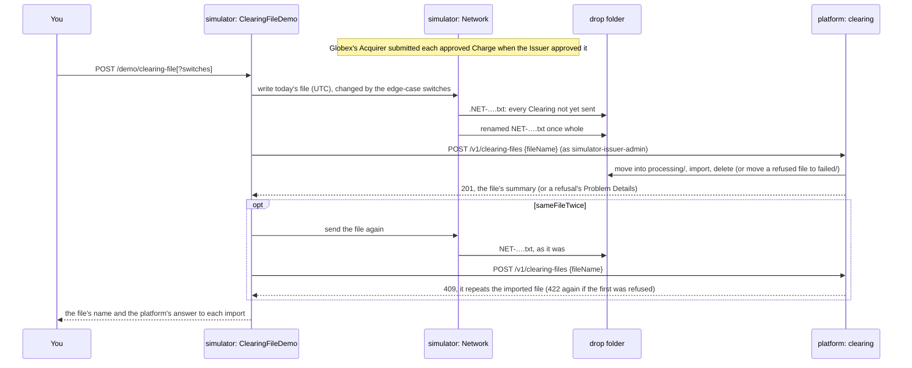

- **Submitting a Clearing:** Globex charges for the full amount and nothing changes it later, so the Acquirer submits a Charge for Clearing the moment the Issuer approves it: the PAN, amount and currency, retrieval reference number, authorization code, Acceptor ID and Charge date (UTC). A declined Charge is never submitted, and neither is one the Network declined `91` and reversed. The Network gives each Clearing its Network record ID (`NR-` and 12 random letters and digits) and writes its detail record when it's submitted, so one that doesn't fit the layout is refused then rather than holding up every file after it; it keeps the record in memory only until it sends it, and neither record's `toString` shows the PAN.
- **The file:** a file for a Business Date carries every Clearing not yet sent dated on or before that day, exactly to the layout contract in `contracts`: a header with a file ID (`NET-`, the Business Date and 7 random letters and digits, so it stays unique when the simulator restarts), the Network's sequence number (one more each file) and the Business Date; the detail records; a trailer with the record count, the amount total and a net settlement amount equal to it (the simulator charges no fees). A Clearing goes in one file only. A demo file and the file written at midnight can share a Business Date; the platform settles each file on its own. With nothing to send, the Network writes no file and uses no sequence number, so a quiet day leaves no gap.
- **Delivery:** the Network writes into `simulator.network.drop-folder` (by default `../var/clearing`, the platform's own default) under the file's name with a `.` in front, then renames it in one atomic move, so the platform never reads half a file; if the write fails, it deletes the half-written file, which holds PANs, and the Clearings wait for the next one. `simulator.network.clearing-file-cron` (`0 5 0 * * *`, in UTC) writes the file for the day that just ended, which the platform's 30-second check imports; a Charge made since midnight waits for the next file. `-` turns it off, as every simulator test and the end-to-end test do.
- **On demand:** `POST /demo/clearing-file` (`ClearingFileDemo`) writes today's file (UTC) and has Issuer staff (`simulator-issuer-admin`, through the generated `ClearingFilesApi`) import it at once with `POST /v1/clearing-files`; it answers `200` with the file's name and the platform's answer to each import it made (`imports`: the status, and the summary or a refusal's Problem Details as the platform sent them), or `204` with no body when there was nothing to clear. An answer other than a `2xx` is shown, not raised: if the platform's own check takes the file first, the import's `409` or `404` shows, and the file is imported either way.
- **Reconciliation on demand:** `POST /demo/reconciliation` (`ReconciliationDemo`) has Issuer staff (`simulator-issuer-admin`, through the generated `ReconciliationRunsApi` and `BreaksApi`) run Reconciliation for today (UTC) with `POST /v1/reconciliation-runs`, then read `GET /v1/breaks?status=OPEN` page by page, newest first, keeping the Breaks of today's Business Date and stopping at the first one raised before today began. It answers `200` with the run's summary as the platform sent it and each open Break's ID, kind, gap and Buyer (`null` for an unknown card's), never the facts of the records it names. The simulator never resolves a Break: the README does that with one `curl` as `simulator-reconciler`, the client holding the `reconciler` role.
- **The edge cases** (M3 design, [Simulator and end-to-end test](design/m3-clearing-and-settlement.md#simulator-and-end-to-end-test-q3-q17)): optional switches on `POST /demo/clearing-file`, all off by default, each change the file of that call only (`NetworkClearingFiles.EdgeCase`), so each of the platform's rules can be seen working end to end:

  | Switch | The file | The platform |
  |---|---|---|
  | `duplicateRecord` | the first detail record again at the end, under its Network record ID | skips the repeat (`skippedCount`); the Network settles it twice, so the Settlement is mismatched |
  | `aboveAuthorizedAmount` | the first Clearing $100.00 above its Charge | `aboveAuthorizedAmount`, all of it posted |
  | `noAuthorization` | an extra Clearing on the first one's card, authorization code `NONE` (an approved Authorization's has six characters) | `noAuthorization`, posted to the card's Buyer |
  | `unknownPan` | an extra Clearing on `9900000000000000002`: Luhn-valid, from the 990000 range, 19 digits where the Issuer's PANs have 16 | `unknownCard`, posted to Clearing Suspense |
  | `wrongTrailerTotal` | the trailer's amount total one cent more than the records' | refuses the file whole: `422` |
  | `sameFileTwice` | the same file delivered again, as it was, once the first import has taken it | the second import answers `409`; `422` again after a refused first import, as a refused file doesn't count |

  An extra Clearing is otherwise the first one's, under its own Network record ID and retrieval reference number. The trailer stays true to the records except under `wrongTrailerTotal`, and its net settlement amount is their total. The switches combine, change a file but never make one (with nothing to clear the answer is `204` whatever they say), and a Clearing sent under one counts as sent, even in a refused file. Sending a file again uses no sequence number.
- **In memory only:** restarting the simulator loses the Clearings not yet sent, and the sequence number starts again at 1, like the Acquirer's STANs. The file holds PANs, as the Network's file does; the Network logs a file by its name, Business Date, count and total only.

## authorization-service

A Spring Boot app in its own Maven module and package, `dev.rgonz.payments.authorization`, with its own PostgreSQL (ADR-0016, [M5 design](design/m5-authorization-service.md)). It keeps a copy of every card it may authorize and answers the Network's Authorizations and Reversals from it over gRPC, by the platform's M2 rules, on `127.0.0.1:9090`, where the platform answered until the cutover (#92). The platform keeps a copy of the approved Authorizations from the service's events.

- **Stack:** WebFlux serves only its HTTP (actuator, health); the database is reached through R2DBC's `DatabaseClient` with handwritten SQL, not `JdbcClient` as in the platform: ADR-0009, as amended for the service, keeps the handwritten SQL and swaps the client so the hot path never blocks a Netty thread. Flyway migrates over its own JDBC connection from `spring.flyway.url`, with no connection pool: Spring Boot's Flyway module without the JDBC starter ([`learning/r2dbc.md`](learning/r2dbc.md)). One database, `authorization`, schema `public`: the service is one module, so it needs no per-module schemas.
- **`card_copy`:** one row per card: Card Token, the PAN's keyed hash (unique) and the security code's, expiry, amount in minor units with its currency, the Supplier's Acceptor ID copied at issuance, and status `ACTIVE`, `AUTHORIZED`, `CANCELLED`, `EXPIRED` or `CLEARED`. The platform's events end a card; the service's own answers move it between `ACTIVE` and `AUTHORIZED`. No PAN or security code (ADR-0004).
- **Feeding it:** `CardsTopicListener` consumes `cards` as group `authorization-service` (from the earliest offset for a new group), reads each message by its `event-type` header (`CardEventReader`) and applies it (`CardCopies`), blocking on the consumer's own thread, off the hot path. The offset is committed after the write, so a crash redelivers. Every write is keyed on the Card Token and event type: `CardIssued` inserts `on conflict do nothing`, so a repeat can't revive a cancelled card; `CardCancelled` and `CardExpired` move only a card not already `CANCELLED`, `EXPIRED` or `CLEARED`, and `CardCleared` any card not already `CLEARED`: all three are final, and `CLEARED` replaces the other two because the platform clears a card whatever its status and nothing moves it after. Because the platform may send a card's events out of order, any order gives the same result: a `CardCancelled`, `CardExpired` or `CardCleared` for a card not seen yet stores a row with only the Card Token and the final status, and the `CardIssued` that follows fills in its details but keeps the status, so a card that ended before it was issued never becomes `ACTIVE` (a check constraint holds `ACTIVE` rows to having every detail). A failure that may pass, such as the database being down, is retried with a pause growing from 1 to 30 seconds and no limit (`CardsTopicErrorHandling`), so the partition waits rather than skip a card. Only a message that can never succeed is logged by partition and offset and skipped: no `event-type` header or one the service doesn't use, or JSON that is malformed or lacks a field the service needs.
- **The hash key:** `CardHashing` holds the platform's `vault.hash-key` from the service's own environment (`VAULT_HASH_KEY` in `.env`, written by `scripts/init-env.sh`) and hashes as the vault does (HMAC-SHA-256, base64). A missing, malformed or wrong-length key stops the service at startup; no message or log shows it.
- **The Network link:** the `IssuerAuthorization` service from `contracts`, on Spring gRPC's Netty server at `127.0.0.1:9090` beside WebFlux's `8082`. `SecurityConfig` checks the Network's Keycloak token as the platform does (`ROLE_network`, realm roles from the `roles` claim). Spring gRPC's security is blocking and wants a `JwtDecoder`, which Spring Boot builds only for servlet apps, so the service declares one from the issuer, resolved at the first call, or from `jwk-set-uri` with the issuer still checked when that is set ([Runtime](#runtime)); its HTTP chain leaves `/actuator/health/**` open and wants a token for the rest.
- **Answering** (`network.Authorizations`): as [The Network link](#the-network-link) describes, the platform's M2 answer step for step, from the copy of the card. The request's PAN is hashed under `vault.hash-key` in memory and the card found by its hash (`CardCopies.findByPanHash`); the security code is hashed and compared in constant time (`CardHashing.matches`); neither is stored, logged or traced. `AuthorizationRules` gives the platform's response codes, with the Acceptor ID copied at issuance; an `AUTHORIZED` or `CLEARED` card answers `57`, as the platform answered a `CLEARED` card in M4, and a Reversal moves only an `AUTHORIZED` card, so a Reversal after the Clearing leaves the card `CLEARED`. The request-ID claim, the conditional move from `ACTIVE` to `AUTHORIZED`, the Reversal's claim and both Reversal orders are the platform's, against the service's own `authorizations` table (the platform's columns) and `card_copy`, in one R2DBC transaction per call (`@Transactional` on a method returning `Mono`).
- **The hot path is reactive:** Spring gRPC documents nothing reactive, so `IssuerAuthorizationService` is the bridge: each call builds its `Mono`, subscribes and returns, and the answer goes out from the thread that completes it, one of R2DBC's event loop threads. gRPC runs calls on four `grpc-call-` threads (`GrpcCallThreads`) rather than its unbounded default, which would hide a handler that waits; the token check runs there too, never on Netty's event loop, because a JWK set refresh blocks while Keycloak answers. A call the Network cancels still runs to its end, so its answer is recorded for a resend or Reversal. Only the database time limit cancels a call: an Authorization then answers `91`, and the service reverses it itself ([The Network link](#the-network-link)). An Authorization's error answers `91` too; a Reversal's reaches the Network as `UNKNOWN` with no description. How it works: [`learning/reactor-webflux.md`](learning/reactor-webflux.md).
- **Publishing:** an approved Authorization, its Reversal and a newly stored card write their event to the `outbox` table in the same transaction, and `OutboxRelay` sends them to the `authorizations` topic: see [The authorizations topic](#the-authorizations-topic).
- **Metrics:** `authorization.answers` by response code, `91` included, and the database breaker's state (`resilience4j.circuitbreaker.state`, `name=authorization-database`) with its calls and the time limiter's, from Resilience4j's Micrometer binding; and Spring gRPC's `grpc.server` timing as a histogram with a 100 ms boundary, under the names the platform used until #92, which the Authorization dashboard and its alert read.
- **Observability (#96):** metrics, traces and logs go to the same `otel-lgtm` as the platform's, over OTLP, under `service.name` `authorization-service` (its application name; Prometheus labels its series `job="authorization-service"`). The service has no Docker Compose support to find `otel-lgtm`, so `application.properties` names the trace and log endpoints (`localhost:4318`); metrics go there by default. Every trace is kept. Logs reach Loki through the Logback appender, as the platform's do, and carry the trace ID; none shows a PAN or security code, and spans record no message fields or metadata. On the hot path, `spring.reactor.context-propagation=auto` and the bridge's `contextCapture()` carry the call's trace from the gRPC thread to whichever R2DBC thread writes the outbox row ([The authorizations topic](#the-authorizations-topic)).
- **Tests:** `NetworkLinkTests` plays the platform on a real Kafka's `cards` topic and the Network over gRPC, with a stand-in token decoder, on the service's PostgreSQL: the answers the platform's `AuthorizeTests` proved until #92 (`00`, `14`, `54`, `N7`, `57`, `61`, `13`, a second Charge `57`), a resend, one request ID sent six times at once, eight Charges on one card at once (one `00`), each Reversal case including both race orders (held on locks on `card_copy`), refusals without a request ID or the Network's token, and the metrics. `DatabaseFailures` proves the `91`s on the application's own settings:
  - A Charge held on a locked `card_copy` answers `91` within the Network's deadline and ends `REVERSED` with `05`, its card `ACTIVE`.
  - With the PostgreSQL container frozen (`docker pause`), and again with it refusing connections (its sessions ended, so the pool must reconnect), Charges answer `91` until the breaker opens, then within 50 ms. The `91`s are counted, and a Reversal fails quickly. Once the database is back, the breaker closes and Charges are approved, with no restart, and none of the `91`s leaves an approval standing.
  - A Charge whose commit is held past the limit (a synchronous standby that never connects) answers `91`. The service's own Reversal then reverses the approval, writes `AuthorizationReversed`, and a new Charge on the card is approved.

  The tests that hold locks to order a race (`HeldOnLocks`, `Reversals`) run in a nested context with a long time limit. One test holds more Charges on a locked `card_copy` than there are call threads and still gets a Reversal answered: a handler that waited for the database would have held every call thread. `AuthorizationRulesTests` unit-tests the rules on a `CardCopy`. `CardsTopicTests` runs PostgreSQL and Kafka in Testcontainers, sends each event as the platform does and reads the copy back: `CardIssued` stores every field, `CardCancelled`, `CardExpired` and `CardCleared` move the status, `CardCleared` wins over `CardCancelled` or `CardExpired` in either order, and a repeated event, a `CardIssued` after a cancellation included, changes nothing (the test waits until the consumer group has committed every offset). A `CardCancelled`, `CardExpired` or `CardCleared` before its `CardIssued` leaves the card ended with its details. A `CardIssued` sent while the database refuses connections waits, unconsumed, for longer than the default handler's ten tries, and is stored once the database is back; messages with no or an unknown `event-type`, malformed JSON or a missing field are skipped and the card's later events still arrive. `CardHashingTests` checks the hash against `openssl`'s for the test key, and the key checks. `CardEventsPactTests`: see [The cards topic](#the-cards-topic); `AuthorizationEventsPactVerificationTests`: see [The authorizations topic](#the-authorizations-topic).

## The Gateway

A Spring Boot app in its own Maven module and package, `dev.rgonz.payments.gateway`, on Spring Cloud Gateway's WebFlux server (M6, ADR-0017, [M6 design](design/m6-run-as-a-platform.md#traffic-q4-q7-q8-q11-q16-q20)). It stands in front of the platform's REST API: the ERP, Approvers, the Supplier's remittance link, Issuer staff and Reconcilers reach `/v1` through it. The Network's gRPC skips it and goes straight to `authorization-service`. How it works: [`learning/spring-cloud-gateway.md`](learning/spring-cloud-gateway.md).

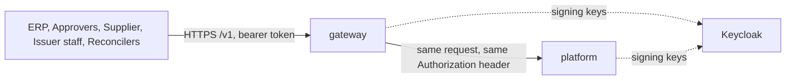

- **Routing:** one route, `platform`: `Path=/v1/**` to `gateway.platform-uri` (`http://localhost:8080` in development; `GATEWAY_PLATFORM_URI` overrides it). Path, query, body and `Authorization` go on unchanged. The headers don't all: the platform gets its own address as `Host`, hop-by-hop headers and `X-Application-Context` are dropped, and with `trusted-proxies` unset every client-sent `Forwarded` and `X-Forwarded-*` header is stripped and none is added, so the platform doesn't see the client's address ([gotcha](learning/spring-cloud-gateway.md#gotchas-we-hit)). The Gateway listens on `8083` in development.
- **Tokens at the edge:** `SecurityConfig` makes it an OAuth2 resource server on the platform's `issuer-uri`. A request without a valid Keycloak token gets `401` Problem Details (RFC 9457) with `WWW-Authenticate: Bearer` from the Gateway and never reaches the platform. Open without a token: the Gateway's `/actuator/health/**` and `GET /v1/remittance-links/*`, whose link token the platform checks. The Gateway checks no roles: the platform stays the authority and keeps every check of its own, so a valid token without the role still gets the platform's `403`.
- **The Gateway's own errors:** `GatewayProblems` renders them as Problem Details (`application/problem+json`): `404` for a path no route serves, `502` when the platform refuses the connection, and the status of any other error the Gateway raises. The platform's own answers pass through as it wrote them.
- **Settings:** `gateway.platform-uri` (`GATEWAY_PLATFORM_URI`); `spring.security.oauth2.resourceserver.jwt.issuer-uri`, and optionally `jwk-set-uri` (`SPRING_SECURITY_OAUTH2_RESOURCESERVER_JWT_JWK_SET_URI`): set, Spring Boot's reactive decoder fetches the signing keys from it and still checks `iss` against `issuer-uri`, as the platform and `authorization-service` do.
- **In the cluster:** a LoadBalancer Service on `127.0.0.1:8080` of the host and `gateway:8080` inside ([Deployment](#deployment)).
- **Not yet:** the per-client rate limit with Redis (#115).
- **Tests:** `GatewayTests` runs the Gateway between a real Keycloak (the repository's realm file, in Testcontainers) and a stub platform that records what reaches it: a valid token reaches the platform with the same `Authorization` header; no token and a token with its signature cut off get the Gateway's `401` Problem Details and reach nothing; the remittance link passes without a token; a token with the `erp` role gets the stub's `201` and one without it the stub's `403`, unchanged; the platform sees its own `Host` and none of the client's forwarding headers; a path no route serves gets `404` Problem Details, and with nothing listening at the platform's address a request gets `502` Problem Details; the Gateway's health is open.

## How the core path is proven

- **The core path** (`CorePathTests`): real Keycloak tokens from the repository's realm file and real PostgreSQL, the worker on its schedule, only the Supplier's address stubbed and `authorization-service`'s card on file played by the test (no Kafka). Acme is set up, an Invoice above the threshold is approved twice and paid, Available Credit drops by its amount, and the link opens once, then answers `410`.
- **No PAN outside the vault:** the same test class reads the PAN and security code through the link, plays `authorization-service`'s approved Authorization of the Charge, which carries only the Card Token (`ServiceAuthorizations`), and clears the Charge in a Clearing File that Issuer staff import, then searches every column of every table outside `vault` (the `authorization`, `clearing`, `ledger` and `batch` schemas included, the job repository's saved step state too) and the captured logs, the import's included, for either.
- **A crash at each Payment state** (`PaymentSagaTests`): the platform stops mid-step after `STARTED`, `HOLD_PLACED` and `CARD_ON_FILE`, and the next pass completes the Payment with one Hold and one card.
- **The wait for the card on file** (`PaymentSagaTests`, with Kafka in Testcontainers): a Payment waits at `CARD_ISSUED`, its Hold placed and no advice sent, until a `CardOnFile` arrives on the `authorizations` topic, then completes; a worker pass a day later neither moves it nor counts an attempt; the same event twice delivers the advice once; a card that expires while its Payment waits ends it `EXPIRED` with its credit back, and a late `CardOnFile` changes nothing; malformed JSON, a message without a Card Token, one with no value, one with no `event-type` header, an unknown card and another event type are skipped and the next `CardOnFile` behind them on the partition still arrives; the gauges count the waiting Payment and how long it has waited, and stop counting it once on file. `CardEventsTests` pauses Kafka while a card is issued, sees the send fail, and the resubmission pass delivers `CardIssued` once Kafka is back, with no restart. The other saga tests confirm each card by hand as soon as it is issued.
- **Several workers at once** (`PaymentSagaTests`): four workers draining 40 due Payments at once complete every one, placing each Hold, issuing each card and delivering each advice exactly once.
- **Module boundaries:** `ModularityTests` (Spring Modulith's verification, and only `cards`, `suppliers` and `clearing` using `vault`).
- **The simulator's roles and the demo** against stub Keycloak and platform servers, and a stub `IssuerAuthorization` gRPC server: after the Payment completes, the demo's Summary shows the Charge's answer; the clearing-file call writes the Network's file with the Charge in it, asks the platform to import it with `simulator-issuer-admin`'s token and answers with the file's name and the platform's summary as sent, its Settlement included, and with nothing left to clear answers `204`, writes nothing and imports nothing, whatever the switches. Each switch that changes the file makes one import of a file showing its change, and the answer carries the platform's response as sent, a `422`'s Problem Details included; `sameFileTwice` imports the same file, back in the drop folder, twice, and shows the `201` and the `409`. Neither answer nor the logs show any PAN in the file, the unknown one included (`AcmeDemoTests`). The reconciliation call runs today's Reconciliation and lists open Breaks with `simulator-issuer-admin`'s token, reads every page, and answers with the run's summary and only today's Breaks, by ID, kind, gap and Buyer, the facts left out of the answer and the log (`ReconciliationDemoTests`).
- **The core path through both apps** (`e2e`, `CorePathEndToEndTests`): the platform and the simulator run in one JVM against real PostgreSQL, Kafka and Keycloak, with `authorization-service` beside them as its own process, from its executable jar, against its own PostgreSQL: its reactive stack and Flyway setup can't share the platform's classpath. It starts before the platform, which works either way since each app declares both topics, and the Payment waits for its card to be on file as it would in development. The simulator's demo endpoint takes an Invoice through two approvals to a completed Payment, Globex opens the card through its link and charges it, and the simulator's Network asks `authorization-service`, which approves the Charge (`00`, a six-character authorization code). The test waits until the platform's copy has the approved Authorization and the platform's own lag check (`AuthorizationCopyFreshness`) finds the offset committed: the import's wait (#94) would answer the demo's single import `503` while the copy lags, and can't see the event while it is still in the service's outbox; the demo's clearing-file call then has the Network write its file into a temporary drop folder both apps share, and Issuer staff import it through the platform: one import, `201`, one Clearing, `IMPORTED`, its outcome `matched`, the file settled matched at the Charge's amount, and the file gone from the folder. The journal, which no API shows until M9, read from the platform's database, shows the Settlement posted: the Buyer Receivable owes the Charge's amount, the Network Settlement Payable is back to zero, and Issuer Cash paid it out. Acme's credit, read as Issuer staff before and after, shows the Charge's Hold turned into its Buyer Receivable, Available Credit unchanged. Last, the demo's reconciliation call runs today's Reconciliation as Issuer staff: no Break found, new or known, and no open Break for today, so none names the Charge. `docs/learning/testcontainers.md` explains how two apps share one JVM. Last, after the Reconciliation they would change, the same test seeds five load-test cards through the simulator's `/demo/load-test-cards`, Initech's Invoices paid through the same wait, and checks that a card is written for each.
- **Authorizations with the platform stopped** (`e2e`, `PlatformStoppedEndToEndTests`; ADR-0016): the same apps, from the abstract harness both e2e classes extend (`EndToEndHarness`). Its containers and apps are static fields, started for each class and stopped after it, so the classes run one after another, never in parallel. The simulator seeds four load-test cards, each Payment complete so each card is on file with the service. The Network charges one first, which opens its gRPC channel and fetches its token. Then the platform's application context is closed, the test checks nothing listens on its port, and the Network charges the other three over gRPC through the simulator's signed-in stub, within its own one-second deadline: `00` each time, with a six-character authorization code. Read straight from the platform's database, its copy doesn't hold them yet. A new platform context then starts against the same database and Kafka, and the test waits until the Authorization Copy holds all four approved Authorizations from the `authorizations` topic and each card is `AUTHORIZED`, read from the database again, not through the context.

## How the Network link is proven

- **The service's answers** are proven in `authorization-service` ([authorization-service](#authorization-service)): `AuthorizationRulesTests` unit-tests the rules on a `CardCopy`, and `NetworkLinkTests` covers over gRPC every answer, resend, race and Reversal case that the platform's `AuthorizationRulesTests`, `AuthorizeTests` and `NetworkAuthenticationTests` proved until #92, the call without the Network's token included. The e2e test signs the Network in with a real Keycloak token.
- **The platform's copy** (`AuthorizationCopyTests`): see [The authorizations topic](#the-authorizations-topic).
- **The Supplier's Acceptor ID** (`InvoicesApiTests`): an Invoice carrying one stores it on the Supplier, later Invoices show it, a different one later doesn't change it, and Invoices without one are still accepted.
- **The vault finds a card by its PAN and checks its security code** (`CardSecretsTests`): a known PAN gives its Card Token, an unknown one nothing; the card's own security code matches, any other doesn't.
- **The simulator's Acquirer and Network** (`GlobexAcquirerTests`): against a stub Keycloak and a stub `IssuerAuthorization` server on a free port. The request carries Globex's Acceptor ID and name and the card's PAN, security code, amount, currency and expiry month in UTC: `2612` for a card that expires at 21:00 on 30 November 2026 in New York. Each Charge has its own retrieval reference number and STAN, and the metadata carries the `network` client's token as `Bearer`. An approval and a decline come back to Globex as the stub sent them. Neither the card record's `toString` nor a Charge's logs show the PAN or security code.
- **The Network's deadline** (`SlowPlatformTests`, `UnreachablePlatformTests`, `GlobexAcquirerTests`): with a 200 ms deadline and a stub that answers after 2 seconds, Globex gets `91` with no authorization code, and the stub then receives one `Reverse` carrying the Charge's retrieval reference number, a six-digit STAN, the time sent and the `network` client's token. With the channel pointed at a port nothing listens on, the Charge is declined `91` at once, without failing, while the Reversal is still being tried; after four failed attempts (`UNAVAILABLE`) the log names the retrieval reference number, with neither the PAN nor the security code anywhere in the captured logs. An Authorization approved within the deadline is returned as sent, and no Reversal follows.

## How the Clearing import is proven

- **The layout contract** (`ClearingFileLayoutTests`): the platform's reader parses `contracts`' sample file into its header, three Clearings and its trailer. A record off the layout (its length, its type, each field's form, the records' order), or a trailer whose totals aren't its records', is refused by its line and field, and the message never holds the PAN.
- **Import through the endpoint** (`ClearingFileImportTests`): on PostgreSQL, with cards issued as the saga issues them and charged as the service's approved Authorizations reach the platform (`ServiceAuthorizations`). A Clearing below its approved Authorization: `201` and the file's summary, one Journal Entry debiting the Buyer Receivable and crediting the Network Settlement Payable by the cleared amount, the Hold and the card `CLEARED`, Available Credit the Credit Line minus the cleared amount (the rest of the Hold freed), the Clearing recorded `MATCHED`, the file deleted. An unknown file name: `404`; the `erp` role: `403`, the file left in place.
- **A bad file is refused whole** (`ClearingFileImportTests`): a trailer whose record count or amount total isn't the detail records', a trailer in a currency other than USD, a malformed detail record and a missing trailer each answer `422` with the check that failed, never the PAN; the file is recorded `REFUSED` with that reason and moves to `failed/`, nothing is posted and Available Credit is unchanged. A file whose header can't be read answers `422` and moves to `failed/`, with no summary, having no file ID.
- **A repeated file is refused, a repeated record skipped** (`ClearingFileImportTests`): a file with the ID of an imported one, and an imported file's content under a new file ID, each answer `409` naming the earlier file and move to `failed/`, with nothing posted twice. A Network record ID repeated within a file and again in a second file is posted once and counted skipped in each file's summary. A corrected file with a refused file's ID is imported. An imported file is deleted and keeps its content hash (checked against the runbook's `awk … | sha256sum` over a fixed file, which leaves out the file ID and the PAN) and its header and trailer figures. A `validate` step that committed and runs again (the import step fails once, and `validate` is marked failed as if the platform had stopped before recording it complete): the restart imports the file once.
- **The outcome decision** (`ClearingOutcomeTests`, unit tests): each outcome, and their order: an unknown card comes first; a second Clearing of a reversed Authorization is `AUTHORIZATION_ALREADY_CLEARED`; one above a reversed Authorization's amount is `AGAINST_REVERSED_AUTHORIZATION`; one after the Hold was released, above its amount, is `AFTER_HOLD_EXPIRED`.
- **Every outcome through the import** (`ClearingFileImportTests`): each one's Journal Entry debits the right Account (Clearing Suspense for an unknown PAN and for another currency than the card's, the card's Buyer Receivable for every other one, an amount above the Authorization in full) and credits the Network Settlement Payable. The card ends `CLEARED` from `AUTHORIZED`, `ACTIVE` (its Authorization reversed), `EXPIRED` (the 7-day rule ran) and `CANCELLED`; its Hold ends `CLEARED` when it was open and stays `RELEASED` when the 7-day rule released it. A file mixing outcomes answers with each one's count, and the journal's debits still equal its credits.
- **The expiry race** (`ClearingFileImportTests`): the 7-day rule expires a charged card, and `payables`' release of its Hold is held back (a Mockito spy on `Holds`) until a Clearing for the card is imported. The Clearing clears the open Hold; the `CardExpired` handling that then finishes leaves the Hold `CLEARED` and Available Credit unchanged. The test fails when `Holds.release` also releases a cleared Hold.
- **A restart posts every Clearing once** (`ClearingFileImportTests`): 250 Clearings, the 150th failing once (a Mockito spy on the journal). The first import answers `500` with 100 Clearings posted and the file in `processing/`; importing it again answers `201`, with all 250 posted and matched once and every Hold cleared. The same test fails against a reader that doesn't save its position: the restart would replay the first chunk and skip its 100 Clearings, and the restart's summary would count them.
- **The drop folder check** (`ClearingFileImportTests`): a file dropped in the folder is imported; a name starting with `.` stays.
- **Settlement** (`ClearingFileImportTests`): a file whose posted Clearings total its net settlement amount is settled matched, its Settlement debiting the Network Settlement Payable and crediting Issuer Cash by the trailer's figure, and the file's Network Settlement Payable back to zero. A trailer whose net settlement amount is lower: the Network's figure posted, the Settlement recorded `"matched": false` on the summary, the gap left on the Network Settlement Payable, and the warning logged. Two files of one Business Date: two Settlements, each at its own file's figure. A file without Clearings: settled matched at zero, nothing posted. A settle step that fails once (a Mockito spy on the journal): `500`, nothing settled; importing again answers `201`, the import step skipped and the file settled once. A settle step that committed and runs again (the `complete` step fails once, and the settle step is marked failed as if the platform had stopped before recording it complete): the restart runs it a second time and the file is still settled once. That test fails against a Settlement insert without `on conflict`.
- **The Network's file** (`NetworkClearingFileTests`, the simulator against a stub Keycloak and `IssuerAuthorization` server): the test reads each record by the layout's rules (120 characters, numeric fields digits only, alphanumeric fields left-justified, filler spaces), and checks first that they read `contracts`' sample as it is written. An approved Charge becomes the one detail record of a file whose header carries the Business Date and whose trailer's count and totals are right, with the Charge's PAN, amount, retrieval reference number, authorization code, Globex's Acceptor ID and the Charge's date; of two approved Charges, a declined one and one the Network reversed after its deadline, only the two approved ones are in the file. The next file carries the next sequence number, another file ID and only the Clearing submitted since. A file for the day before the Charge leaves it for the next one. Watching the folder shows the file created under a `.` name and arriving under its own name in one rename, never written there. Under each edge case, read by the same rules, the change is there and the rest of the file as it would be: the first detail record twice, with one Network record ID; the first Clearing $100.00 above its Charge and the second untouched; an extra Clearing on the same card under `NONE`, or on a Luhn-valid 19-digit PAN from the 990000 range, each with its own Network record ID and retrieval reference number; the trailer's amount total one cent off while its record count and net settlement amount stay true; the trailer counting and totalling every record in the rest. A Clearing sent under a switch isn't sent again, and a file sent again arrives byte for byte under its own name and uses no sequence number.
- **The journal** (`JournalEntryTests`, unit tests): an entry whose debits and credits differ, with fewer than two lines, in two currencies, or with a line that isn't positive can't be built, and only a Buyer Receivable has a Buyer. On PostgreSQL (`JournalTests`): the same idempotency key twice posts once and returns the first entry; an update or delete of a posted entry or line fails.
- **Reading the files** (`ClearingFilesApiTests`): on PostgreSQL, with files without Clearings imported through the endpoint, in a context of its own whose tests each start with no files. Three files with `limit=2`: the two newest and a `nextCursor`, then, following it, the oldest and no `nextCursor`; `limit=0`, `limit=101` and an unreadable cursor are `400`. Imported files numbered 1, 2 and 4 miss `[3]`; 1, 2 and 3 miss none. One file's detail is the summary its import answered; an unknown file ID is `404`; `erp` and `approver` tokens get `403` from both endpoints.
- **A cleared card takes no Charge** (`authorization-service`'s `AuthorizationRulesTests` and `NetworkLinkTests`): `CardCleared` makes the service's copy `CLEARED`, a Charge on it answers `57`, and a Reversal after the Clearing leaves it `CLEARED`, so the next Charge answers `57` too. The platform's `CardEventsTests` checks a Clearing publishes `CardCleared` once.

## How Reconciliation is proven

- **Over HTTP on PostgreSQL** (`ReconciliationRunTests`), with Clearings written straight into `clearing`'s tables as an import records them, each test on a Business Date of its own. A date with one Clearing of each unmatched outcome, an Undercharge, a matched Clearing at its authorized amount, and an unmatched Clearing the next day: `201`, 8 Breaks found and new, one `OPEN` Break per unmatched outcome and one `UNDERCHARGE`, each with its gap, Buyer (none for the unknown card) and currency, the Undercharge's facts the Clearing's and the Invoice of its card's Payment; nothing for the full match or the other day. A card charged 8 days ago, expired now by the real expiry job (`CardExpiryJob`), its Payment ended `EXPIRED` by `payables`' real listener: today's run raises a `NEVER_CLEARED` Break naming its Authorization, with the authorized amount and the Invoice, and an `UNPAID_INVOICE` Break naming its Payment and Invoice; a Payment `FAILED` today raises one too, one `FAILED` the day before doesn't. Two mismatched Settlements of a date, the Network's figure above the imported total and below it, and a matched one: one `MISMATCHED_SETTLEMENT` Break each for the two, named by file ID, with the gap either way and both figures in the facts. The same date again, with Clearings, a mismatched Settlement and a failed Payment: `201`, the Breaks found as known, none new, none added. The `approver` role: `403`; no Business Date: `400`.
- **One run at a time on PostgreSQL** (`OneReconciliationAtATimeTests`), each run held at its first step until the test lets it go, so a second caller, on a connection of its own as another pod's would be, comes while it runs. Whether the lock is free is asked on a connection outside the pool, since a session's own advisory lock is re-entrant. Two pods' schedules, called by hand at once: one run, and the second logs that it skipped. `POST /v1/reconciliation-runs` during a run: `409` Problem Details, and the first run `201`. After a failed run (`500`) and after a completed one (`201`), the lock is free. The lock's session terminated mid-run, so its unlock fails: the run still answers `201`, logs the failed release, and the lock is free. A lock held on a connection outside the pool, as another pod's run: `409`; that connection terminated with `pg_terminate_backend`: the next run `201`.
- **The books' checks on PostgreSQL** (`BooksOutOfBalanceTests`, with a context and so a PostgreSQL of its own, as the checks read the whole journal): a Clearing and its Settlement at the same figure raise no books Break; a lone debit line, written straight into `ledger`'s tables since the journal refuses an unbalanced entry, raises one `DEBITS_AGAINST_CREDITS` Break of its amount, and a re-run none more; a Settlement below its Clearing with no file left to settle raises one `NETWORK_SETTLEMENT_PAYABLE` Break of the difference. Each test leaves the books balanced again by appending.
- **Which Break a Clearing raises** (`ClearingBreaksTests`, unit tests): a full match raises nothing; below its authorized amount, an `UNDERCHARGE` of the difference; above it, a Break of the difference; every other outcome, a Break of its own kind for the whole Clearing, without an Authorization too, its facts showing none.
- **Reading Breaks over HTTP on PostgreSQL** (`BreaksApiTests`), Breaks raised through `Breaks` for a Buyer of each test's own. Three Breaks with `limit=2`: the two newest and a `nextCursor`, then the oldest and none. `kind`, `status` and `buyerId` each narrow the list (`status=RESOLVED`: only the one resolved). One Break of every kind, each listed by its own `kind` filter, so a kind missing from the OpenAPI document fails here. `limit=0`, `limit=101`, an unknown kind or status and an unreadable cursor: `400`. An `OTHER_CURRENCY` Break's detail shows its euro gap and its Clearing's facts, nulls included; an unknown ID: `404`; `approver`, `erp` and `network`: `403` from both endpoints. A resolved Break's detail shows its resolution.
- **The open-Breaks gauge** (`OpenBreaksMetricTests`): every kind and age is registered at startup; Breaks raised now, 23 hours, 3 days and 10 days ago move their kind's `under_1_day` by two and `1_to_7_days` and `over_7_days` by one each, and no other kind's.
- **The other kinds' gaps** (`RecordBreaksTests`, unit tests): a Settlement's gap either way; balanced books raise nothing; debits above credits, and a Network Settlement Payable off zero (negative too) once every file is settled, raise a Break of the difference named by date, check and currency; the Payable off zero while a file is unsettled raises nothing.
- **Resolving a Break over HTTP on PostgreSQL** (`BreakResolutionTests`), each Break written straight into `reconciliation.break`: `ACCEPTED` resolves with no Journal Entry; `REASSIGNED` moves the amount from Clearing Suspense to the Buyer Receivable; `CORRECTED` debits and credits the two named Accounts; each answers `200` with who, when and the note, and the journal stays balanced. A second resolution: `409`, one Correcting Entry; `issuer-admin`: `403`; an unknown Break: `404`; each invalid body (no note, a blank one, a missing Buyer, Account or amount, an amount of zero or less, an unknown currency or Buyer, a Buyer Receivable without its Buyer or in another currency than its Buyer's, the same Account twice, a field the kind doesn't take): `422`, the Break still `OPEN`. Two resolutions at once: one `200`, one `409`, one Correcting Entry. `KeycloakTokenTests` checks a real `simulator-reconciler` token carries `reconciler` and not `issuer-admin`.
- **Module boundaries:** `ModularityTests`, with `reconciliation` depending on `clearing`, `authorization`, `payables`, `ledger` and `buyers` through their public APIs.

## How Repayments are proven

- **Over HTTP on PostgreSQL** (`RepaymentsApiTests`), after a Clearing posted through `ledger.Journal`: a Repayment answers `201` with its amount, posts one Journal Entry debiting Issuer Cash and crediting the Buyer Receivable, and the credit endpoint shows the Buyer Receivable lower and Available Credit higher by its amount. One minor unit above the Buyer Receivable, zero, a negative amount, `EUR` or `XYZ`: `422`, nothing posted; exactly the Buyer Receivable is posted. An unknown Buyer, or one without a Credit Line: `404`; the `erp`, `approver` and `network` roles: `403`; no `Idempotency-Key`: `400`. The same key twice: the same answer, posted once; the same key with another amount or another Buyer: `422`. Two Repayments at once that together exceed the Buyer Receivable, both held on a lock on the journal until both are running: one `201`, one `422`. The same test fails without the row lock.
- **The credit endpoint** (`CreditApiTests`): after a Hold and a Clearing, it shows the open Holds and the Buyer Receivable beside Available Credit.

## Dashboards and alerts

The `lgtm` container loads its dashboards and its four alert rules from `grafana/` at startup: compose mounts `grafana/dashboards/` read-only, and the provider and rule files into Grafana's provisioning folders beside the image's own ([explainer](learning/grafana-provisioning.md)). They sit in Grafana's **B2B Payments** folder and read Prometheus, which stores what the apps push over OTLP every minute.

| Dashboard | Shows | From |
|---|---|---|
| Authorization | `Authorize` calls per second by gRPC status; server-side p50/p95/p99 with the 100 ms line; answers by response code; consumer lag on `cards` and on `authorizations`, by Kafka client | `authorization-service`'s (`job="authorization-service"`), since #92: Spring gRPC's `grpc.server` timing, a histogram with a 100 ms bucket (`application.properties`); `authorization.answers` (`IssuerAuthorizationService`), tagged `response.code`. The lag is both apps' `kafka.consumer.fetch.manager.records.lag`, from Spring Boot's Kafka client metrics: each partition's messages behind the topic's end as the consumer last fetched, for the app that consumes the topic (`job`), summed by `client_id`, which names the group (`consumer-authorization-service-*`, `consumer-platform-authorization-*`, `consumer-platform-payables-*`). A stopped consumer reports nothing, so its line ends rather than grows, and events still in the service's outbox don't count |
| Payments | Payments reaching each saga state; each step's average and p95 duration; Payments waiting for their card to be on file, and the longest wait with the 5-minute line | `payments.state.changes` (`Payments`, counted when the state's transaction commits), tagged `state`; `payments.steps` (`PaymentSaga`), tagged `step`: `place-hold`, `issue-card`, `deliver-remittance-advice`; `payments.waiting.card.on.file` and `payments.waiting.card.on.file.oldest` (`WaitingPaymentsMetric`) |
| Clearing | Clearing Files by result; Clearings by outcome; Settlements matched and mismatched | `clearing.files` (`imported`, `refused`, `repeated`), `clearing.clearings` (`outcome`) and `clearing.settlements` (`matched`), counted by `ClearingFileImports` once an import completes, from what it committed |
| Breaks | Open Breaks in all; by kind; by age (under 1 day, 1 to 7 days, over 7 days since raised); by kind over time | `reconciliation.breaks.open` (`OpenBreaksMetric`), a gauge tagged `kind` and `age`, read from `reconciliation.break` with one grouped query every 30 seconds; each panel takes `max` across instances, which all read the same table |

- **The alert rule** `authorization-p99` evaluates every minute and fires once `Authorize`'s p99 over the last 5 minutes has stayed above 100 ms for 5 minutes (ADR-0010). No contact point is set up: it shows as firing in Grafana only. It reads only `job="authorization-service"`. No traffic is not a breach (`noDataState: OK`): an idle Network leaves the p99 undefined, which is no data, and that stays OK now that the service exports; a service that stopped exporting is no data too, which this rule doesn't catch.
- **The alert rule** `payment-waiting-card-on-file` evaluates every minute and fires as soon as the longest wait for a card on file is above 300 seconds (`for: 0s`: the gauge is the wait itself), on the M5 design's 5 minutes. Its summary points at the consumer lag panels, the service's outbox and [`runbooks/payment-stuck.md`](runbooks/payment-stuck.md#a-payment-stays-card_issued-its-card-isnt-on-file). No data, the platform not exporting, is OK.
- **The alert rules** `authorization-service-not-exporting` and `platform-not-exporting` fire when the app has sent no metrics for 5 minutes (`absent_over_time(target_info{job="…"}[5m])`): each metrics export refreshes the app's `target_info` series, its OTLP resource, and otel-lgtm's Prometheus scrapes nothing, so there is no `up`. This is what catches a dead service, which the p99 rule reads as no data. Their summaries point to [`runbooks/authorization-service-database-down.md`](runbooks/authorization-service-database-down.md) and [`runbooks/payment-stuck.md`](runbooks/payment-stuck.md#restarting-the-platform-is-safe).
- **Tags never carry a PAN, Card Token or ID**, only a small fixed set of values; each counter, and the Breaks gauge, is registered at zero for every value at startup, since Prometheus's `rate()` and `increase()` miss a series' first increment.
- **What isn't measured yet:** the time a Payment waits between steps, for the worker or a retry's backoff; the payment row keeps no time it entered its state.
- **Payments waiting for their card to be on file:** `WaitingPaymentsMetric` reads the `CARD_ISSUED` Payments with one indexed query every 30 seconds, as `OpenBreaksMetric` does, into two gauges: `payments.waiting.card.on.file`, how many, and `payments.waiting.card.on.file.oldest`, in seconds, how long the one waiting longest has waited since `card_issued_at` (0 when none waits), which the Payments dashboard and the `payment-waiting-card-on-file` rule read.
- **Proven by** a test per metric, in its module's tests (`authorization-service`'s `NetworkLinkTests`, `PaymentSagaTests`, `ClearingFileImportTests`, `OpenBreaksMetricTests`), and `GrafanaProvisioningTests`, which parses the dashboards and the rules and checks they query only metrics the platform or `authorization-service` exports, that the Authorization dashboard and the p99 rule read the service, that the lag and waiting panels exist, and each rule's query and threshold. The metric names, labels and both rules were checked once against a running stack (#96).
- **The one trace** is proven by `NetworkLinkTests` (a Network call carrying a `traceparent` gets an `AuthorizationApproved` message on `authorizations` in the same trace) and `CorePathEndToEndTests` (the simulator's `Authorize` call and both of the platform's consumers of its approved Authorization share one trace ID, which reaches the platform only through the service). The e2e harness turns off only the OTLP exporters, not tracing export as a whole: Spring Boot turns trace propagation off with that.

## Quality targets

- **Authorization latency:** 99% answered within 100 ms at the Issuer's gRPC server (`authorization-service`'s since #92). The Network gives up after 1 second, declines, and sends a Reversal (ADR-0010). Measured in M4 at 200 a second on a laptop: a server-side p99 of 35.6 ms on one run and 104.2 ms on the other, the tail being commits waiting on the disk's flush ([Measured (#75)](design/m4-reconciliation-and-measurement.md#measured-75)). Measured again in M5 against `authorization-service`, with M4's simulation unchanged: a p99 of 16.2 ms on the same storage and 8.2 ms with both databases on a folder with btrfs copy-on-write off, a p50 of 4.5 and 3.7 ms; one run each, consistent with the disk still setting the tail ([Measured (#97)](design/m5-authorization-service.md#measured-97)).

## Planned evolution

Each extraction gets its own ADR naming the force behind it (ADR-0003).

- **M6:** everything runs on Kubernetes (k3d and Helm) behind Spring Cloud Gateway.
- **M7:** `vault` becomes its own service and database, for PCI isolation.
