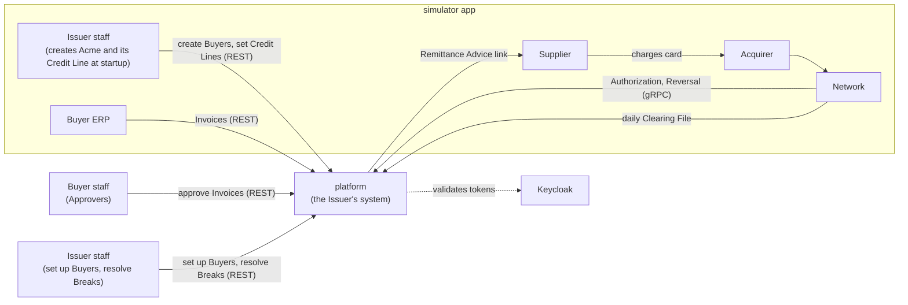
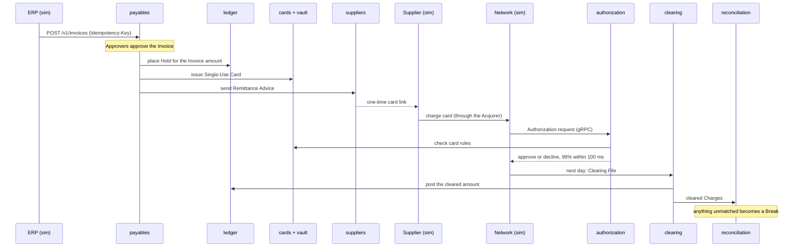

# Architecture

**Status:** M0 foundations are built, and M1 is under way: `shared`, `buyers` and `ledger` exist (`ledger` holds Credit Lines so far); the other modules below don't yet. Terms follow [`GLOSSARY.md`](../GLOSSARY.md), and the reasoning behind each choice is in [`docs/adr/`](adr/). The milestone plan is in the [README](../README.md#roadmap).

## System context

The `platform` is the Issuer's system. Everything it talks to, apart from Keycloak, is played by the `simulator` app (ADR-0002).

## Runtime (M0 to M4)

Docker Compose runs PostgreSQL (one schema per module), `grafana/otel-lgtm` for metrics, traces and logs, and Keycloak, which issues every token. The `platform` and `simulator` run from Maven and start the stack themselves through Spring Boot's Docker Compose support.

- **Identity:** Keycloak's `payments` realm (`keycloak/payments-realm.json`) defines the roles `approver`, `erp` and `issuer-admin`, and puts them in a flat `roles` claim. The platform is an OAuth2 resource server; client secrets live only in the gitignored `.env`, written by `scripts/init-env.sh`.
- **API contract:** the OpenAPI document in the `contracts` module is the source of truth. The platform implements interfaces generated from it, and the simulator calls the platform through HTTP interfaces generated from it.

## Modules

The `platform` is a modular monolith (ADR-0003). Spring Modulith tests enforce the boundaries.

| Module | Owns | Calls |
|---|---|---|
| `shared` | `Money`, `BuyerId`; open to every module | |
| `buyers` | Buyer profiles, Approval Thresholds | |
| `suppliers` | Suppliers, Supplier Relationships, Remittance Advice delivery | |
| `payables` | Invoices, approvals, Payments (runs the Payment saga) | `ledger`, `cards`, `suppliers` |
| `cards` | Virtual Card lifecycle, Card Tokens | `vault` |
| `vault` | PANs, encrypted (ADR-0004) | |
| `authorization` | Authorization rules; answers the Network | `cards`, `ledger` |
| `ledger` | Credit Lines, Holds, postings, Available Credit (ADR-0005) | `buyers` |
| `clearing` | Clearing File processing, Settlement | `ledger` |
| `reconciliation` | Matching Charges to Authorizations and Invoices; Breaks | |

How modules interact:

- **Direct call** when the caller needs an answer now, such as `authorization` checking a card, or `ledger` asking `buyers` whether a Buyer exists before setting its Credit Line. The callee answers through a public type in its module's top-level package (`buyers.BuyerDirectory`); the rest of the module stays package-private.
- **Event** when others react to something that happened. Events are stored with the change that raised them and redelivered until handled (ADR-0008).
- **Data**: each module owns its own schema; no joins or foreign keys cross modules (ADR-0009). Each module's Flyway migrations run in that schema with their own history table, declared through `ModuleMigrations` in `shared`.

## Core payment path

## Payment saga

`payables` orchestrates each Payment (ADR-0013). Every step is safe to repeat, and the Payment's state is saved after each one, so a crash resumes where it stopped.

| Step | Module | If it fails for good |
|---|---|---|
| 1. Place the Hold | `ledger` | The Payment fails; the Invoice stays approved and unpaid |
| 2. Issue the card and store its PAN | `cards`, `vault` | Release the Hold |
| 3. Send the Remittance Advice | `suppliers` | Cancel the card, release the Hold |

## Quality targets

- **Authorization latency:** 99% answered within 100 ms at the platform. The Network gives up after 1 second, declines, and sends a Reversal (ADR-0010).

## Planned evolution

Each extraction gets its own ADR naming the force behind it (ADR-0003).

- **M5:** `authorization` becomes its own service, driven by the latency target. Events start crossing process boundaries through Kafka.
- **M6:** everything runs on Kubernetes (k3d and Helm) behind Spring Cloud Gateway.
- **M7:** `vault` becomes its own service and database, for PCI isolation.
